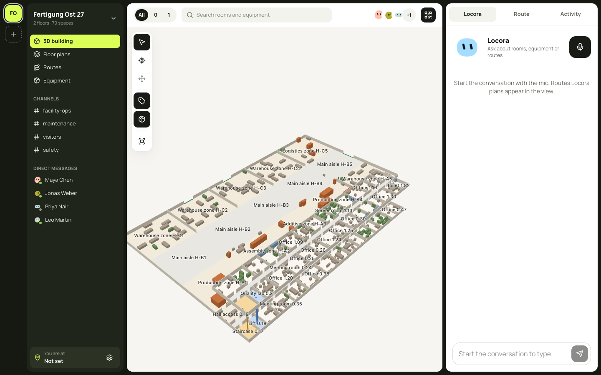
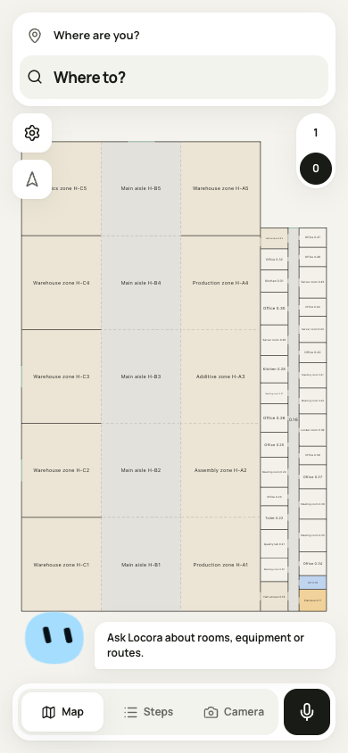
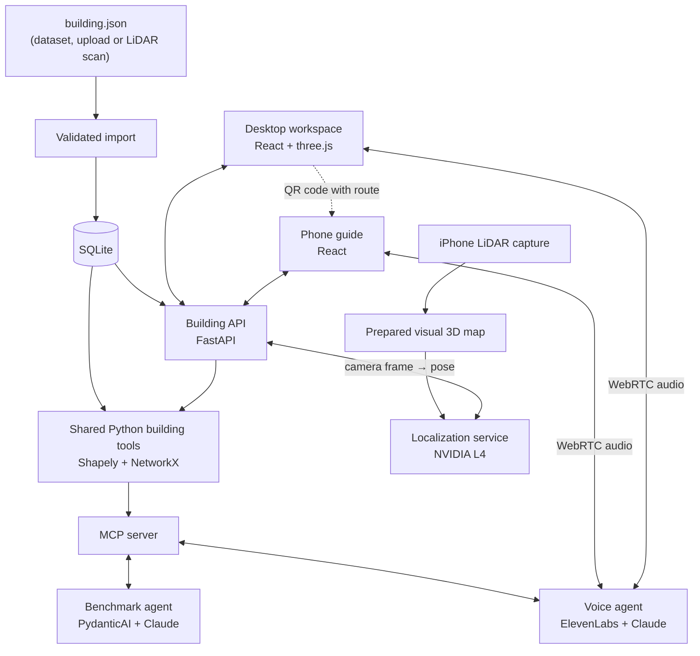

# Locora: talk to your building

**Locora is an indoor guide you can talk to. Ask where a room or piece of equipment is, plan a route on desktop,
scan a QR code and follow the same route on your phone. Locora can use the phone camera to find where you are.**

Built for the *Industrial Agents Hackathon 2026, Talk to Your Building* track (Synera, Munich).

| | |
|---|---|
| **Live app** | https://web-production-99671.up.railway.app |
| **Desktop workspace (example)** | [/admin/proc-factory-dev-003](https://web-production-99671.up.railway.app/admin/proc-factory-dev-003) (factory, 2 floors) |
| **Phone guide (example)** | [/b/proc-factory-dev-003](https://web-production-99671.up.railway.app/b/proc-factory-dev-003) |
| **Benchmark submission** | [`SUBMISSION/`](SUBMISSION/): `answers.json` (145 test answers) and `BENCHMARK.md` |
| **Dev score** | **138 / 138** benchmark questions correct, about **$0.01 per question** |
| **Deep dive** | [docs/architecture-overview.md](docs/architecture-overview.md) |

<p align="center">
  
  
</p>

---

## The problem

In a factory, campus or hospital, finding things wastes time: *where is the CNC mill, which way avoids the stairs,
what if the lift is out?* Facility knowledge sits in CAD files and in a few people's heads. Locora makes that
knowledge conversational and turns every answer into a route you can follow.

**What makes it work:** the language model never calculates. It understands the request and calls
**deterministic building tools**: geometry, areas, adjacency and an exact shortest-path model of rooms, doors,
stairs and lifts. That is why the answers are exact and the same tools serve the benchmark, the voice assistant
and the web app.

## Features

### 🗣️ Conversational agent with exact building tools
- Answers questions about rooms, equipment, areas, door widths, adjacency, floors above or below, and reachability.
- Nine shared tools (`find_spaces`, `find_assets`, `route`, `reachable_spaces`, `shared_walls`, `stacked_spaces`,
  `distance_3d`, `exit_distance_change`, `building_overview`) served over **MCP**.
- Routes with **closures** (for example "the lift is out"), **step-free** rules, **minimum door width** for trolleys
  or pallets, ordered **multi-stop tours** and **what-if doors**.
- Structured output; a deterministic formatter writes the final answer. The agent asks only when information is
  actually missing.

### 🖥️ Desktop workspace (`/admin/:buildingId`)
- Rotatable **3D exploded view** (three.js) and **2D floor plans** (SVG) generated from the same scene.
- Search rooms and equipment, browse equipment by type, set "you are here" by clicking.
- Plan step-free routes across floors; the route is drawn in 2D and 3D.
- **Voice assistant panel:** routes the agent plans appear in the view at once.
- **QR handoff:** the phone link carries the route and opens it on the phone.

### 📱 Phone guide (`/b/:buildingId`)
- Three modes: **Map**, **Steps** (turn-by-turn) and **Camera**, with the voice assistant and an animated avatar
  in every mode.
- **Camera localization:** the phone sends about one frame per second. A GPU service matches it against a
  prepared 3D map of the building and returns the floor, room, position and heading. When the room changes,
  Locora plans the remaining route again from there.
- Compass and floor selection.

### 🎙️ Voice assistant
- **ElevenLabs** conversational agent (speech recognition and speech output) running **Claude Sonnet 5.5**, with
  Claude Haiku 5.5 as backup.
- It calls the *same* Python building tools over authenticated MCP (Streamable HTTP).
- Screen and conversation stay in sync. A route tool call is drawn from the building API, so the screen shows the
  route the agent describes.

### 🏗️ Buildings
- **281 buildings** in the app: factories, campuses, OpenStreetMap buildings (TUM, Munich Airport T2, …),
  apartment blocks, homes, and one building **scanned on site with an iPhone LiDAR**.
- Home page with illustrated collections and isometric building previews.
- **Import building:** upload a `building.json`. It is validated, stored, and you can open and route it at once.

## Results

| What | Result |
|---|---|
| Dev benchmark (138 questions, 9 question kinds) | **138 / 138 correct** in 66 s, $1.27 total (Sonnet 5.5, 94 % prompt-cache reads) |
| Public test set (145 questions) | 145 answered, 0 stopped runs, 68 s, $1.38. See [`SUBMISSION/answers.json`](SUBMISSION/answers.json) |
| Warm-up routes on dev, through the jury command | 30 / 30 with exact space path and length |
| Camera localization (recorded iPhone capture) | 532 of 533 frames localized, **0.33 m median error**, about 200 ms GPU time per frame |
| Automated checks | 146 Python tests, 66 web tests, 22 renderer tests, Ruff and both TypeScript builds |

Per-kind results and the fixes found along the way are in [docs/agent.md](docs/agent.md). Localization measurements
and their test conditions are in [docs/localization.md](docs/localization.md).

## Tech stack

| Layer | Technology |
|---|---|
| Agent harness | **PydanticAI** with Anthropic **Claude Sonnet 5.5**, prompt caching, cost and request limits per question |
| Tool protocol | **MCP** via FastMCP: in-process for the benchmark agent, Streamable HTTP with a bearer token for voice |
| Geometry and routing | **Shapely** (GEOS) for polygons, **NetworkX** for graphs: visibility graph and Floyd–Warshall inside rooms, bidirectional Dijkstra across the building |
| Storage | **SQLite**, with room areas as `STORED` generated columns; validated, idempotent `building.json` import |
| API | **FastAPI**: buildings, routes with drawing points, JSON import, isometric previews, localization proxy; OpenAPI → generated TypeScript types |
| Voice | **ElevenLabs** Conversational AI over WebRTC, Starlette token and MCP server |
| Frontend | **React 19**, **TypeScript**, **Vite**, **Tailwind CSS 4**, TanStack Query, Blobatar avatar |
| 2D / 3D rendering | `@locora/view`: a framework-free TypeScript package. One compiled scene, rendered as **SVG** (2D) and with **three.js** (3D) |
| Camera localization | **hloc**: MegaLoc retrieval, SuperPoint + LightGlue matching, COLMAP triangulation, PnP + RANSAC; NVIDIA **L4** GPU on Google Cloud |
| Capture | iPhone with LiDAR and Stray Scanner (video, depth, ARKit poses) |
| Hosting | **Railway** (web and voice services, auto-deployed from `main`), Google Cloud VM with Caddy for the GPU service |
| Tooling | uv, pnpm, Ruff, unittest, Vitest |

## Architecture



**Design principles**

1. **The LLM interprets, the tools calculate.** Areas, distances, routes and counts always come from Python tools,
   never from the model. One implementation serves every host: benchmark, voice and web.
2. **One building format end to end.** `building.json` → SQLite → tools → API → generated TypeScript types →
   renderer. IDs, units and coordinates are the same in every layer.
3. **The screen follows the agent.** When the voice agent calls `route`, the web app requests the same route from
   the API and draws it. The frontend has no routing logic of its own.
4. **Map once, then localize from camera frames.** The LiDAR capture and 3D map are prepared offline. At runtime a
   normal phone camera frame is enough.
5. **Evaluation data stays out.** The runtime and deployments never see benchmark questions or answers; the agent
   receives only the question text and the building.

**One voice request, end to end:** *"How do I get to the CNC mill without stairs?"* → ElevenLabs transcribes it →
Claude calls `find_assets` and `route(step_free=true)` over MCP → the Python tools compute the exact route → the
agent answers in speech → the web app reads the tool call, fetches the same route from the API and draws it in
2D/3D → a QR code moves it to the phone.

### Route model

Nodes are rooms and doors. Inside a room, walks keep 15 cm off the walls and go around corners (visibility graph
on the shrunken polygon). Stairs cost 2 m per metre climbed; a lift costs 15 m per ride plus 1 m per metre
climbed. Closures, step-free rules and door-width limits remove edges, and parallel stairs and lifts stay as
separate edges. This follows the official grading model, so route lengths match the expected answers to the
centimetre. Full specification: [docs/challenge-kit.md § 3](docs/challenge-kit.md#3-data-format).

## Repository map

| Path | What it does |
|---|---|
| [`building_db/`](building_db/) | `building.json` models, SQLite schema, validated import |
| [`building_tools/`](building_tools/) | Lookup, spatial calculations, walking graph, routes, MCP server |
| [`building_agent/`](building_agent/) | PydanticAI agent, instructions, answer shapes, batch and submission runner |
| [`building_api/`](building_api/) | FastAPI: buildings, routes, import, previews, localization proxy, static web app |
| [`voice_agent/`](voice_agent/) | ElevenLabs agent config and sync, token server, MCP adapter for voice |
| [`localization/`](localization/) | Capture processing, 3D map, floor outline from LiDAR, GPU pose service |
| [`packages/building-view/`](packages/building-view/) | Scene compiler, SVG floor plan, three.js 3D view |
| [`web/`](web/) | React app: home, desktop workspace, phone guide |
| [`benchmark/`](benchmark/) | Official scorer and evaluator (unchanged from the kit) |
| [`SUBMISSION/`](SUBMISSION/) | Jury instructions and submitted answers |
| [`data/`](data/) | 280 kit buildings with train/dev/test questions |
| [`docs/`](docs/) | Design documents (see below) |

## Quick start

Requirements: Python 3.12+, [uv](https://docs.astral.sh/uv/), Node.js and pnpm.

```bash
uv sync
cp .env.example .env          # set ANTHROPIC_API_KEY for the agent
```

**Answer jury questions for a new building** (see [SUBMISSION/BENCHMARK.md](SUBMISSION/BENCHMARK.md)):

```bash
uv run run_benchmark <building_dir> <questions.json> <answers.json>
```

**Evaluate on dev with the official scorer:**

```bash
uv run python -m building_agent.batch data/dev --workers 10 --name dev-run
```

**Run the web app locally:**

```bash
uv run python -m building_db import buildings.sqlite3 data/*/*/building.json
uv run python -m building_api serve buildings.sqlite3 --port 8010
pnpm --dir packages/building-view install
cd web && pnpm install && pnpm dev
```

**Run every offline check** (no paid API calls):

```bash
scripts/check.sh
```

## Scope

What is real and what is a preview, so the demo can be judged fairly:

- **Real:** benchmark agent, routing and spatial tools, voice agent with live tool calls, 2D/3D views, QR handoff,
  JSON import, and camera localization in the mapped building.
- **Preview:** the team sidebar (people, channels, messages) uses sample data. Moving equipment changes only the
  browser's copy of the building. The camera mode draws guidance over the camera image; it is not
  world-anchored AR.
- **Limits:** camera localization needs a building that was mapped beforehand. The LiDAR pipeline currently
  produces one floor outline per capture. Multi-stop tours visit stops in the given order.

## Documentation

| Document | Content |
|---|---|
| [docs/architecture-overview.md](docs/architecture-overview.md) | Full architecture, decisions, measurements and screenshots |
| [ARCHITECTURE.md](ARCHITECTURE.md) | Responsibilities and confirmed technical direction |
| [docs/agent.md](docs/agent.md) | Agent harness, settings, measured runs |
| [docs/tools.md](docs/tools.md) | Building tools and their rules |
| [docs/db.md](docs/db.md) | SQLite schema and import |
| [docs/visualization.md](docs/visualization.md) | Scene compiler, 2D and 3D renderers |
| [docs/voice.md](docs/voice.md) | ElevenLabs voice agent and security |
| [docs/localization.md](docs/localization.md) | LiDAR capture, 3D map, camera localization |
| [docs/deployment-status.md](docs/deployment-status.md) | Railway services and release checks |
| [docs/challenge-kit.md](docs/challenge-kit.md) | Kit specification: data format, route model, question kinds, scoring |
| [docs/challenge.md](docs/challenge.md) | Organizer clarifications |

## Data and licences

Locora starts from the [Synera student kit](https://github.com/Synera-GmbH/industrial-agents-hackathon-2026).
Building data comes from Swiss Dwellings and ResPlan (CC BY 4.0), OpenStreetMap (ODbL 1.0, © OpenStreetMap
contributors) and procedural generation (CC0). See [ATTRIBUTION.md](ATTRIBUTION.md).
