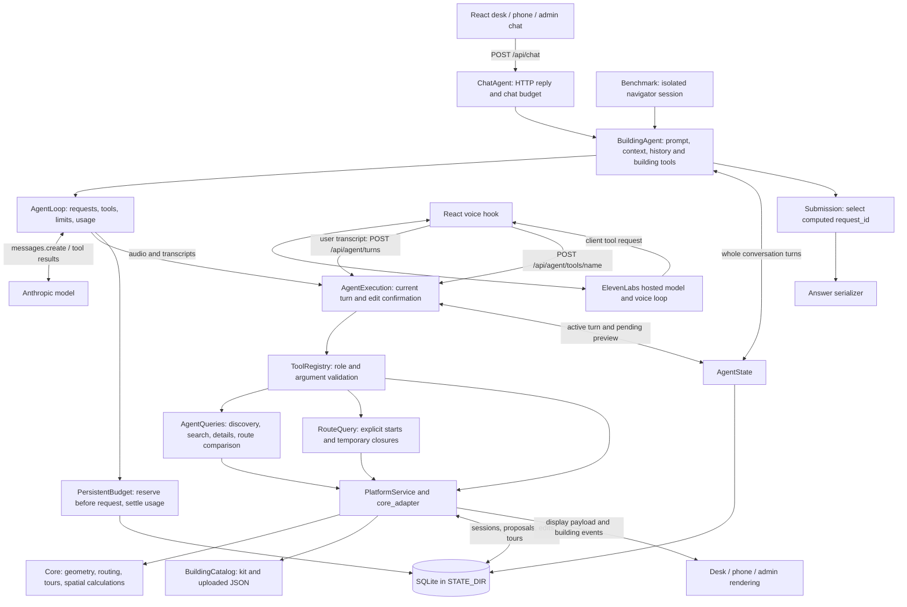

# Building agents

The large language model (LLM) chooses tools, reads results, repairs failed requests and writes the chat reply. Python validates tool arguments and calculates building results. The model does not calculate routes or write directly to the database.

## Architecture



FastAPI runs in one process. Blocking chat and building work runs in its thread pool. There is no separate agent worker or message queue. Session locks serialize agent actions within that process. SQLite transactions protect saved changes and budget reservations. Running several application workers needs a separate review of session locking and event delivery.

Text and voice share tool execution policy. They do not share a model loop: text uses `AgentLoop`; ElevenLabs runs the voice model loop. The browser registers real user transcripts before it forwards a voice tool request. An assistant transcript cannot authorize an edit. A failed registration blocks that request. Old connection callbacks and replaced turns cannot execute later tools.

## Module ownership

- `core.py`: the common building agent. It prepares the original message, current context, shared prompt, role-filtered building tools and history. It executes those tools through `AgentExecution` and saves the turn.
- `chat.py`: chat budget setup and the HTTP reply, status, sources and display adapter.
- `config.py`: one model and execution configuration for chat and submission.
- `runtime.py`: explicit model/tool cycle, deadline, request/tool/context limits, usage and stop reasons. Complete tool-use blocks get matching tool results. Truncated responses cannot execute tools. A completed benchmark submission stops later tools in the same batch.
- `execution.py`: shared text/voice policy, active-turn checks, edit confirmation and compact model observations. UI route geometry remains in the full response. Model observations retain route facts and maneuvers.
- `state.py`: SQLite turns, pending previews and bounded whole-turn history. History loads at most 12 previous turns within 100,000 bytes. An oversized turn can retain whole compact tool observations instead. There is no long-term semantic memory.
- `budget.py`: allocation reservation and cost accounting. Uncertain requests keep their reservation.
- `server/agent_queries.py`: read-only structured discovery and actual route comparison.
- `server/tools.py`: one registry for manual HTTP controls, text and voice. Role and Pydantic validation run on every call.
- `bench/llm_fallback.py`: calls `BuildingAgent` with the original question and a submission adapter. The old separate interpretation tools and Haiku/Sonnet escalation are removed.
- `bench/session.py`: creates an isolated SQLite platform session from the supplied building only. It has no access to question files or answer keys. The temporary session is removed after the question.
- `bench/submission.py`: stores observed tool results and accepts one result reference. The serializer formats that computed result without another solver call.

The database contains session, conversation and edit state. Base building entities come from validated JSON, materialized with saved edit events. The agent queries those entities through tools. It has no raw SQL tool.

## Tools

`building_info` discovers floors, object types, counts, position and constraints. `search_entities` filters objects by kind, text, exact type, floor or room. It returns `total` and `next_cursor`, with 25 results by default and at most 100 per page. Search is case-insensitive substring matching, not semantic search. Cursors bind filters and the current building state. Changed buildings require a new search.

`get_entities` fetches 1–100 stable IDs in request order. Missing IDs produce an explicit error. `compare_routes` calculates real routes to 1–100 destination IDs and ranks reachable results by distance. It reports unreachable candidates with reasons. It accepts an optional explicit start and temporary closures. It keeps current mobility constraints and does not start navigation.

`find` resolves a named entity and returns real candidates on ambiguity. `route` validates a destination and returns a route for display. It does not create an active tour. `plan_tour` takes an array of IDs, optional final destination, fixed-order preference and mobility constraints. It creates the active tour. `next_step` uses that active tour. Tour order can be heuristic for larger problems; read the returned order policy before claiming optimality. A legacy comma-separated `items` string is accepted during voice configuration migration. New callers should use arrays.

The registry exposes 17 tools for admin sessions and 11 for navigator sessions. `query_route` and `query_tour` calculate routes without saving navigation or building edits. They accept explicit stable start IDs, temporary closures and mobility constraints. With no explicit start, they use the session position. An unreachable query returns a successful calculation with `reachable=false` and a reason. This lets the model explain the result and lets submission serialize "no route". A tour reports partial reachability and its order policy.

`spatial_query` delegates supported spatial calculations to the core, including asset counts and locations. Route-dependent calculations preserve saved closures, minimum width and transit restrictions. Temporary `closed` IDs are additional restrictions. `calculation` metadata identifies the operation and validated inputs for result selection. Admin tools are `propose_edit`, `commit_edit`, `undo`, `what_if`, `set_scale` and `generate_markers`. Availability still depends on the platform: for example, plan import/scale is not made available by this agent refactor.

For "Find the nearest printer, but avoid stairs":

1. Discover printer types with `building_info`.
2. Read every matching `search_entities` page. Use floor filters only if requested.
3. Call `compare_routes` with all candidate IDs and `step_free=true`. For more than 100 candidates, compare batches, then compare their winners.
4. Choose `nearest_id` from reachable routes. Report failures when none can be reached.
5. Use `route` to show the path, or `plan_tour` with that one ID to start a tour with `next_step` support.

These tools make the workflow possible. Whether the model selects it correctly requires a live model evaluation.

## Edits and turn state

The server records the pending proposal from a successful preview. A later, explicit user confirmation authorizes that exact proposal for the current session. Recognized confirmations include `yes`, `yes please`, `apply it`, `go ahead`, `ja` and `ja bitte`. This is a deliberately narrow write-control check, not an answer engine. Other wording asks the user to confirm again. A different request clears the pending confirmation. A new preview needs its own later confirmation.

A model cannot add a confirmation flag to a tool argument. Same-turn preview and commit are blocked. Underlying role, version, expiry and idempotency checks still apply. Manual application edit controls use the platform's existing preview/commit flow through `/api/tools`; the agent-specific guard is on `/api/agent/tools`.

A new registered user turn supersedes the previous turn across text and voice. It blocks later tools and further model requests from that previous turn. An already running provider request or tool transaction cannot be recalled. Full hard cancellation of geometry computation is not provided. The frontend also suppresses retired results.

## Configuration and paid calls

`TYB` means "Talk to Your Building". Credentials stay on the server. A key alone does not enable text requests. Set a positive allocation only after a written team budget is approved:

- `ANTHROPIC_API_KEY`: server credential.
- `TYB_CHAT_BUDGET_USD`: total dollar cap for the allocation.
- `TYB_CHAT_BUDGET_ID`: stable allocation ID, default `chat`. Spend persists in `STATE_DIR`. Keep the same ID and amount after a restart. A different amount under the same ID is rejected. A new ID represents a new approved allocation, not an automatic budget reset.
- `TYB_AGENT_MODEL`: shared chat/submission model, default `claude-sonnet-5-5`. A model must have recorded rates in `budget.py`. `TYB_CHAT_MODEL` remains a legacy alias when the shared setting is absent.
- `TYB_AGENT_MAX_STEPS`: maximum model requests per chat or submission turn, default 24.
- `TYB_AGENT_MAX_TOOL_CALLS`: maximum attempted tool calls per chat or submission turn, default 128.
- `TYB_AGENT_TURN_SECONDS`: shared turn deadline, default 90 seconds. Each model request has at most 30 seconds and cannot exceed the remaining deadline.

Text output is limited to 4,096 tokens per request. The serialized request size is limited to 256,000 bytes, including an allowance for provider overhead. Invalid settings disable chat or fail configuration. Budget reservations use conservative input-byte and maximum-output estimates, then settle reported usage. Automatic SDK retries are disabled. These are application-side limits, not a provider billing guarantee. Rates are recorded from the project master plan; verify them against the team agreement before paid use.

Before migrating an older deployment, reconcile its process-only spend before enabling a persistent allocation.

No hidden local answer fallback runs when chat fails. The desk shows the failure and retains the request for retry. Partial agent work returns an explicit incomplete status, stop reason, usage and cost. Successful tool displays can remain visible after a later model failure.

## Voice integration

The browser has one generated list of tool names from the server registry. Regenerate the server contract and frontend types with:

```sh
uv run python -m server.export_openapi
(cd web/app && bun run gen:api)
```

This produces `server/openapi.json`, `server/agent-tools.json`, `web/app/src/api/agentTools.gen.ts` and `schema.gen.ts`. The tool JSON contains names, descriptions, argument schemas and roles for reviewing the hosted setup.

The hosted ElevenLabs agents still need their tool definitions updated to match all applicable names and schemas. Use client tools with a response expected. Use the matching prompt under `voice_prompts/`. Navigator gets navigation/query tools; admin can also use edit tools. Set credentials and agent IDs through the existing server setup. This refactor does not change the human-owned configuration document or the live account. The text-chat dollar cap does not cover ElevenLabs billing. Configure voice limits in the hosted setup.

The voice serializer preserves complete compact observations within 48 KiB. Larger results return `result_too_large` instead of cutting off candidates. The model must request a smaller page or batch. Full display data stays with the application.

## Verification and limits

Offline tests use real Anthropic SDK message blocks and an HTTP mock transport. They test orchestration and platform behavior without provider calls. They cover terminal/truncated responses, limits, budget accounting, search pagination, unknown IDs, accessible route comparison, confirmation, cross-session isolation, restart state, stale turns and frontend retry behavior.

The default benchmark path uses the common `BuildingAgent`, model configuration, prompt, platform registry and execution policy. It adds `submit_answer(request_id)` to select a successful calculation observed in that run. This tool accepts neither computation inputs nor model-written answer values. Results cannot be selected across runs. Model prose is ignored for the committed `Answer:` line.

The old template parser remains an explicit `--mode template` baseline. It is not the default agent and never runs as a hidden fallback. Benchmark calls require a separate explicit `--max-cost` allocation and provider credentials. Chat and benchmark share model settings, but their approved budget accounts remain separate. Supplied benchmark constraints enter the isolated session before the model runs; the common tools enforce them during calculation. Reports and checkpoint keys include the actual model, limits, prompt and source versions. Experiments can change settings, but must be labelled as such.

Chat prose is written by the model. Argument validation and correct calculations do not prove that every sentence matches the result or that the model understood the user. Numeric string-matching heuristics are not used as a substitute for factual validation. Successful tool request IDs are returned as sources for inspection.

Before claiming live quality, evaluate the current prompt and model on: nearest reachable printer without stairs, pagination over 100 candidates, invalid destination, ambiguous name, missing start, multi-stop route and final destination, stale search after an edit, same-turn commit refusal, later voice confirmation, provider failure after a successful tool, and recovery after a server restart. Check both tool choices and final prose. Offline scripted responses do not measure these language decisions. Live microphone, latency, hosted tool migration and paid model behavior remain separate acceptance checks.

Run the repository gate with `scripts/check.sh`. It disables provider keys and paid budgets. Keep real model measurements in a separately approved run.
