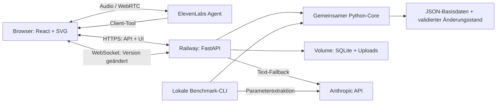

# Codex-Review: priorisierte Änderungen am Hackathon-Plan

**Stand:** 24.10.2026. Geprüfte Basis: Team-Repo `f41616590b69f3ea0c1cbfb41d6c35edd9ce53df`; `PLAN.md` zuletzt geändert in `1537c04`, dokumentierter Planstand 17:00 Uhr. **Neue verbindliche Teamentscheidung aus dieser Unterhaltung: Deployment auf Railway.** Die folgenden Architektur- und Umsetzungsvorschläge berücksichtigen diesen Wechsel vollständig.

## Urteil und wichtigste Entscheidungen

Der Plan hat einen tragfähigen fachlichen Kern: ein deterministisches Gebäudemodell, dieselben Rechenfunktionen für App und Benchmark, frühe Sprachintegration und sichtbare Rückmeldung. Seine größten Risiken sind der ungeklärte Bewertungsvertrag, die Abhängigkeit von noch nicht integriertem Code und zu viele gleichzeitig zu bauende Systeme. Railway ist die Gelegenheit, eine komplette zusätzliche Backend-Schicht zu streichen.

**Meine Empfehlung:** eine React-App, ein FastAPI-Service auf Railway, ein persistenter Gebäudestatus, ein gemeinsamer Python-Core und ein unabhängig ausführbarer Benchmark. Zuerst belastbare Ergebnisse und eine durchgehende 2D-Interaktion; anschließend genau eine überzeugende Erweiterung. Nicht der Umfang des Architekturdiagramms, sondern ein reproduzierbares, korrektes Produkt sollte den Plan bestimmen.

Die Reihenfolge unten bewertet den Einfluss auf Abgabefähigkeit, Korrektheit und verbleibende Arbeitszeit. **P0:** sofort entscheiden/absichern. **P1:** vor einer verlässlichen Demo lösen. **P2:** gezielt verbessern, nachdem die Grundlagen funktionieren. Diese Prioritäten sind Review-Empfehlungen, keine zusätzlichen Juryregeln.

| Rang | Priorität | Änderung | Warum sie wichtig ist |
|---|---|---|---|
| 1 | P0 | Bewertungsprofil und Sonntagsformat ausdrücklich versionieren | Ein korrekt implementiertes falsches Distanzmodell liefert falsche Antworten. |
| 2 | P0 | Railway als einen gemeinsamen App-Service planen | Worker, Durable Objects, Hono, R2 und deren Integrationsarbeit entfallen. |
| 3 | P0 | Lokale Vorarbeit sofort ins gemeinsame Repo integrieren und prüfen | Der gepushte Stand enthält die behauptete vollständige Vorarbeit noch nicht. |
| 4 | P0 | Benchmark früh absichern; einfachen Geometriefragen Vorrang geben | 104 von 145 veröffentlichten Testfragen betreffen fünf Geometriefamilien. |
| 5 | P0 | Verantwortlichkeiten und Zeitplan nach Abhängigkeiten aufteilen | Im alten Plan ist die Core-Person gleichzeitig für fast den gesamten kritischen Pfad zuständig. |
| 6 | P1 | Gebäudezustand, Vorschau, Bestätigung und Undo konkret spezifizieren | Railway ersetzt die geplante Zustandslogik eines Durable Object nicht automatisch. |
| 7 | P1 | Voice-Vertrag korrigieren und sofort öffentlich testen | WebRTC-Token, Tool-Antworten und Serverkontext müssen zusammenpassen. |
| 8 | P1 | Geodäsie begrenzen und tatsächliche Portalgeometrie durchreichen | Eine plausible Raumfolge allein garantiert weder eine gültige noch richtig gezeichnete Route. |
| 9 | P1 | Build und Scale mit ehrlichen Mindestleistungen planen | JSON-Import, Bildrekonstruktion und gebäudeübergreifendes Routing sind unterschiedliche Leistungen. |
| 10 | P1 | Eine Demo-Story und eine Erweiterung verbindlich auswählen | Drei Personas, Gabelstapler und 3D erhöhen die Ausfallfläche und passen schlecht in eine Minute. |
| 11 | P1 | Abgabe, Wiederanlauf und Frischklon früh testen | 145 Zeilen oder eine öffentliche URL sind noch keine reproduzierbare Einreichung. |
| 12 | P2 | Modelle beibehalten, Budgetannahmen und Optimierungen korrigieren | Zeit, Rate Limits und Fehlerfälle sind voraussichtlich knapper als Tokens. |

## 1. Bewertungsvertrag vor weiterer Routing-Optimierung absichern

**Problem im Plan:** §§1 und 5 ordnen das Kostenmodell nach Frageart zu. Für die veröffentlichten Daten ist das README-Modell nachvollziehbar. Daraus folgt aber nicht, dass ein Sonntags-`errand` dieselben Regeln verwenden wird. Die [Route-Ankündigung](2026-10-24-route-scoring-specifications.md) beschreibt eine andere Geometrie und andere Lift-/Treppenkosten als [README §3](README.md) und [BuildingMap](starter_agent/building_map.py). Der vorhandene [Scorer](benchmark/score.py) bewertet Textantworten, keine neuen Raumfolgen nach dem angekündigten Routenquotienten.

**Ändern:** Den Lauf ausdrücklich mit einem versionierten Bewertungsprofil starten, beispielsweise `published_v1` und später `sunday_confirmed_vN`. Das Profil legt Kostenmodell, Constraints und Ausgabeadapter fest. Namen sind Vorschläge. Profil, Daten-Hash und Code-Commit gehören in den Laufbericht. Das LLM wählt keines dieser Profile. Dieselbe Frageart kann je nach bestätigtem Prüfvertrag ein anderes Profil benötigen.

**Beibehalten:** README-Router und neue Geodäsie getrennt halten. Neue Liftkosten niemals global in den Referenzrouter einbauen. Für die veröffentlichten Antworten gilt bis zu einer verbindlichen Änderung der dokumentierte Vertrag; für die Live-App darf ein gesonderter geometrisch gültiger Pfad verwendet werden, dessen Länge nicht als identisch mit der Benchmarklänge ausgegeben wird.

**Heute klären:** Geltungsbereich der neuen Regeln, finaler Sonntagsein-/ausgang, konkrete IDs und Darstellung von „unerreichbar“, Laufzeitfenster. Eine kleine Referenzdatei mit erwarteter Antwort hilft mehr als weitere mündliche Näherungen. Die [bereits priorisierten Jurorenfragen](<open questions for judge .md>) enthalten die vollständigen Formulierungen. Die Kopie der Route-Ankündigung hat keine ursprüngliche Nachrichten-URL oder Versionsangabe; diese Unsicherheit bleibt bestehen.

**Abnahme:** Ein bestätigtes Beispiel pro tatsächlich gefordertem Ausgabeformat läuft durch denselben Core. Ein vorbereiteter JSON-Serializer bleibt bis zur Schemafreigabe ausdrücklich vorläufig.

## 2. Railway: die Architektur deutlich verkleinern

**Railway ist gesetzt.** In `PLAN.md` müssen dafür §§2–4, P0/P6, Zeitplan, Secrets, Kosten und Fallback gemeinsam angepasst werden. Nur „Cloudflare Container“ durch „Railway Container“ zu ersetzen würde die unnötige Restarchitektur stehen lassen.

### Empfohlene Zielarchitektur für dieses Wochenende

Der in ElevenLabs konfigurierte Claude verarbeitet den Sprachdialog. Ein Client-Tool läuft im Browser, ruft FastAPI auf und gibt das berechnete Ergebnis an ElevenLabs zurück. **Jeder Toolaufruf hat einen eindeutigen Ausführungsverantwortlichen; UI und Sprache verwenden dasselbe Ergebnis.** Eine Frage darf mehrere Berechnungen erfordern, etwa Suche und Route oder einen Vorher-/Nachher-Vergleich. Voice und Textchat sind alternative Eingänge und führen dieselbe Operation nicht parallel doppelt aus. Das Diagramm ist ein Vorschlag für die Umsetzung, kein Nachweis eines bereits existierenden Deployments.

| Bisher im Plan | Ersatz auf Railway |
|---|---|
| Worker + Hono + Static Assets | FastAPI liefert `/api/*` und das gebaute Vite-`dist` unter derselben Origin aus. |
| Durable Object `BuildingRoom` | Kleine Python-Zustandsschicht mit SQLite-Transaktionen und Gebäudeversionen. |
| DO-WebSocket/Hibernation | Ein FastAPI-WebSocket-Verteiler; nach Reconnect Snapshot laden. |
| Cloudflare Container | Derselbe Python-Prozess mit Core und API in einem Docker-Image. |
| R2 + interner Worker-Katalog | Neue validierte JSON-Gebäude auf Railway Volume, Metadaten in SQLite. |
| Wrangler, Container-Class, Worker-Secrets | Docker-Build, Railway-Servicevariablen, öffentliche Railway-Domain. |
| Worker → Tunnel → Laptop | Lokaler Start derselben App als Notbetrieb; kein zweiter Hosting-Umbau im letzten Moment. |

**Konkret:** Multistage-Dockerfile: React bauen, Build in Python-Image kopieren. Produktion verwendet keinen Vite-Devserver. Repo-Wurzel als Build-Kontext, API-Routen vor SPA-Fallback, `0.0.0.0:$PORT`, `/health` und festgeschriebene Dependencies. Ein Service ist eine bewusste Vereinfachung auf Basis des [Railway-FastAPI-Pfads](https://docs.railway.com/guides/fastapi).

**Persistenz:** Basisdaten beispielsweise unter `/app/data` im Image, neue Gebäude und SQLite unter `/state` auf einem Volume. Volume nicht über die mitgelieferten Basisdaten mounten. Initialisierung erfolgt beim Start, wenn das Volume verfügbar ist, nicht beim Image-Build. [Railway: Volumes verwenden](https://docs.railway.com/volumes).

**Betriebsgrenze:** Für den Hackathon **eine Replica und ein Uvicorn-Prozess**. SQLite-Transaktionen sichern Änderungen; der WebSocket-Verteiler bleibt damit in einem Prozess. Railway erlaubt für Services mit Volume derzeit keine Replicas und weist auf kurze Downtime bei Redeploy hin. Das akzeptieren und beim Demoablauf berücksichtigen. Falls ein funktionierendes Postgres-Setup bereits integriert ist, muss es nicht zurückgebaut werden; ein neues Postgres-/Redis-System lohnt sich allein für diese Demo nicht. [Volume-Grenzen](https://docs.railway.com/volumes/reference).

**Abnahme:** öffentliche URL → Karte → echter Tool-Aufruf; danach Änderung, Reload und Prozessneustart ohne Zustandsverlust. `/health` muss die lokale Betriebsbereitschaft prüfen, ohne pro Probe einen bezahlten LLM-Aufruf auszulösen. Railway-Healthchecks sind Deployment-Prüfungen und kein dauerhaftes Monitoring. Für die Vorführung App-Sleeping deaktivieren. [Healthchecks](https://docs.railway.com/deployments/healthchecks), [App-Sleeping](https://docs.railway.com/deployments/serverless).

## 3. Den tatsächlichen gemeinsamen Entwicklungsstand herstellen

**Befund:** Im geprüften Commit fehlen `core/`, `server/`, `bench/`, `web/` und `tests/`. Die `agent.py` im Repo-Root ist leer; der funktionierende Beispielagent liegt unter `starter_agent/`. Das Packaging in [pyproject.toml](pyproject.toml) umfasst nur `starter_agent` und `benchmark`. Der Plan verweist für Erweiterungen und GLB-Export auf `../repo`; dieser Ordner gehört nicht zum geprüften Checkout.

**Ändern:** In den ersten 30 Minuten relevante lokale Vorarbeit übernehmen, Importpfade, Dependencies und Paketkonfiguration korrigieren und einen zweiten Rechner beziehungsweise frischen Clone verwenden. Für jeden als fertig bezeichneten Baustein einen Commit und einen ausführbaren Nachweis notieren. „Läuft lokal beim Kollegen“ ist ein wertvoller Ausgangspunkt, aber noch keine verfügbare gemeinsame Abhängigkeit.

**Abnahme:** Ein Teammitglied startet den aktuellen Clone ohne Zugriff auf fremde Nachbarordner; mindestens ein Gebäude lädt und eine Route wird berechnet. Erst danach dürfen GLB und zusätzliche `node_path`-Felder den weiteren Zeitplan verkürzen. Der bislang behauptete Warm-up-Score wird getrennt von echter Benchmarkleistung dokumentiert.

## 4. Benchmark nach messbarem Nutzen priorisieren

Die vorhandene Testverteilung ist ein konkreter Ansatzpunkt:

| Reihenfolge | Familien | Veröffentlichte Testfragen | Vorgehen |
|---|---|---:|---|
| 1 | `floor_area_total`, `largest_room`, `straight_line_3d` | 69 | Polygonfläche, Maximum, Schwerpunkt und reale Etagenhöhe deterministisch berechnen. |
| 2 | `shared_walls_count`, `room_stacked` | 35 | Fachliche Geometriepräzision: Wandtoleranz bzw. Überdeckungsfläche. |
| 3 | `errand`, `wide_delivery_count` | 38 | Vorhandenen Graphen erweitern und Constraints korrekt anwenden. |
| 4 | `what_if_door` | 3 | Neue Tür fachlich richtig setzen, isoliert simulieren und Veränderungen zählen. |
| Zusätzlich | `step_free_reachable_count`, sechs Warm-up-Familien | 0 dieses Typs im veröffentlichten Test; relevant für Dev/Sonntag/App | Nicht aufgrund der Testverteilung streichen; gemeinsame Primitive wiederverwenden. |

**104/145 = 71,7 % beziehen sich auf die fünf Geometriefamilien im veröffentlichten Test. Daraus folgt weder ein garantierter Score noch ein Anteil an den gesamten 55 Funktionspunkten.**

Ein kleiner unabhängiger Review-Check berechnete die ersten drei Familien aus den Polygondaten und verglich sie mit `benchmark.score.score_reply`: **64/64 Dev und 243/243 Train korrekt**. Dabei wurden die vorhandenen Gold-`inputs` als Parameter verwendet. Das bestätigt einen einfachen deterministischen Lösungsweg für diese Fälle; es ist **kein Test eines fertigen Agents, keiner Sprachinterpretation und kein Testscore**.

**Konkrete Planänderung:** Den vorhandenen [Evaluator](benchmark/evaluate.py) weiterverwenden. Er unterstützt bereits `--agent module:function`, den offiziellen Scorer und CSV. Zunächst eine Funktion `answer(building_directory, question_text)` implementieren. Sie bekommt im offiziellen Aufruf keinen fertigen `kind` und keine Gold-`inputs`; Extraktion und Entitätsauflösung müssen also tatsächlich aus dem Fragetext funktionieren. Einen neuen `bench`-Wrapper nur für fehlende Funktionen ergänzen: Checkpoints, begrenzte Parallelität und den bestätigten Sonntagsadapter.

**Zwei getrennte Prüfungen:** Core gegen bekannte Parameter und anschließend Agent Ende-zu-Ende gegen alle 138 Dev-Fragetexte. Fehler nach Interpretation, Berechnung und Ausgabeformat trennen. Keine Goldantworten oder Goldparameter in den Produktionspfad laden. Die vollständige 145er-Datei früh erzeugen, automatisiert prüfen und später gezielt verbessern.

### Fachliche Details, die sofort in die Core-Verträge gehören

| Aufgabe | Häufige Fehlinterpretation | Richtiger Prüfpunkt aus dem Kit |
|---|---|---|
| `errand` | Den insgesamt kürzesten Weg über irgendeinen Pickup wählen | Erst das vom Start aus nächste passende Asset-Zimmer finden, dann zum größten gefragten Zielraum. |
| `straight_line_3d` | Routinganker oder feste Geschosshöhe verwenden | Polygon-`centroid` und tatsächliches `elevation_m`. |
| `shared_walls_count` | Nur gemeinsame Türen oder exakt berührende Polygone zählen | Mindestens 1 m Wandverlauf innerhalb 0,35 m Toleranz; geforderte Raumtypen filtern. |
| `room_stacked` | Den nächsten Schwerpunkt wählen | Größte Polygonüberdeckung auf der nächsten relevanten Etage im gemeinsamen XY-System. |
| Breite/Erreichbarkeit | Trolley automatisch als Gabelstapler behandeln | Frageeigene Breite, Step-free und Sperrungen; zählbare Raumtypen beachten. |
| `what_if_door` | Dauerhaft mutieren; neue Tür am nächstgelegenen Eckpunkt | Gemeinsame Wandmitte, isolierte Kopie, Verbesserung strikt größer als 1 m, nur das gefragte Geschoss. |

Quellen: [README §4](README.md), jeweilige Dev-`inputs`; insbesondere [BuildingMap.add_door](starter_agent/building_map.py), Zeilen 299–320. Der Starter verwendet dort `nearest_points`, was nicht allgemein die Mitte der gemeinsamen Wand liefert. Die Funktion eignet sich deshalb nicht unverändert als Oracle für `what_if_door`.

## 5. Arbeit so verteilen, dass der kritische Pfad parallel vorankommt

Der alte Zeitplan gibt A Geometrie, Graph, Agent-Extraktion, Benchmark, neue Geodäsie und Regression. Gleichzeitig baut B einen zweiten Backend-Stack. Das ist die größte organisatorische Schwäche. Mit Railway sollte die eingesparte Arbeit in Integration und Fehleranalyse fließen.

**Vorschlag für drei parallele Verantwortungsbereiche:** A verantwortet Core und fachliche Korrektheit; B verantwortet React, Railway-Verpackung und Darstellung; C verantwortet FastAPI-Vertrag, Sprach-/Textagent, Parameterextraktion und Benchmarkadapter. C entwickelt den Adapter, während A die Rechenfunktionen ergänzt. Jede gemeinsame Schnittstelle hat einen Besitzer; die anderen implementieren dagegen. Die tatsächliche Teamgröße und verfügbare Arbeitszeit sind nicht aus den Credits ableitbar.

**Geschätzte Größenordnungen für erfahrene Implementierende:** Core und fachliche Tests 6–10 Personenstunden; Extraktion/Benchmarkintegration 3–5; React-2D und API-Anbindung 3–5; Railway-Build und Persistenz 2–4; Voice/Text 2–4; gemeinsamer Edit-/Reconnect-Ablauf 2–4. Integration, Aufnahmen und Abgabe brauchen weitere Reserve. Diese Schätzungen sind keine gemessenen Projektzeiten und überlappen teilweise; sie zeigen, weshalb zusätzliche Geodäsie, Forklift und 3D nicht alle ungeprüft Pflicht sein können.

### Überarbeiteter Ablauf

`T0` ist die Übernahme dieses Reviews. Die relativen Gates ersetzen überholte Uhrzeiten; der Sonntagsschluss bleibt fest. Von Samstag 17:00 bis Sonntag 13:00 sind wegen der Zeitumstellung 21 reale Stunden verfügbar, jedoch nicht 21 produktive Stunden pro Person. Liegt ein relatives Gate hinter dem nächsten festen Gate, wird der Umfang reduziert; Abgabe- und Ruheplanung verschieben sich dadurch nicht.

| Zeitpunkt | A: Core | B: Web + Railway | C: Agent + Integration | Gemeinsames Gate / Reaktion |
|---|---|---|---|---|
| T0 bis +30 min | Vorarbeit integrieren, Referenzdaten festlegen | Minimaler Docker-/Vite-Build | Toolvertrag und Jurorenfragen | Aktueller Clone startet; Verträge beschlossen. |
| Bis T0 +90 min | Erste Geometriefunktionen; Starterroute | Öffentliche 2D-Karte | Ein echter Voice-Tool-Aufruf; Bench-Adapter parallel beginnen | Route aus Backend auf Karte; Textweg funktioniert. Voicefehler isolieren. |
| Ziel T0 +4 h | Drei einfache Geometriefamilien absichern, weitere Geometrie/Graphfamilien ergänzen | Persistenter Zustand und einfache Preview | Erster vollständiger Dev-End-to-End-Lauf, Fehler nach Ursache | Erster automatischer Antwortversuch für jede der 145 IDs und Dev-Bericht; fehlende Familien und Fehler offen ausweisen. Keine Platzhalter als erfolgreiche Abgabe zählen. Bei Lücke alle Kür pausieren. |
| Bis etwa 23:30 | Routing-/What-if-Fehler; begrenzter Geodäsie-Versuch | Commit, Undo, aktive Route aktualisieren | Rückfragen, Fehlerausgaben, Demoablauf | Reale Hauptstory funktioniert auf öffentlicher URL. |
| Bis 00:30 | Gezielte Regression | Zweites Gerät, Reconnect, Neustart | Erste brauchbare Aufnahme, Setup-Dokumentation | Danach keine neue Infrastruktur. |
| Nacht | Gemeinsam eine echte Ruhephase reservieren | | | Zeitumstellung nicht durch doppelt gezählte Arbeitsstunden verplanen. |
| So 07:00–09:00 | Frischklon und unbekannt behandeltes Dev-Gebäude | Handyprüfung, kleine Fehler | Finale Agentkonfiguration, Aufnahmen | Sonntagslauf jederzeit startbereit. 3D nur bei grünen Pflicht-Gates. |
| Ab 09:00 | Eine Person überwacht Veröffentlichung und führt Lauf aus | Nur freigegebene Verbesserungen | Ein-Minuten-Videos finalisieren | Veröffentlichung ist nicht als „sicher um 09:00“ bestätigt. |
| 10:00 | Feature Freeze, nur Fehler und erforderlicher Sonntagsadapter | Letzter geplanter Release | Links und Artefakte prüfen | Keine neue Featurelinie starten. |
| 11:30–12:30 | Outputs und Runbook abschließen | Öffentliche URL prüfen | Uploads und Zugriffsrechte prüfen | Um 12:30 abgabebereit; Rest ist Reserve. |
| So 13:00 | **Offizieller Code Freeze** | | | Portal-/Partnerabgabe bestätigt. |

**Abbruchregeln:** Misslingt Voice nach einem begrenzten Integrationsversuch, bleibt der getestete Text-/Klickpfad nutzbar, während C den Fehler behebt. Voice bleibt ein Produktziel, darf aber nicht die vollständige Abgabe verhindern. Bei unklarer Forklift-Semantik entfällt diese Demo. Bei unfertiger Geodäsie keine erfundene Route als gültig darstellen; die gesicherte veröffentlichte Benchmark-Abgabe bleibt bestehen, die Lücke zur neuen Route-Spec wird offen dokumentiert.

## 6. Zustand und Änderungen präzise festlegen

Vorschau, Bestätigung und Undo unbedingt behalten. Unter Railway müssen ihre Garantien aber als Anwendungscode existieren. Ein minimaler Vertrag genügt:

- **Basisdaten:** unveränderliches Original, identifiziert durch Gebäude-ID und Inhalts-Hash. Nutzerstart, ausgewählte Etage und Barrierefreiheitspräferenz gehören in die Sitzung; bestätigte Gebäudesperrungen in den gemeinsamen Gebäudestatus.
- **Vorschlag:** `proposal_id`, `building_id`, `expected_version`, konkrete Änderung und Sitzung. `what_if` und Preview schreiben nichts dauerhaft.
- **Commit:** validiert serverseitig Berechtigung und Version; `operation_id`/Idempotenzschlüssel verhindert doppelte Ausführung. Erst nach erfolgreicher Datenbanktransaktion wird Erfolg gemeldet. Ein überholter Vorschlag liefert einen Konflikt und eine neue Vorschau.
- **Undo:** macht eine bestimmte eigene Änderung als neues Ereignis rückgängig, soweit mit späteren Änderungen vereinbar. Keine gesamte Historie oder fremde spätere Arbeit zurücksetzen. Für das MVP notfalls nur die letzte konfliktfreie Änderung anbieten.
- **Ereignis:** enthält Gebäude, neue Version und Ereignis-ID. Clients markieren betroffene Routen sofort als veraltet und berechnen sie neu. Nur eine neue Karte zu laden reicht nicht.
- **Antwortreihenfolge:** Tool-Ergebnisse tragen Gebäudeversion und Anfrage-ID. Eine verspätete Antwort darf eine inzwischen neuere Route oder einen Gebäudewechsel nicht überschreiben. Nach Reconnect Snapshot nachladen.
- **Benchmark:** jede unabhängige Frage startet vom ursprünglichen Zustand. Keine Demo-Sperrung, Sitzung oder vorherige What-if-Frage beeinflusst den nächsten Lauf.

**Abnahme:** Doppelte Bestätigung erzeugt einen Commit; zwei konkurrierende Änderungen führen zu einem erklärten Versionskonflikt; Abbruch vor Bestätigung mutiert nichts; Undo und Neustart erhalten einen konsistenten Zustand. Öffentliches Lesen und erlaubtes Bearbeiten serverseitig unterscheiden; ein vom LLM gelieferter Parameter ist keine Berechtigung. Eine einfache getrennte Admin-Sitzung reicht für die Demo, ein vollständiges Accountsystem ist dafür nicht nötig.

## 7. Voice behalten, den konkreten Transportvertrag korrigieren

**Gut im Plan:** Client-Tools → Backend → direkte Karte. Dafür ist kein zweites LLM zur Darstellung nötig. Textfallback und serverseitige Rechenlogik bleiben sinnvoll.

**Korrektur:** Der Plan nennt einen Token-Endpunkt, liefert aber eine signierte URL. Für den aktuellen React-Voice-Pfad mit **WebRTC** braucht ihr einen `conversationToken`; `signedUrl` gehört zum **WebSocket**-Pfad. Einen Transport ausdrücklich auswählen und konsistent implementieren. Für das aktuelle SDK sind die Hooks innerhalb eines `ConversationProvider` zu verwenden. Version locken und genau dazu passende Beispiele verwenden. [React SDK](https://elevenlabs.io/docs/eleven-agents/libraries/react), [WebRTC-Token](https://elevenlabs.io/docs/eleven-agents/api-reference/conversations/get-webrtc-token).

**Tool-Vertrag:** Agentkonfiguration und Handler müssen gleiche Namen und Parameter haben; „Wait for response“ aktivieren. Ein Backendfehler wird als Fehler zurückgegeben und nicht als „Route angezeigt“ bestätigt. UI und Agent verwenden dasselbe Ergebnis. Eine Sprachunterbrechung hebt einen bereits bestätigten Server-Commit nicht automatisch auf. [Client Tools](https://elevenlabs.io/docs/eleven-agents/customization/tools/client-tools).

**Kontext:** Gebäude und Startpunkt kommen aus der tatsächlichen UI-/Sessionauswahl; das Modell darf sie nicht aus einer alten Unterhaltung übernehmen. „Rollstuhl“ wird als explizites Profil gespeichert und serverseitig in Routing-Constraints übersetzt. Bei mehreren Treffern gezielt rückfragen, statt eine ähnlich geschriebene Maschine still auszuwählen.

**Abnahme:** Handy über HTTPS, Mikrofon erlauben/ablehnen, unerreichbares Ziel, zwei gleichnamige Objekte, Abbruch während Tool-Aufruf und Wiederverbinden. Clienttool-Namen, Prompt, Modell- und Voice-ID ohne Secrets exportieren. Die eigenen API-Schlüssel bleiben in Railway-Servicevariablen. Den Custom-LLM-SSE-Adapter erst erwägen, wenn ein konkretes Kontingentproblem besteht und der Standardpfad bereits funktioniert.

**Fehlersuche in zwei kleinen Schritten:** Zuerst Browser → ElevenLabs mit einem einfachen `show_status`-Clienttool prüfen, dann das echte Backend-`route` anschließen. So bleiben Mikrofon-/Authfehler von Core-/APIfehlern unterscheidbar. Bei knappem Voicekontingent ist der direkte Anthropic-Textpfad der vorhandene Rückfallweg; ein neuer SSE-Adapter ist keine kurzfristige Rettungsmaßnahme.

## 8. Geodäsie und Kartenroute als ein konsistentes Ergebnis behandeln

Der Portalgraph ist fachlich richtig: Tür-zu-Tür-Kosten innerhalb eines Raums hängen von Eingangs- und Ausgangsportal ab. Auch das Verbot, zerfallene Inset-Flächen pauschal zu verbinden, soll bleiben. **Eine Projektion auf den nächstgelegenen Rand allein ist aber kein Beweis für einen gültigen Weg zur richtigen Komponente.**

**Konkreter Starterfehler für die Wiederverwendung:** `RouteResult` enthält eine Raumfolge; [viewer.py](starter_agent/viewer.py), Zeilen 33–42, sucht zwischen zwei Räumen anschließend die erste passende Öffnung. Bei mehreren Türen kann das eine andere als die geroutete sein. Solche inneren Raumpaare existieren in `resplan-12469` und `swiss-401` tatsächlich.

**Ändern:** Der Core liefert `space_path`, konkrete Portal-/Kanten-IDs, Polyline je Etage, Kostenmodell und Gebäudeversion. Die Karte zeichnet diese Polyline; sie wählt keine Türen selbst und glättet keine Linie durch Wände. Raumfolge und Jury-Ausgabe bleiben ein separater Serializer. Reihenfolge, Etagenwechsel und Y-Transformation müssen für Räume, Assets und Route identisch sein; Labels sollen lesbar bleiben.

**Begrenzte Geometrieprüfung:** L-/U-Raum, Loch, mehrere Türen, schmaler Hals, zerfallenes Inset, gesperrtes Portal und unerreichbares Ziel. Start-/Endkosten, Außenwege und einmalige Liftpauschale über mehrere Stops bleiben an die bestätigte Spec gebunden. Für einen erzeugten Weg unabhängig prüfen, ob er vollständig im zulässigen Raum liegt; Fehler nicht durch pauschal deaktivierte Validierung verdecken. Shapely beschreibt [negative Buffer](https://shapely.readthedocs.io/en/stable/reference/shapely.buffer.html) und [covers](https://shapely.readthedocs.io/en/stable/reference/shapely.covers.html) als passende Bausteine, nicht als fertige Scorer-Implementierung.

**Leistung:** Der Datensatz enthält ein Gebäude mit 1.623 Spaces und 1.799 Openings; ein einzelner Raum hat 56 Öffnungen und 126 Polygonpunkte. Deshalb nur das ausgewählte Gebäude und benötigte Räume vorberechnen. Geometriecache nach Basis-Hash/Geometrieversion, Routecache zusätzlich nach Bewertungsprofil, Start/Ziel, Sperrungen und Constraints. Keine globale Geodäsie aller 280 Gebäude beim Serverstart. Rechenintensive Arbeit darf den FastAPI-Event-Loop nicht blockieren; begrenztes Offloading und ein gleichzeitiger UI-/Voice-Test sind ausreichend, bevor eine zusätzliche Queue erwogen wird. [FastAPI: Nebenläufigkeit](https://fastapi.tiangolo.com/async/).

## 9. Build und Scale mit einem belastbaren Mindestumfang planen

Das [Lead-Q&A](2026-10-24-challenge-lead-qa.md), 05:55–08:47, stützt lokale What-if-Änderungen. Es bestätigt nicht eindeutig „Event-Log zwingend, PNG immer optional für volle Punkte“. Die schriftliche Challenge nennt weiterhin neue Gebäude aus Plänen. Das ist ein Scope-Risiko, kein Grund, jetzt ungeprüft eine Bildrekonstruktion zu beginnen.

**Empfohlenes MVP:** Ein neues `building.json` laden, IDs/Referenzen/Einheiten/Geometrie prüfen, sofort darstellen und dieselben Such-/Routingtools darauf anwenden. Dazu eine echte lokale Änderung mit Vorschau, Bestätigung und Undo. Ungültige Referenzen und Geometrie erklären; unerreichbare Räume nicht pauschal als ungültiges Gebäude ablehnen. Unerreichbarkeit ist ein erlaubter fachlicher Ausgang.

**Offen markieren:** Strukturierter JSON-Import ist kein PNG-/PDF-Import. Mehrere Gebäude auswählen ist kein Routing zwischen Gebäuden. Für letzteres fehlen im bereitgestellten Format gemeinsame Außenverbindungen und eine bestätigte Bewertungsregel. Erst nach entsprechender Juryantwort entscheiden, ob ein eigener, ausdrücklich angelegter Walkway für die Demo den Aufwand rechtfertigt. Keine Verbindungen erfinden und als Datensatzwissen darstellen.

## 10. Eine kurze, überzeugende Demo statt vieler halbfertiger Szenarien

**Beibehalten:** Industriebezug, mobile Bedienung, sichtbare Änderung und erklärbare Berechnung. **Kürzen:** die gleichzeitige Verpflichtung zu Techniker-, Facility- und Forklift-Szenario, zwei Geräten und zusätzlicher 3D-Inszenierung.

**Empfohlene Hauptstory:** Eine Person sucht eine Maschine und benötigt eine stufenlose Route. Der Facility Manager sperrt den benutzten Lift nach einer sichtbaren Vorschau. Die Route wird neu berechnet oder ehrlich als nicht verfügbar gemeldet. Undo stellt den vorherigen Zustand wieder her. Falls das zweite Gerät stabil synchronisiert wird, ist genau das die gewählte Erweiterung. Sonst dieselbe Story zunächst auf einem Gerät zeigen.

**Forklift nur nach Bestätigung:** Die Daten besitzen keine explizite einheitliche „forklift aisle“-Kennzeichnung. Breite ≥3 m allein genügt nicht. Produktionsbereiche als Ziel statt Transit und die Unterscheidung von Trolleys müssen wirklich implementiert sein. Ein schöner Pfad mit unbelegten Klassifikationen wäre die schwächere Demo.

**Die Ein-Minuten-Demo grob takten:** 0–10 s Nutzerproblem; 10–25 s Finden und Route; 25–45 s bestätigte Sperrung und sichtbare Reaktion; 45–55 s Undo; 55–60 s Nutzen. Den tatsächlichen Clip stoppen und nötigenfalls einen Schritt kürzen. Das zweite Ein-Minuten-Video zeigt Architektur, gemessenen Dev-Score und einen reproduzierbaren Lauf. Die [Kickoff-Folien](<Industrial Agents Hackathon Kick-Off.pdf>), Seite 32, legen diese zwei Videoformate fest.

## 11. Die Abgabe als eigenes Produkt behandeln

**145 Zeilen sind kein ausreichendes Gate.** Prüfen: exakt die 145 eindeutigen Template-IDs, nur `question_id,answer`, UTF-8, höchstens 5 MB und keine unbeabsichtigt leeren Antworten. Bei Zahlen verlangt der Scorer genau eine Zahl in der letzten `Answer:`-Zeile. Bei Raumantworten muss der Serializer die erwartete Bezeichnung/Referenz ausgeben; eine interne ID allein ist nicht automatisch gleichwertig. Der Serializer wird aus typisierten Core-Ergebnissen erzeugt, nicht einem weiteren freien LLM-Text überlassen. [README §6](README.md), [score.py](benchmark/score.py).

**Für Sonntag:** Keine Anthropic Message Batches im kritischen Pfad. Die offizielle Dokumentation nennt bis zu 24 Stunden bis Abschluss beziehungsweise Ablauf. Normale Requests mit begrenzter Parallelität, Timeout, Backoff und Checkpoint pro Frage sind hier sinnvoller. Ein Fehler darf bereits erfolgreiche Antworten nicht vernichten. Checkpoints müssen auch Frage-/Daten-Hash, Modell-/Promptversion und Bewertungsprofil enthalten, sonst werden nach Änderungen veraltete Resultate wiederverwendet. [Batch-Verarbeitung](https://platform.claude.com/docs/en/build-with-claude/batch-processing).

**Fertig bedeutet:** `BENCHMARK.md` enthält genau den getesteten Befehl, Eingaben, Ausgaben, benötigte Keys, Versionen und bekannte Grenzen. Ein Frischklon schafft denselben Lauf ohne ElevenLabs und ohne Railway. Dev-Ergebnisse werden mit Commit, Profil und Fehlern pro Art dokumentiert. Installationsprobe und Sonntags-Generalprobe vor dem Feature Freeze, nicht als letzte Aktion um 12:55.

**Abgabecheck:** Original-Test-CSV, bestätigtes Sonntagsformat, Repositoryzugriff, öffentliche URL, lokale Startanleitung, Agent-Konfiguration ohne Secrets, zwei Videos und Architekturnotizen. Die alte Architektur-PNG ausdrücklich als initialen Entwurf kennzeichnen; in der technischen Erklärung die Railway-Architektur verwenden. Veröffentlichung des Sonntagsinputs und die tatsächlichen Formularfelder bleiben im Portal/Challengekanal zu prüfen.

## 12. Modelle und Budget: die Richtung stimmt, die Details nachziehen

Haiku 5.5 für Extraktion und Sonnet 5.5 für Dialog sind sinnvolle Startpunkte und in den aktuellen offiziellen Modellunterlagen vorhanden. Nicht vorab einen universellen Sonnet-Fallback nach Bauchgefühl bauen: zuerst Fehlerursache finden. Ein falsches Raum-Mapping oder ein Geometriefehler wird durch das größere Modell nicht zuverlässig repariert.

Die offizielle Preisliste bestätigt die Haiku-Beispielrechnung des Plans für 10k Input/1k Output innerhalb der kleinen Promptstufe. **Korrektur:** Sonnet-5.5-Cache-Hits stehen derzeit bei 0,10 USD/MTok, also 0,05× des 2-USD-Inputpreises; die 0,20/0,1×-Aussage in §§6/11 des Plans ist nicht aktuell. Diese Änderung ist geringer priorisiert als ein funktionierender Lauf. [Anthropic-Preise](https://platform.claude.com/docs/en/about-claude/pricing).

600 USD sind eine Teamannahme, kein hier verifizierter Kontostand. Das Kickoff nennt 150 USD **pro Person**; die frühere Aufnahmezusammenfassung enthält eine abweichende Formulierung. Tatsächlichen Zugriff, Guthaben und Rate Limits einmal prüfen. ElevenLabs-Agentnutzung und dessen eingebautes LLM werden separat von direkten Anthropic-Aufrufen abgerechnet; vorhandene Anthropic-Credits werden nicht automatisch verwendet. [ElevenAgents-Preise](https://elevenlabs.io/pricing/agents).

Die v4-Turbo-Latenz ist keine vollständige Ende-zu-Ende-Latenz. „Reaktion unter 1 s / Route unter 3 s“ als interne Messziele behalten und Voice, LLM, Core und Darstellung getrennt messen. Erst optimieren, wenn ein Zeitanteil auffällt. [v4 Turbo](https://elevenlabs.io/agents/v4-turbo).

## Was ich ausdrücklich beibehalten würde

| Entscheidung | Warum sie gut ist |
|---|---|
| Gemeinsamer deterministischer Python-Core | App, Text, Voice und Benchmark widersprechen sich dadurch nicht fachlich. |
| JSON als Basis der gelieferten Gebäude | Geometrie ist bereits strukturiert vorhanden; keine unnötige Bildrekonstruktion für diese Daten. |
| React + TypeScript und zunächst eigenes SVG | Passt zu lokalen Meterkoordinaten, interaktiven Flächen und Backend-Polylines. |
| Client-Tools mit kurzer Backend-Brücke | Sofortige Kartenaktualisierung ist möglich; die Datenhoheit bleibt auf dem Server. |
| Vorschau, Bestätigung, Rückfrage, Undo | Trifft die dokumentierte Interaktionsanforderung und demonstriert nachvollziehbare Änderungen. |
| Getrennter Headless-Benchmark und Textfallback | Jury kann das System ohne Mikrofon, Voicekonto oder Cloudzugriff auf eure App prüfen. |
| Kein Fine-Tuning, keine Kameraortung im Pflichtpfad | Entspricht den Quellen und schützt die verfügbare Implementierungszeit. |
| Frischklon, Freeze, Herkunftsliste | Macht das Ergebnis überprüfbar und vermeidet Überraschungen bei Übergabe. |

## Zusätzliche Repository-Recherche: gezielt übernehmen

Geprüft wurden Projektquellen, dokumentierte APIs und Lizenzangaben am 24.10.2026. Die Aufwandsspannen sind **Integrationsschätzungen**, keine Liefergarantien. Der erste Einsatz soll immer ein kleiner überprüfbarer Versuch sein. Große Fremdarchitekturen zu importieren spart bei diesem speziellen Daten- und Scorervertrag voraussichtlich weniger Zeit als einzelne Bausteine.

| Prio | Repository / Lizenz | Konkreter Nutzen und Grenze | Realistischer Einsatz |
|---|---|---|---|
| 1 | [elevenlabs/packages](https://github.com/elevenlabs/packages), MIT | Offizielles React-SDK für Session und Client-Tools; kein eigener Voice-Transport nötig. | 1–2 h für ersten vollständigen Durchlauf, Fehlerbehandlung zusätzlich. Standardpfad verwenden. |
| 2 | [BetterTyped/react-zoom-pan-pinch](https://github.com/BetterTyped/react-zoom-pan-pinch), MIT | Zoom, Pan und Touch um unser eigenes SVG. Liefert keine Routinglogik und soll das auch nicht. | 30–60 min Basis, weitere 30–60 min für Handy und Klickkoordinaten. Sehr guter direkter Baustein. |
| 3 | [RapidFuzz](https://github.com/rapidfuzz/RapidFuzz), MIT | Unscharfe Kandidatensuche für Transkriptionsfehler nach exakter ID-/Alias-Suche. | 45–90 min einschließlich eigener Normalisierung. Nummern erhalten: „Presse 4“ darf nicht still zu „Presse 14“ werden. Mehrdeutigkeit per Rückfrage lösen. |
| 4 | [jannikmi/extremitypathfinder](https://github.com/jannikmi/extremitypathfinder), MIT | Sichtbarkeitsgraph für kürzeste Wege innerhalb einer Polygonbegrenzung, auch mit Löchern. Lokaler Raum-Adapter; globale Portale und Synera-Kosten bleiben eigene Arbeit. | Maximal 60 min Machbarkeitsversuch; bei Erfolg grob 2–4 h für robusteren Raum-Adapter. Kein Garant für fertiges globales Routing. |
| 5 | [Shapely](https://github.com/shapely/shapely) und [NetworkX](https://github.com/networkx/networkx), BSD-3-Clause | Bereits vorhandene Basis für Geometrie und Graphen. | Bestehenden Code gezielt erweitern; kein neues Graphframework nötig. |
| 6 | [ElevenLabs UI](https://github.com/elevenlabs/ui), MIT | Kleine Conversation Bar/Statusanzeige statt eigener Gestaltung. | Maximal 30 min Versuch; wenn das Designsystem stört, einfache vorhandene Buttons verwenden. |
| 7 | [react-three-fiber](https://github.com/pmndrs/react-three-fiber) + [drei](https://github.com/pmndrs/drei), MIT | Verifizierten GLB-Export darstellen. | 1–3 h für begrenzten Viewer nach bestandenen Pflicht-Gates; dynamische Änderungen und synchronisierte Routen sind Zusatzarbeit. |
| 8 | [railwayapp-templates/fastapi](https://github.com/railwayapp-templates/fastapi), MIT | Kleinstes Deployment-Beispiel zum Verständnis. | Nur als Referenz. Der geprüfte Stand verwendet Nixpacks und alte FastAPI/Hypercorn-Pins; nicht dessen Dependencydateien blind übernehmen. Aktuellen eigenen Dockerpfad bauen. |

**extremitypathfinder konkret:** API `PolygonEnvironment.store(boundary, holes, validate=True)` und `find_shortest_path(start, goal)`. Ringe haben definierte Orientierung und kein doppelt angehängtes Endvertex. Das passt direkter zu einem begrenzten Raum als ein Router für Hindernisse im offenen Außenraum. Zunächst ohne optionales Numba starten; Version locken. Türen, 15-cm-Inset, zerfallene Komponenten und Scorersemantik sind weiterhin euer Adapterproblem. [API](https://extremitypathfinder.readthedocs.io/en/latest/1_usage.html), [Voraussetzungen](https://extremitypathfinder.readthedocs.io/en/latest/0_getting_started.html).

**Zusätzlich tatsächlich geprüft:** Ein isolierter synthetischer Test mit Python 3.12.14, extremitypathfinder 2.8.0, Shapely 2.2.0, NetworkX 3.7 und NumPy 2.5.4 auf macOS arm64, ohne Numba, bestand die folgenden Fälle. Die drei normalen Pfade wurden gegen analytische Längen und unabhängig mit Shapely `covers` geprüft:

| Test | Ergebnis |
|---|---|
| L-Raum | 6,324555 m; korrekte Länge, Linie vollständig im Polygon. |
| U-Raum | 8,324555 m; korrekte Länge, Linie vollständig im Polygon. |
| Raum mit Loch | 6,472136 m; korrekte Länge, Linie vollständig im Polygon. |
| Türpunkt außerhalb des 0,15-m-Insets | Wird abgewiesen; im einfachen Rechteck nach Projektion auf den Rand erfolgreich. Keine allgemeine Garantie für konkave Räume. |
| 0,2-m-Verbindungshals nach Inset | Zwei Komponenten; der kleine Shapely-Adapter erkennt unterschiedliche Start-/Zielkomponenten als unerreichbar. Das ist keine direkt getestete Unreachable-Funktion der Pfadbibliothek. |
| Ziel außerhalb des Raums | Wird mit `ValueError` abgewiesen. |

Das macht die Bibliothek zu einem belastbareren Kandidaten für einen begrenzten Integrationsversuch. **Nicht damit geprüft:** echte Synera-Gebäude, globale Portalwahl, Jury-Kostenmodell, allgemeine Türprojektion oder Linux/Railway. Die Testumgebung und Projektabhängigkeiten wurden getrennt gehalten; diese Prüfung implementiert noch keine Produktfunktion.

**RapidFuzz konkret:** Eigene Normalisierung ist erforderlich; aktuelle Versionen bereinigen die Texte nicht automatisch. Nur wenige Kandidaten an den Agenten geben. Für dieses strukturierte Raum-/Asset-Inventar ist das der kleinere Versuch gegenüber einer Vektordatenbank. [Projekt-README](https://github.com/rapidfuzz/RapidFuzz).

### Repositories, die ich jetzt nicht als neue Basis nehmen würde

| Projekt | Bewertung für diesen Hackathon |
|---|---|
| [KnotzerIO/indoor-wayfinder](https://github.com/KnotzerIO/indoor-wayfinder) | Gute UX-Referenz, aber Routing über manuell vorbereitete SVG-Pfade und entfernter Backendteil. Kein direkter Adapter für beliebige Synera-Polygone. MIT wird im README genannt; die Planangabe ist daher nicht pauschal falsch. |
| [c3nav](https://github.com/c3nav/c3nav), Apache-2.0 | Architekturideen für Karten-/Routertrennung behalten; die ganze Anwendung wäre ein neues Integrationsprojekt. |
| [OpenIndoorMaps](https://github.com/openindoormaps/openindoormaps), Apache-2.0 | Bringt einen weiteren Karten-/Appstack für Indoor/Outdoor mit. Für lokale Meterpolygone und eigenen Scorer zu viel Umstellung. |
| [TaipanRex/pyvisgraph](https://github.com/TaipanRex/pyvisgraph), MIT | Modelliert Hindernispolygone. Ein Raum als Hindernis würde gerade sein Inneres sperren. Als begrenzter Innenraumrouter weniger direkt passend. |
| [fastapi/full-stack-fastapi-template](https://github.com/fastapi/full-stack-fastapi-template), MIT | Nützliches allgemeines Produktgerüst, aber zusätzliche Datenbank-, Auth- und Deploymentstruktur. Kein schnellerer Ersatz für diese kleine Railway-App. |
| [NavigaTUM](https://github.com/TUM-Dev/NavigaTUM), GPL-3.0 | Such- und Etagen-UX weiter als Idee nutzen. Gemäß Teamvorgabe heute keinen Anwendungscode kopieren. |
| [xeokit-bim-viewer](https://github.com/xeokit/xeokit-bim-viewer), AGPL-3.0 | BIM-/IFC-Integration löst nicht das aktuelle JSON-/Benchmarkproblem; für optionales 3D zu viel Umfang. |
| [Open-RMF](https://github.com/open-rmf/rmf_traffic), Apache-2.0 | Verkehrsmanagement als spätere Produktperspektive; keine schnelle Raumfolge-/Scoringlösung. |
| [Open-Location-Stack/floorplan-editor](https://github.com/Open-Location-Stack/floorplan-editor) | IMDF- statt Synera-Datenmodell. Lizenzfreigabe in den geprüften Hauptquellen nicht klar; unabhängig davon lohnt der neue Adapter für optionale Imports jetzt nicht. |

Die MIT-/Apache-Regel des Plans sollte sich eindeutig auf zu übernehmenden Anwendungscode beziehen. Shapely und NetworkX sind bereits vorgesehene BSD-3-Clause-Abhängigkeiten. Für tatsächliche Übernahmen Repository, Commit, Dateien und Lizenz in `THIRD_PARTY.md` notieren; bei Gebäudedaten die bestehende [ATTRIBUTION.md](ATTRIBUTION.md) beachten. Lizenzangaben ersetzen keine Integrationsprüfung. [Shapely-Lizenz](https://raw.githubusercontent.com/shapely/shapely/main/LICENSE.txt), [NetworkX-Lizenz](https://raw.githubusercontent.com/networkx/networkx/main/LICENSE.txt).

## Konkrete Änderungen für die nächste PLAN.md-Fassung

1. **§§2–4 und P0/P6:** Railway-Architektur aus diesem Review einsetzen; sämtliche Cloudflare-spezifischen Voraussetzungen und Zustandswege entfernen.
2. **§§1/5:** versioniertes Bewertungsprofil, vorläufige Sonntagsschnittstelle und bestätigte/offene Regeln trennen.
3. **§7:** jede behauptete Vorarbeit mit tatsächlich integriertem Commit und Startkommando versehen.
4. **§§8/9:** A von Agentadapter/Runner entlasten; C übernimmt diese Arbeit. Frühe vollständige CSV, öffentlicher Durchlauf und Zustandsprüfung als Gates.
5. **§12:** Demo auf eine Hauptstory kürzen; Multiuser nur nach Abnahme, Forklift erst nach bestätigtem Mapping.
6. **§13:** kleine Libraries auswählen, nicht mehrere Gesamtprojekte. Zusatzrecherche nach einem abgegrenzten Versuch beenden.
7. **Abgabeabschnitt ergänzen:** zwei Ein-Minuten-Videos, Architektur mit Railway, Runbook, Konfiguration, Outputs und Prüfdatum des letzten Frischklons.

## Prüfgrundlage und Grenzen

Einbezogen wurden `PLAN.md`, Challenge-README, Starter-/Evaluator-/Scorercode, Route-Spezifikation, beide gespeicherten Volltranskripte und sämtliche vorhandenen Gesprächszusammenfassungen/Jurorenfragen. Die [Challenge-PDF](<Hackathon Challenge - Talk to Your Building-1.pdf>), insbesondere Seite 3, und die [Kickoff-PDF](<Industrial Agents Hackathon Kick-Off.pdf>), insbesondere Seiten 31–32, liefern Bewertungs-, Credit- und Abgabevorgaben. Die entscheidenden Bewertungs-/Abgabeseiten wurden auch visuell geprüft. Frühere Architekturgrafiken sind Entwürfe und werden durch die neue Railway-Entscheidung überholt.

Die Datensichtung umfasst Struktur-/Bestandsprüfungen der 280 Gebäude, Frageverteilungen und relevante Geometrie-/Verbindungsfälle; sie ist keine Sichtprüfung aller Planbilder. Die gespeicherten Mitschriften sind nicht audioverifiziert und enthalten unsichere Sprecherzuordnung. Neuere Discord-/Portalnachrichten außerhalb des Repos wurden für dieses Review nicht abgerufen.

Die beschriebenen API-/SDK-Eigenschaften wurden an Primärquellen recherchiert. Keine echte Voice-Session, kein Railway-Deployment und kein bezahlter Agent-Benchmark wurden im Rahmen dieses Reviews ausgeführt. Ein hoher Core-Score mit Goldparametern beweist keine Ende-zu-Ende-Leistung. Eine funktionsfähige Juryabgabe bleibt durch die oben beschriebenen Gates nachzuweisen.
