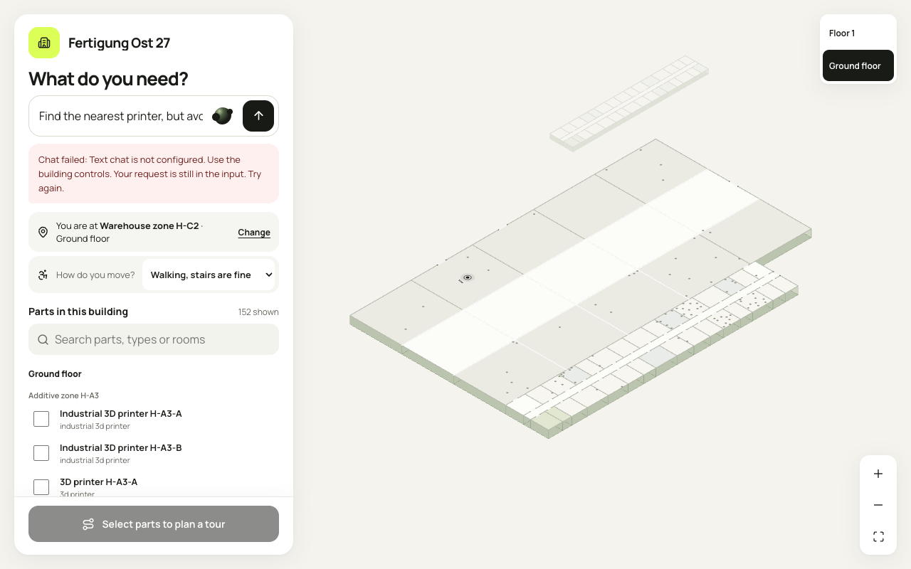
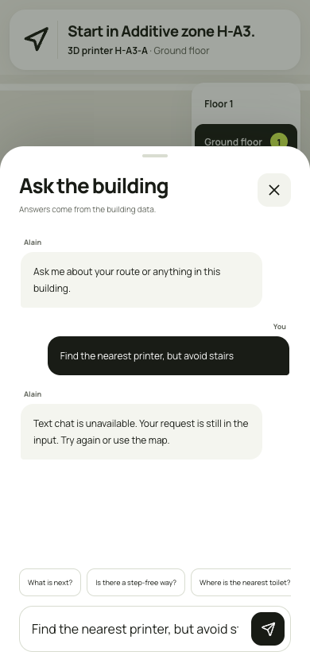

# Agent error and retry checks

These screenshots show the combined agent refactor and main UI on 25 October 2026.
The browser used the real local API, an isolated SQLite database and empty provider keys.
They show HTTP 503 handling, not a connected model or a voice conversation.

On both screens, a failed request stays in the input for retry. The app shows the
service error. It does not replace the model response with a local answer.

Desktop, 1280 by 800:

Phone, 390 by 844, after confirming the start of a real local tour:

The checks also found no horizontal overflow at these sizes. Keyboard focus can
reach the desktop input, submit control and position control. Live microphone,
hosted ElevenLabs tools and model answer quality need separate acceptance checks.
