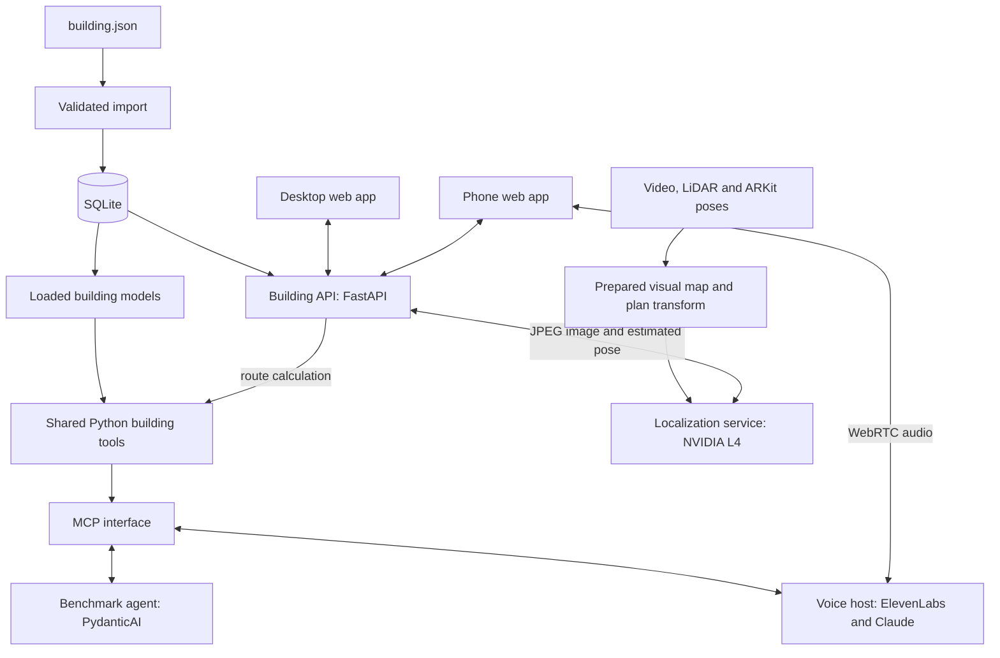
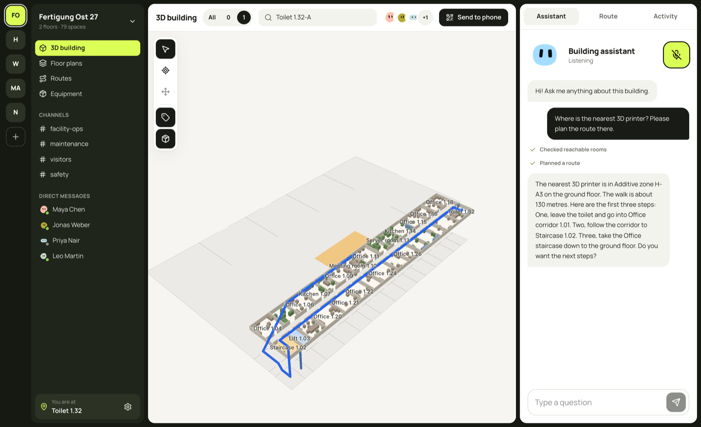
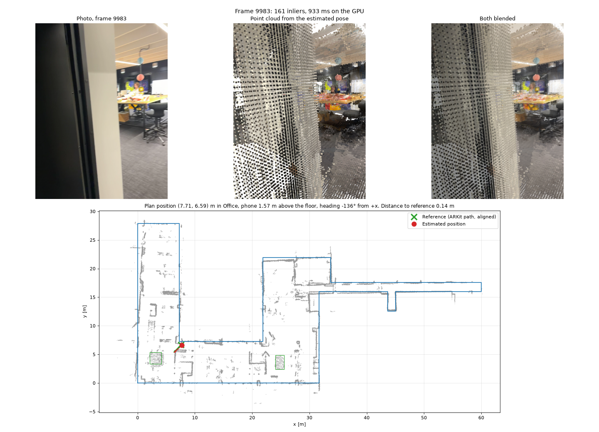
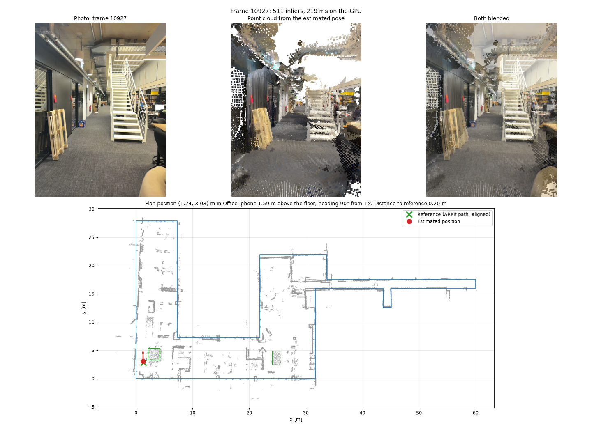
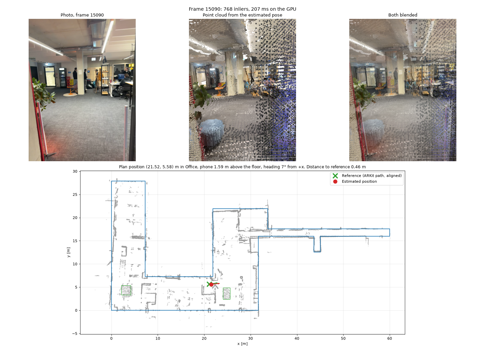
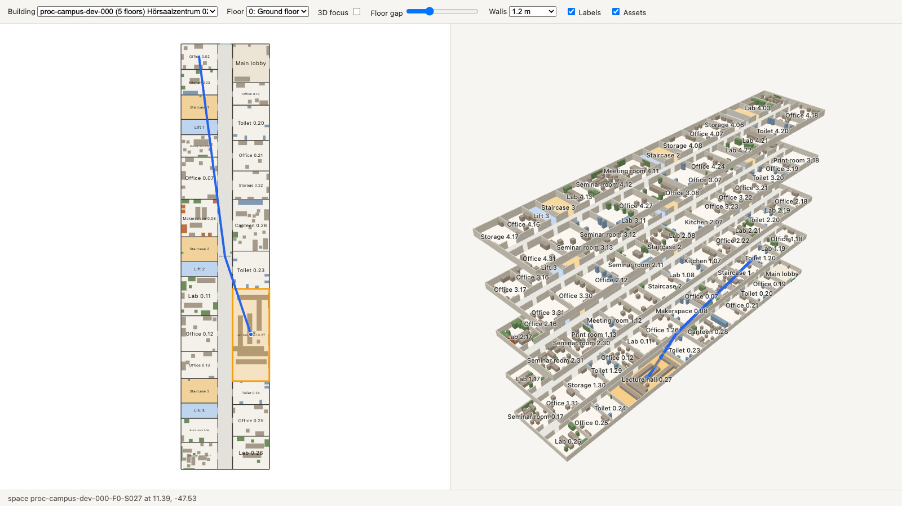
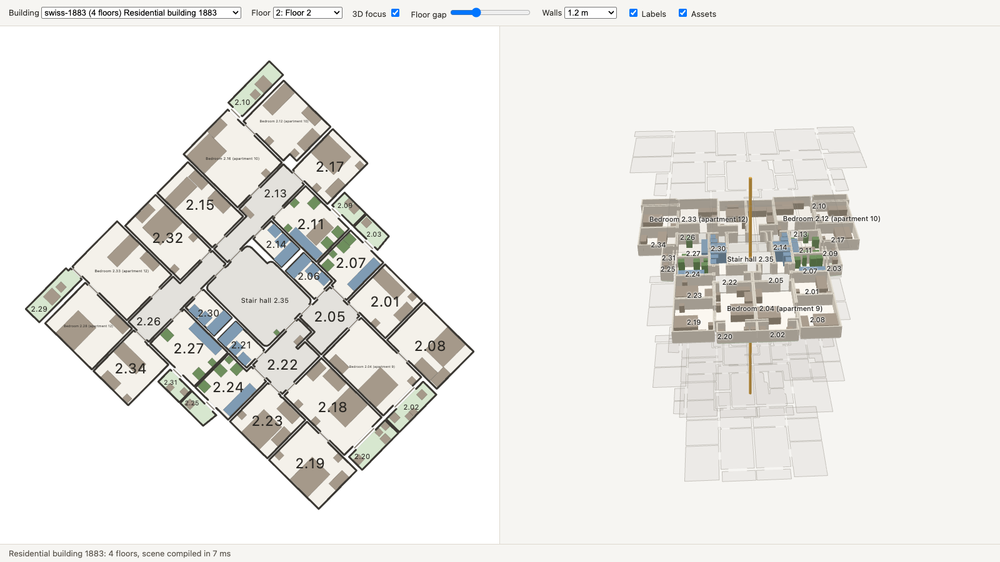
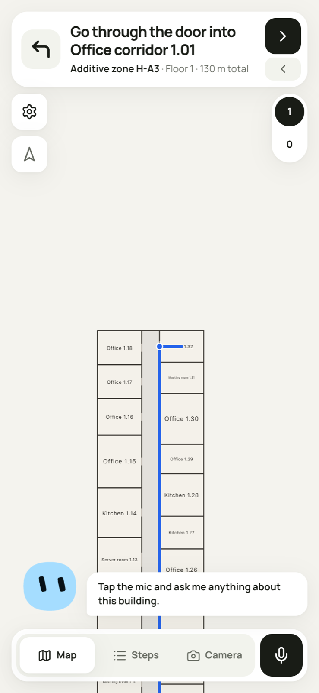
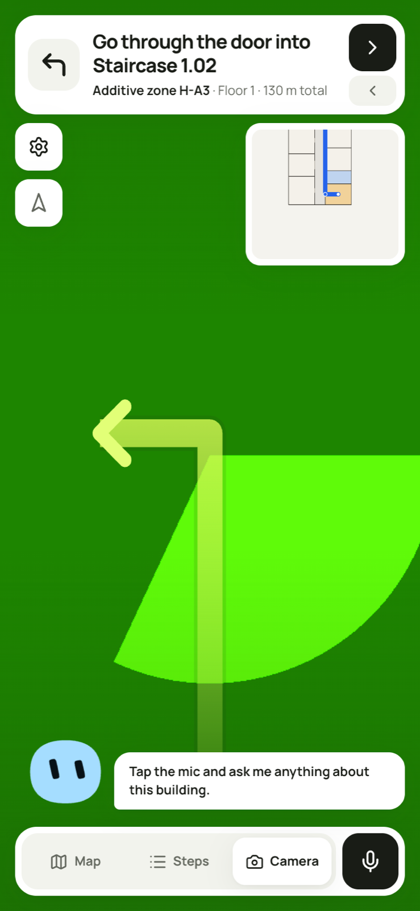
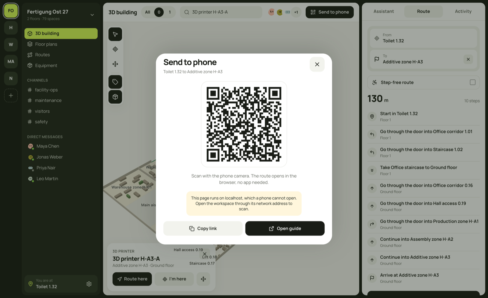

# Locora architecture and technical decisions

Locora connects a building model, route calculations, spoken conversation and camera-based indoor positioning. Desktop users inspect a building and plan a journey. Phone users open the same route and follow it through map, step and camera views.

The central decision is to give each part a clear task. Language models interpret requests and select tools. Python tools calculate building facts and routes. A GPU service estimates camera position. The frontend draws the returned data.

This outline describes the implementation on `main` on 25 October 2026, at [the source revision used here][revision]. Recorded measurements have their test conditions beside them. Deployment details describe the recorded configuration, rather than a new live service check.

## Architecture at a glance

The application has two connected paths. The conversation path answers questions and plans routes. The camera path finds the user's position in a prepared building. Both paths use the building's identifiers and coordinates.

Model Context Protocol (MCP) is the tool interface between an agent host and the building tools. WebRTC carries the live audio between the browser and ElevenLabs. Neither interface contains a separate routing implementation.

The drawing groups responsibilities. The deployments load their own building models; they do not all connect to one shared live database. [Architecture source][architecture]

## Main decisions and their purpose

| Decision | Purpose | Consequence |
|---|---|---|
| Keep building calculations outside the language model | Produce numeric results and routes from explicit rules | Both agent hosts use the same Python calculations |
| Use one building data format | Keep imports, tools and views tied to the same entities | Source IDs, units and coordinates survive storage and transport |
| Prepare a visual map before navigation | Move map construction out of a user's camera request | A mapped building is required before camera positioning can work |
| Capture with LiDAR, navigate with a camera | Use depth and poses during setup without requiring them on every user's phone | Capture and navigation have different device requirements |
| Use an existing agent harness | Reuse model turns, validation and usage controls | PydanticAI hosts the benchmark agent; ElevenLabs hosts voice conversations |
| Compile one scene for two renderers | Keep 2D and 3D views consistent | The visual package remains independent of React |
| Keep evaluation data outside the runtime | Prevent answers from leaking into agent context | Questions and expected answers stay with the evaluator |

## Building data and storage

### Source and validation

`building.json` supplies the building, floors, spaces, openings, vertical connectors and assets. SQLite stores those records. Entity IDs are scoped to the building. Foreign keys and import checks preserve their relationships.

The importer checks types, finite coordinates, duplicate IDs, polygon validity, floor references and opening sides. A content hash identifies the imported data. Re-importing identical content is a no-op. Importing different content under an existing building ID reports a conflict.

Geometry stays traceable to the source polygons. The stored model does not include benchmark questions, generator inputs or expected answers. [Database design][db]

### Precomputed values and loaded models

Room area is a SQLite `STORED` generated column. Shapely calculates the polygon area when a row is written. Reads use the stored value. Changing the polygon recalculates it. Changing the calculation itself requires a calculation-version change and a rewrite of stored values.

The serving paths differ:

- The building API reads a persistent SQLite file. Its route endpoint caches up to 16 prepared building models, which retain their computed indoor walking distances.
- The voice server imports the allowed building files into an in-memory SQLite database at startup. It then loads building models and closes that database connection. Voice tool calls use the loaded models.
- The benchmark agent imports and loads the requested building. The submission runner uses a fresh temporary database for a new benchmark building.

Therefore, the voice architecture is not a language model with unrestricted database access. The model calls specific operations on a selected building. [API implementation][api], [Voice data loader][voicetools], [Benchmark agent][agent]

## Building tools and route calculations

### Tool responsibilities

The shared tool layer uses Pydantic result models, Shapely for planar geometry and NetworkX for graph operations. Tools accept entity IDs and return facts with units. Lookup tools resolve names into candidate IDs. Missing or ambiguous information remains visible to the agent.

| Tool | Responsibility |
|---|---|
| `building_overview` | List floors, connectors and available room and asset types |
| `find_spaces` | Find rooms and other spaces, with areas and aggregate values |
| `find_assets` | Find equipment and the space that holds it |
| `stacked_spaces` | Calculate overlap with spaces on another floor |
| `shared_walls` | Find neighbours under the shared-wall rule |
| `distance_3d` | Calculate straight-line distance between space centres |
| `route` | Calculate a route through stops in the supplied order |
| `reachable_spaces` | List reachable spaces and walking distances under route rules |
| `exit_distance_change` | Compare distances to an entrance before and after a hypothetical change |

The MCP server publishes these operations. Provider adapters change the interface where needed, while the calculations remain in `building_tools/`. [Tool design][tools]

### Two levels of shortest-path calculation

Inside a space, a visibility graph connects points that can see each other without crossing the allowed outline. Its points include the room anchor, door landing points and polygon corners. Floyd-Warshall calculates the shortest distances between all pairs of points.

The normal wall clearance is 15 cm. Door landings are normally 30 cm inside the space. The distance from an opening to its landing is included. This lets a route cross a corridor from door to door without forcing it through the corridor's centre.

At building scale, room anchors and openings form a weighted graph. Stairs and lifts connect floors. NetworkX's **bidirectional Dijkstra** finds a route between a start and an end. Reachability uses single-source Dijkstra. Nearest-exit comparison uses multi-source Dijkstra on the reversed graph. [Indoor walks][walks], [Building graph][network], [Route operations][routes]

### Rules and limits

Route conditions can close spaces, openings or connectors. They can require step-free travel, a minimum opening width or restrictions on passing through room types. The tools also support hypothetical added doors and conditions that differ by route leg.

The distance model follows the challenge rules. Stairs cost 2 m per metre climbed. A lift costs 15 m per ride plus 1 m per metre climbed. Furniture is not an obstacle. Entrances do not connect otherwise separate building parts through the outside.

Several stops are visited in the supplied order. The implementation calculates the shortest path for each consecutive pair. It does not search for the best permutation of stops.

Two details matter when presenting the result:

- If the indoor visibility graph cannot connect two points, the current implementation uses 1.5 times their straight-line distance as a fallback. This is a model estimate, not a geometrically verified walk.
- The route drawing contains room anchors and openings. A line between these drawing points can cross a corner even when the distance calculation goes around it. The drawn line is not the full internal visibility path.

The graph can compute a new route when conditions change. It does not detect a failed lift or a blocked corridor by itself. [Route rules][tools], [Fallback calculation][walks], [Drawing path][routes]

## Conversation and agent hosts

### ElevenLabs voice host

ElevenLabs runs speech recognition, the language model and speech output. The checked-in configuration selects Claude Sonnet 5.5 and a Claude Haiku 5.5 backup. The browser obtains a short-lived conversation token from the voice server, then starts a WebRTC conversation.

The conversation includes the selected building and, when known, the current room and destination. ElevenLabs calls the MCP endpoint with the building ID. The server selects that building's tool instance and checks its bearer token.

ElevenLabs does not call the PydanticAI benchmark agent. These are separate hosts with shared calculations. Equal tool code does not guarantee equal model answers. Each conversation path needs its own end-to-end checks.

ElevenLabs drops tools with nested object parameters. The voice adapter therefore exposes route conditions as flat parameters. Per-leg conditions and added doors are not exposed through this adapter. The what-if exit tool is also hidden. [Voice architecture and configuration][voice]

### Keeping speech and the screen connected

When a successful voice tool call plans a route, the frontend reads its stops and supported route conditions. It asks the building API for that route and its drawing points. The frontend does not implement Dijkstra again.

The app can also send changed screen context to the conversation. For example, a manually selected current room can become the start for the next request. The avatar reflects conversation state and audio level; it has no role in route calculation. [Web integration][web]

Figure 1. Desktop integration from the settled UI thread. The assistant panel and route are visible together. Team names and channels in this capture are sample content.

### Benchmark host

PydanticAI manages model calls, tool execution, structured results, repair attempts and usage limits. The agent receives the original question and allowed building context. It selects and combines tools rather than receiving a question-specific solution from a preprocessing step.

Output shapes cover numbers, counts, rooms, items, routes and explicit failures. For a route, the final output carries the selected stops and conditions. The formatter uses the route tools again to produce the path and length. A valid output schema alone does not prove a correct answer.

The submission command is `uv run run_benchmark <building_dir> <questions.json> <answers.json>`. Results contain the full reply, the `Answer:` text and structured data. Route entries contain ordered space IDs, element IDs and length. [Agent design][agent], [Submission instructions][submission]

## Camera localization and GPU processing

### Capture and map construction

The capture device is an iPhone 12 Pro with LiDAR (Light Detection and Ranging, a depth sensor). Stray Scanner records video, depth, camera calibration and ARKit camera poses. ARKit supplies an estimate of camera position and orientation during capture.

The implemented map builder handles one capture:

1. Select keyframes by movement and turning. Choose a sharp nearby frame.
2. Decode video with NVIDIA's NVDEC hardware decoder and turn images upright.
3. Keep the ARKit poses fixed, so the map has metric scale and a known up direction.
4. Extract MegaLoc global image descriptors and SuperPoint local features.
5. Match nearby and visually similar frames with LightGlue.
6. Triangulate matched image features into 3D landmarks with COLMAP.

The implementation uses hloc (Hierarchical Localization) to connect these components. It does not reconstruct the whole building during each navigation request. [Mapping pipeline][localization]

### Floor plan from the same capture

LiDAR depth is projected into 5 cm voxels. Floor height, wall evidence and free space support a floor outline. A stored `building_from_map` transform maps the visual map's coordinates into building-plan coordinates.

This shared transform is essential. A camera pose must be in the same coordinate system as the room polygons and route points before the frontend can draw it correctly.

The current scan pipeline produces one floor and one space. Annotations supply names, room types and furniture. Automatic room and door splitting, and joining several captures into a single reconstruction, remain planned work. Existing multi-room and multi-floor JSON buildings already work with the route and rendering tools. [Floor plan pipeline and results][localization]

### One navigation request

The phone sends a JPEG image to the building API. The API forwards it to the GPU service over HTTPS and adds the server-held token. The GPU service:

1. Uses MegaLoc to retrieve similar map images.
2. Uses SuperPoint and LightGlue to match image features to known 3D landmarks.
3. Estimates the camera pose with Perspective-n-Point (PnP) and Random Sample Consensus (RANSAC), which rejects inconsistent matches.
4. Applies the map-to-plan transform and finds the containing space.
5. Returns floor, space, plan position, camera height, viewing direction and a reliability flag.

Browsers do not supply calibrated camera intrinsics. The service can estimate focal length during pose estimation. A user needs a camera image, rather than a LiDAR scan, for this request. [Localization service][localization], [Pose implementation][localizer]

### Phone updates and failure handling

In camera view, the phone sends about one image per second, with a long side of 1024 pixels. Only one request runs at a time. The frontend uses results marked `reliable: true`.

Two consecutive fixes must agree on a new space before it becomes the route start. The app then calculates a route through the stops still ahead. Passed stops are removed. A 404 response means that the building has no map. A 503 means that localization is not configured. Those responses stop uploads until reload. Other failures trigger retry backoff up to 16 seconds.

The backend proxy retains an HTTP connection between requests. It limits images to 4 MiB and uses a five-second upstream timeout. Camera frames are processed without being stored by the localization service. [Client behaviour][web], [Localization proxy][proxy]

### GPU and recorded measurements

The recorded deployment uses a Google Cloud `g2-standard-4` virtual machine with one NVIDIA L4. It runs a FastAPI localization service behind Caddy. A systemd service starts the process after reboot. The selected standard VM avoids the interruption policy of the earlier Spot VM.

| Recorded test | Result | Scope |
|---|---|---|
| GPU processing, 1024 px JPEG and five retrieved map images | 196–208 ms | Server processing; network time is additional |
| Separate fast iPhone 17 Pro capture | 532 of 533 frames localized; 0.33 m median error | Recorded frames aligned to an ARKit-derived reference |
| Same capture, at least 30 inlier matches | 0.27 m median error; 97% within 1 m | This subset contains 86% of frames |
| Map construction from a 9.5-minute capture | 1,666 keyframes and 167,539 3D points | One capture and one mapped area |
| Optimized map construction | About 11.4 minutes | Offline preparation on the recorded VM |

An inlier is a feature match that agrees with the estimated camera pose. The service uses at least 30 inliers as its reliability threshold. Below that threshold, the recorded median error was 4.3 m.

The separate recordings were aligned using their ARKit trajectories. Drift in those trajectories affects the reference. These numbers describe a localization experiment, not guaranteed building-wide accuracy or a measured browser-to-screen latency. [Measurement conditions and results][localization]

## Localization image evidence

Each supplied image compares a recorded phone frame with a point-cloud rendering from the estimated pose. The blended view helps inspect alignment. The plan below shows the estimated position and the aligned ARKit reference.

| Frame | Inliers | GPU time shown in image | Distance to reference shown in image |
|---|---:|---:|---:|
| 9983 | 161 | 933 ms | 0.14 m |
| 10927 | 511 | 219 ms | 0.20 m |
| 15090 | 768 | 207 ms | 0.46 m |

These are individual examples. Frame 9983 also shows why an approximately 200 ms processing figure is not a bound on every request. The images do not explain the cause of its longer processing time.

Figure 2. Frame 9983. The image reports 161 inliers, 933 ms on the GPU and 0.14 m from the aligned reference.

Figure 3. Frame 10927. The image reports 511 inliers, 219 ms on the GPU and 0.20 m from the aligned reference.

Figure 4. Frame 15090. The image reports 768 inliers, 207 ms on the GPU and 0.46 m from the aligned reference.

## Frontend and visualization

### One scene model for both views

The web application uses TypeScript, React, Vite and Tailwind. The separate `packages/building-view/` package has no React dependency. It receives the parsed API response as an object. It does not create an intermediate JSON file.

`compileScene` builds a deterministic scene. It sorts IDs, rounds derived coordinates to millimetres and reports broken references. Both renderers consume this scene:

- `FloorPlan` draws one floor as Scalable Vector Graphics (SVG).
- `BuildingView3D` uses three.js for a rotatable exploded view of the floors.

Walls are derived from room edges because the input has no separate wall objects. Openings cut gaps in nearby edges. Assets use their footprints and rotation. Labels use an interior point, so labels for concave rooms stay inside the room.

The Python models publish an OpenAPI schema. The TypeScript building types are generated from that schema. This keeps the API contract tied to the source model. [Visualization design][visualization]

Figure 5. Historical visualization playground from the settled renderer thread. The blue line is a test overlay path. This screenshot demonstrates drawing support, not a validated route calculation.

### Drawing performance and floor focus

The 2D building layer is separate from the overlay layer. A changed user position updates a few elements without rebuilding the floor plan.

In 3D, walls are merged per floor and assets use instanced drawing. Rooms remain individually selectable. Rendering runs after a change rather than in a permanent drawing loop. A focused floor keeps its 3D geometry while other floors become flat outlines. This avoids stacked transparent walls obscuring the selected floor.

The recorded scene-compilation time for the largest dataset building was about 40 ms. That figure measures scene construction, not total page load or device frame rate. Asset heights are display defaults because the source data has no asset heights. [Rendering choices][visualization]

Figure 6. Historical floor-focus view. The selected floor remains readable while the surrounding floors provide context.

### Desktop and phone

The desktop route `/admin/:buildingId` provides search, 2D and 3D inspection, position selection, equipment selection, route planning and a phone link. The phone route `/b/:buildingId` provides map, steps and camera views with voice controls.

A Quick Response (QR) code carries the phone URL and route parameters. The phone loads the route itself. This transfers a journey without establishing a shared live session between desktop and phone.

The camera view draws directional guidance over the camera image. It is a screen overlay, rather than a verified world-anchored augmented-reality system. [Frontend behaviour][web]

Figure 7. Historical phone map and route guidance from the settled UI thread.

Figure 8. Historical camera-layout capture. The green background is a simulated camera input. This image shows the guidance layout and mini map, not a successful physical-camera localization run.

Figure 9. Historical QR dialog. The visible localhost warning belongs to the local development capture. It does not prove a successful phone handoff.

## Deployment and trust boundaries

The recorded Railway project has separate `web` and `voice-agent` services. The web container serves the built frontend and the building API. It imports allowed building files into SQLite during its build. The voice service synchronizes its configuration with ElevenLabs before deployment.

The GPU localization service runs separately on Google Cloud. It contains the prepared visual map and GPU models. The web backend forwards camera requests to it. The browser does not receive the localization token.

| Boundary | Control |
|---|---|
| Browser to ElevenLabs | Short-lived conversation token; provider key stays on the voice server |
| ElevenLabs to building tools | Bearer token and a selected building ID |
| Building API to GPU service | Server-held localization token, image-size limit and timeout |
| Agent to building data | Named, validated tools; no unrestricted SQL, shell or file access |
| Runtime to evaluation material | Deployment files exclude questions, labels, submissions and run results |

The deployment record lists successful web and voice releases and HTTP checks for an earlier revision. It also records that fresh microphone and physical-phone checks were not completed in that deployment task. Later source changes and historical screenshots do not replace those checks. [Deployment record][deployment], [Voice security][voice]

## Verification and remaining scope

The recorded benchmark-agent development run answered 138 of 138 dev questions correctly. The test-set run produced 145 answers without stopped runs. The latter is a completion count, not an independently established test-set accuracy score. These results belong to the PydanticAI path. They do not measure live voice quality. [Recorded agent results][agent]

| Area | Implemented or recorded | Remaining limit |
|---|---|---|
| Building model | Validated imports, stored areas, source IDs and references | General persistent editing is not part of the current read-only tools |
| Routing | Indoor distances, multiple floors, closures, step-free rules and ordered stops | Stop order is supplied; some indoor distances use a fallback |
| Voice | ElevenLabs host with shared building tools | Its schema adapter exposes fewer route features than the benchmark host |
| Visual localization | Prepared map, GPU pose service and client upload path | Requires a map; recorded accuracy is not a device acceptance test |
| Scan-derived plan | One-floor outline in the map's coordinate system | Room and door splitting, and joined captures, remain planned |
| Visualization | Shared scene, SVG plan and three.js exploded view | Drawing points can simplify the actual walk around corners |
| Team and messaging UI | Sample people, channels, messages and presence | Not a verified cross-user messaging or tracking service on this revision |
| Equipment movement | Changes the browser's building copy | No shared persistent equipment update |
| Camera guidance | Camera image with navigation overlay | No verified world-anchored augmented reality |

Wi-Fi positioning is not part of this implementation. A route closure is an input to the route tools; automatic building-fault detection is not established. The current home screen selects existing buildings. It does not provide the proposed general floor-plan upload and building-creation workflow. [Current web scope][web], [Localization scope][localization], [Demo capability notes][demo]

## Repository map and further reading

| Location | Responsibility |
|---|---|
| `building_db/` | Source models, SQLite schema, imports and read access |
| `building_tools/` | Lookup, spatial calculations, walking graph and MCP server |
| `building_agent/` | PydanticAI agent, output validation and submission runner |
| `voice_agent/` | ElevenLabs configuration, tokens and tool adapter |
| `building_api/` | Read-only building and route API, localization proxy |
| `localization/` | Capture processing, visual map, floor outline and pose service |
| `packages/building-view/` | Scene compiler and 2D and 3D renderers |
| `web/` | Desktop and phone application |
| `benchmark/` | Official evaluation and scoring, outside the serving path |
| `SUBMISSION/` | Reproduction instructions and submitted answers |

The [image source index](assets/architecture/README.md) records the original files, fixed Git revisions and source threads. The three localization images came with this request. Six other images were recovered from settled project threads and copied here so their links do not depend on temporary files or asset branches remaining available.

[revision]: https://github.com/hagenhaeussler/Industrial-Agents-Hackathon-2026/tree/ce809ee23f2bd8eb0c3d6f477654895290203875
[architecture]: https://github.com/hagenhaeussler/Industrial-Agents-Hackathon-2026/blob/ce809ee23f2bd8eb0c3d6f477654895290203875/ARCHITECTURE.md
[db]: https://github.com/hagenhaeussler/Industrial-Agents-Hackathon-2026/blob/ce809ee23f2bd8eb0c3d6f477654895290203875/docs/db.md
[api]: https://github.com/hagenhaeussler/Industrial-Agents-Hackathon-2026/blob/ce809ee23f2bd8eb0c3d6f477654895290203875/building_api/app.py
[voicetools]: https://github.com/hagenhaeussler/Industrial-Agents-Hackathon-2026/blob/ce809ee23f2bd8eb0c3d6f477654895290203875/voice_agent/tools.py
[tools]: https://github.com/hagenhaeussler/Industrial-Agents-Hackathon-2026/blob/ce809ee23f2bd8eb0c3d6f477654895290203875/docs/tools.md
[walks]: https://github.com/hagenhaeussler/Industrial-Agents-Hackathon-2026/blob/ce809ee23f2bd8eb0c3d6f477654895290203875/building_tools/walks.py
[network]: https://github.com/hagenhaeussler/Industrial-Agents-Hackathon-2026/blob/ce809ee23f2bd8eb0c3d6f477654895290203875/building_tools/network.py
[routes]: https://github.com/hagenhaeussler/Industrial-Agents-Hackathon-2026/blob/ce809ee23f2bd8eb0c3d6f477654895290203875/building_tools/routes.py
[voice]: https://github.com/hagenhaeussler/Industrial-Agents-Hackathon-2026/blob/ce809ee23f2bd8eb0c3d6f477654895290203875/docs/voice.md
[web]: https://github.com/hagenhaeussler/Industrial-Agents-Hackathon-2026/blob/ce809ee23f2bd8eb0c3d6f477654895290203875/web/README.md
[agent]: https://github.com/hagenhaeussler/Industrial-Agents-Hackathon-2026/blob/ce809ee23f2bd8eb0c3d6f477654895290203875/docs/agent.md
[submission]: https://github.com/hagenhaeussler/Industrial-Agents-Hackathon-2026/blob/ce809ee23f2bd8eb0c3d6f477654895290203875/SUBMISSION/BENCHMARK.md
[localization]: https://github.com/hagenhaeussler/Industrial-Agents-Hackathon-2026/blob/ce809ee23f2bd8eb0c3d6f477654895290203875/docs/localization.md
[localizer]: https://github.com/hagenhaeussler/Industrial-Agents-Hackathon-2026/blob/ce809ee23f2bd8eb0c3d6f477654895290203875/localization/localizer.py
[proxy]: https://github.com/hagenhaeussler/Industrial-Agents-Hackathon-2026/blob/ce809ee23f2bd8eb0c3d6f477654895290203875/building_api/localize.py
[visualization]: https://github.com/hagenhaeussler/Industrial-Agents-Hackathon-2026/blob/ce809ee23f2bd8eb0c3d6f477654895290203875/docs/visualization.md
[deployment]: https://github.com/hagenhaeussler/Industrial-Agents-Hackathon-2026/blob/ce809ee23f2bd8eb0c3d6f477654895290203875/docs/deployment-status.md
[demo]: https://github.com/hagenhaeussler/Industrial-Agents-Hackathon-2026/blob/ce809ee23f2bd8eb0c3d6f477654895290203875/demo%20video%20prompt%20.md
