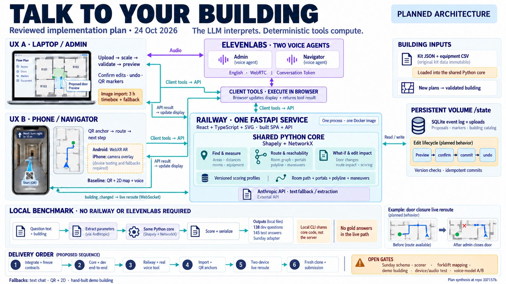

# Reviewed implementation plan visualization

Generated with the built-in image generation model on 24 October 2026, using repository snapshot `337157b45b4703cf7e866cd7063de26417d01e37`. The image depicts planned behavior and integration gates, not a completed deployment or measured agent performance. The [generation and correction prompts](2026-10-24-reviewed-plan-image-prompt.txt) are retained for reproducibility.

## Source precedence

1. [Two-UX review](../../2026-10-24-plan-review-zwei-ux.md): latest team decisions, Railway, laptop Admin and phone Navigator experiences, image-import timebox, QR anchoring, camera paths, scope and fallbacks.
2. [ElevenLabs agent configuration](../elevenlabs-agent-config.md): two agents, English, WebRTC Conversation Token, browser client tools, confirmation and session context. The final voice LLM remains subject to the planned A/B test.
3. [Codex architecture review](../../codex%20reviewed%20plan%20suggestions%20.md): one FastAPI service, shared Python core, persistent versioned events, scoring profiles, independent benchmark and fresh-clone validation.
4. [Original plan](../../PLAN.md), [route announcement](../../2026-10-24-route-scoring-specifications.md) and [judge questions](../../open%20questions%20for%20judge%20.md): broader requirements, unresolved evaluation contracts and question families.

The latest two-UX review takes precedence where the older documents conflict. The original Cloudflare design is superseded. Camera navigation is the selected extension with device testing and fallbacks. Image import is timeboxed; a hand-built demo building is the fallback. The standalone 3D viewer, forklift demo, cross-building routes and custom LLM endpoint are excluded from the depicted delivery scope. Forklift constraints remain a core requirement whose data mapping needs confirmation.

## Reading the image

- Both browser experiences use the same API and deterministic calculations. Voice client tools execute in the browser, call the API, update the display and return the same tool result to ElevenLabs.
- The backend keeps versioned building state on the persistent volume. Confirmed edits trigger WebSocket updates and active-route recalculation. Preview and what-if operations do not imply a persistent commit.
- The local benchmark shares core code, rather than depending on the deployed Railway service. Parameter extraction can use Anthropic. Known answers and gold parameters remain outside the production inference path.
- Android WebXR and the iPhone overlay are intended device paths, not proof of completed camera/audio testing or continuous iPhone localization. The baseline is QR, 2D and voice.
- The delivery sequence is a synthesis of dependencies, not a replacement for the detailed gates or a statement that steps are complete. Sunday schema/scorer, forklift mapping, demo building, device/audio testing and the voice-model comparison remain open in the source snapshot.

The in-image laptop and phone screens are illustrative mockups. The Markdown sources remain authoritative for exact API contracts, permissions, cost profiles and scoring semantics.
