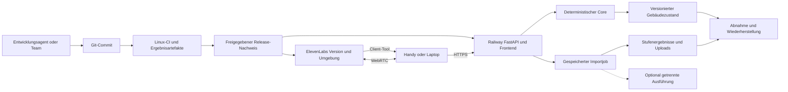

# Research: Agent-Harnesses, Infrastruktur und bisher offene Möglichkeiten

**Stand:** 24.10.2026. **Repo-Basis:** `b7df2f17b0a84e6b076883efc170e405968edbf1`, `main`, vor dieser Ausarbeitung erneut synchronisiert. **Kontext:** Synera „Talk to Your Building“, Railway, FastAPI, React/TypeScript, ElevenLabs, deterministischer Python-Core, Laptop-Administration und Smartphone-Navigation.

**Empfehlung:** Den bestehenden Produktpfad beibehalten und seine Ausführung überprüfbar machen: Code und Voice-Konfiguration gemeinsam versionieren, vollständige Gesprächsabläufe testen, einen Release unter Linux reproduzieren und Wiederherstellung tatsächlich üben. Ein Coding-Harness kann die Entwicklung unterstützen; ein dauerhafter Jobablauf kann den Planimport absichern. Beides erfüllt andere Aufgaben als der Voice-Agent.

Die aussichtsreichsten neuen Ressourcen sind ElevenLabs' native Test- und Versionsverwaltung, aktuelle Harness-Verfahren mit unabhängiger Abnahme, die Evaluationsmethodik von τ²-Bench und τ-Voice sowie Railway-Umgebungen und isolierte Ausführung. Managed-Agent-Dienste, Temporal, IndoorGML und A2A sind relevante Weiterentwicklungen mit klaren Einsatzschwellen. Ein Architekturwechsel ist für den Hackathon gegen zusätzliche Integrationszeit abzuwägen.

Dieser Bericht liefert Recherche und Integrationsvorschläge. Es wurden keine Anbieter-Konten umgestellt, kostenpflichtigen Ausführungsumgebungen provisioniert, Live-Agenten getestet oder Deployment-Einstellungen verändert. Es wurden auch keine Deployments manuell gestartet. Verfügbarkeit und Grenzen wurden anhand aktueller Primärquellen geprüft; konkrete Accountfreischaltungen, verbleibende Credits und laufende Dienste wurden nicht untersucht.

## 1. Was bereits untersucht wurde und was neu hinzukommt

Die beiden vorhandenen Research-Berichte behandeln [Repositories und Skills](2026-10-24-repositories-und-agent-skills.md) sowie [Tools, Bibliotheken, Datenstrukturen und Algorithmen](2026-10-24-tools-libraries-data-structures-algorithms.md). Darin stehen bereits typisierte Tools, Zustandsmaschinen, SQLite, Caches, Routing, Geometrie, SDK-Anbindung, Hypothesis, Tracing und fachliche Testfälle. Diese werden hier als Voraussetzungen verwendet und nicht als neue Entdeckungen ausgegeben.

Der [Codex-Review](<../codex reviewed plan suggestions .md>) verlangt schon Frischklon, Geräteprüfung, Konfigurationsexport und eine Generalprobe. Neu ist deshalb nicht die Forderung „mehr testen“, sondern die konkrete Infrastruktur, mit der diese Prüfungen wiederholbar, versioniert und über mehrere Systeme hinweg nachweisbar werden.

Im geprüften Git-Stand sind `pyproject.toml` und `uv.lock` vorhanden. Ein produktiver `core/`, `server/`, `web/`, Dockerfile und `.github`-Workflow sind dort noch nicht eingecheckt. Aus diesem Repo lässt sich daher kein bereits funktionierender Betriebs- oder CI-Prozess ableiten. Die verbindlichen Architekturentscheidungen stehen im [Review beider User Experiences](../2026-10-24-plan-review-zwei-ux.md); die bisherige Cloudflare-Planung wird dadurch ersetzt.

### Karte der offenen Möglichkeiten

| Bereich | Bisher behandelt | Neu untersuchte Lücke | Ziel |
|---|---|---|---|
| Release-Identität | Git-Commit und Agent-Export empfohlen | Gemeinsame Identität von App, Voice-Version, Anbieterumgebung, Kostenprofil und Fixtures | Ein Testlauf beschreibt genau den später vorgeführten Stand. |
| Voice-Evaluation | Tool-Vertrag und manuelle Sprachtests | Native Gesprächssimulation, Parameterprüfungen, wiederholte Läufe, externe Full-Duplex-Benchmarks | Fehler im Gesprächsverlauf systematisch erfassen. |
| Entwicklungsagenten | Arbeitspakete und Teamrollen | Übergebbarer Arbeitsstand, getrennte Implementierung und Abnahme, begrenzte Überarbeitung | Fortschritt über Agentensitzungen hinweg erhalten. |
| Lang laufende Produktarbeit | Edit-/Undo-Zustand | Wiederanlauf eines unterbrochenen Imports einschließlich bezahlter externer Schritte | Kein Neustart der gesamten Arbeit nach Browser- oder Prozessabbruch. |
| Betrieb | Railway-Service, Volume, Healthcheck | Isolierte Testumgebung, CI-Freigabe, geprüfter Restore und passende Versionen beim Rollback | Ein fehlerhafter Release lässt sich kontrolliert zurücknehmen. |
| Laufzeitisolation | Kein allgemeiner Code-Executor im Pflichtpfad | Entwicklungs-VMs, kurzlebige Sandboxes, kontrollierte Netzanbindung und Lebenszyklus | Fremde Ausführung bleibt von App und Gebäudedaten getrennt. |
| Gesamtsystemtests | Core-Invarianten und Dev-Scorer | Aufgezeichnete Abhängigkeiten, Fehlerzeitpunkte, zwei gleichzeitig handelnde Nutzer und echte Geräte | Erfolg unter Unterbrechung und Konkurrenz nachweisen. |
| Nutzung im Gebäude | 2D, Voice, Kamerakalibrierung | Ausfallmodi, menschliche Aufgabenerfüllung und multimodale Zugänglichkeit | Auch mit Lärm, verlorenem Tracking oder schlechter Verbindung verständlich bleiben. |
| Externe Fachressourcen | Kit-Daten, einige Format-/BIM-Nennungen | Unabhängige Planannotationsdaten und ein Navigationsstandard als Referenz | Import und Datenmodell außerhalb der eigenen Beispiele prüfen. |
| Interoperabilität | HTTP-/Client-Tools, MCP erwähnt | A2A-Aufgabenlebenszyklus und externe Agenten als getrennte Dienstgrenze | Spätere Zusammenarbeit ermöglichen, ohne jeden Dienst zum gemeinsamen Agenten zu machen. |

## 2. Rangliste

Priorität bewertet Nutzen und Machbarkeit **für dieses Projekt und den verbleibenden Hackathon**. Aufwand sind eigene Größenordnungen bei vorhandenem App-Grundgerüst. Er ersetzt nicht die zuerst notwendige Implementierung des fachlichen Cores.

| Rang | Entdeckung / Ansatz | Priorität | Begrenzter erster Schritt |
|---|---|---|---|
| 1 | Gemeinsamer Release-Nachweis und fest gestartete ElevenLabs-Version | **Hoch** | 30–60 min: Manifest, wirksame Konfiguration und Versionswahl im Tokenpfad. |
| 2 | Native ElevenLabs-Regression plus τ²-/τ-Voice-Testmethodik | **Hoch** | 60–90 min: sechs gezielte Szenarien, zunächst kontrollierte Tool-Antworten. |
| 3 | Linux-CI und überprüfte Freigabe vor Railway-Deployment | **Hoch** | 45–90 min: Frischklon, Lockfile, Core-Tests, Frontend-Build und gespeicherte Ergebnisse. |
| 4 | Entwicklungs-Harness mit Arbeitsübergabe und unabhängiger Abnahme | **Hoch** | 30–45 min: kurze Featureliste, klare Zuständigkeit, prüfbarer Abschluss. |
| 5 | Wiederaufnehmbarer Importjob; später gegebenenfalls Temporal | **Hoch für Import** | 1–3 h: gespeicherte Eingabe, Stufenstatus und bewusster Neustart einer Stufe. |
| 6 | Record/Replay und gezielte Unterbrechung vollständiger Abläufe | **Hoch** | 60–90 min: wenige Fehlerszenarien mit eindeutigem Endzustand. |
| 7 | Geräteläufe mit Systemmetriken und Zugänglichkeitsprüfung | **Hoch** | 45–90 min mit beiden vorhandenen Handys und bekanntem Demonstrationsweg. |
| 8 | Getrennte Railway-Testumgebung und geprüfte Wiederherstellung | **Hoch vor Änderungen an persistenten Daten** | 45–90 min: Demo-Seed, Snapshot und Restore in gesondertem Ziel. |
| 9 | Programmgesteuerte Agent-Harnesses und Managed-Agent-Dienste | **Mittel, bedingt** | 45–60 min Konzeptprobe für genau einen wirklich mehrstufigen Hintergrundauftrag. |
| 10 | Railway Sandboxes / Cloud Agents und E2B als Ausführungsinfrastruktur | **Mittel, bedingt** | Separater Linux-Frischklon, wenn die bestehende Entwicklungsumgebung nicht reicht. |
| 11 | Begrenzte Offline-Fortsetzung; Local-first als strategische Alternative | **Mittel** | Letzten Plan und letzte Route mit Versions-/Verbindungsstatus erhalten. |
| 12 | CubiCasa5K und FP-TXT als unabhängige Planimport-Ressourcen | **Niedrig für dieses Wochenende** | Zunächst Eignung und Datenrechte prüfen, danach kleine getrennte Evaluationsauswahl. |
| 13 | OGC IndoorGML 2.0 als Referenz für spätere Gebäudeverträge | **Niedrig für dieses Wochenende** | Eine Mappingnotiz; das Challengeformat weiter bedienen. |
| 14 | A2A für spätere externe Spezialisten | **Niedrig** | Erst bei konkretem zweiten Dienst einen begrenzten Adapter entwerfen. |

Die Zeitangaben überlappen teilweise. Sie sind kein Auftrag, vor Sonntag alle 14 Punkte umzusetzen. Zuerst die hoch priorisierten Prüfungen am tatsächlich fertigen Pfad durchführen; neue Dienste nur bei einem nachgewiesenen Bedarf aufnehmen.

## 3. Entdeckungen und Bewertung

### 3.1 Gemeinsamer Release-Nachweis und festgelegte Voice-Version

- **Name / Kategorie:** Übergreifende Release-Identität; ElevenLabs-Versionierung und umgebungsgebundener Gesprächsstart.
- **Zweck:** Einen getesteten Zustand über Git, Railway und ElevenLabs hinweg identifizieren und erneut starten können.
- **Neuheit:** Der bisher empfohlene Konfigurationsexport verhindert allein noch nicht, dass der Token-Endpunkt eine inzwischen veränderte Agentenversion startet.
- **Relevanz:** Unsere Konfigurationsdatei unterscheidet bereits Soll- und Ist-LLM. Änderungen im Dashboard können deshalb ein anderes Verhalten erzeugen, obwohl App und Core unverändert sind.
- **Nutzen:** Vergleichbare A/B-Tests, nachvollziehbare Fehler und eine stabilere Vorführung. Die aktuelle Token-API unterstützt ausdrücklich `version_id`, `branch_id` und `environment`; letzteres hat den Default `production`.
- **Trade-offs:** Die native Versionierung ist laut Dokumentation nach Aktivierung nicht abschaltbar. Außerdem bleiben unter anderem Authentifizierung, Limits und Privacy-Einstellungen agentenweit gemeinsam. Eine Versions-ID friert nicht sämtliche Betriebsbedingungen oder das Verhalten eines externen Modellanbieters ein.
- **Integration:** Serverseitig je Navigator/Admin die freigegebene Agent-ID, feste Versions-ID und Anbieterumgebung wählen. Nicht beliebige Versionen aus Browserparametern übernehmen. Railway-`staging` und ElevenLabs-`staging` ausdrücklich zuordnen; gleiche Namen stellen die Zuordnung nicht automatisch her. Zunächst Konfiguration exportieren und den gewählten Gesprächsstart prüfen; native Versionierung bei Bedarf zuerst an einem Testagenten erproben.
- **Priorität:** **Hoch.** Geringe zusätzliche Infrastruktur, unmittelbar wichtig für jede Ergebnisbehauptung.
- **Quellen:** [ElevenLabs Agent Versioning](https://elevenlabs.io/docs/eleven-agents/operate/versioning), [WebRTC Conversation Token](https://elevenlabs.io/docs/eleven-agents/api-reference/conversations/get-webrtc-token).

Ein gemeinsamer Release-Nachweis kann klein bleiben. Folgende Felder sind ein Vorschlag, kein bereits vorhandenes Schema:

```text
Release
  git_sha, lockfile_hash, image_digest_or_railway_deployment_id
  core_profile_schema, fixture_set_hash
  navigator: agent_id, version_id, provider_environment
  admin:     agent_id, version_id, provider_environment
  shared_provider_settings_hash, config_export_hash

Ausführung
  release_id, request_id, conversation_id
  building_id, base_data_hash, building_version
  cost_profile, operation_id_or_job_id, outcome, evidence_reference
```

Release-Metadaten und veränderlicher Gebäudezustand bleiben getrennt. Keine API-Schlüssel, Tokens oder vollständigen Audiodaten in dieses Manifest schreiben. Ein Versionsvergleich muss zeigen können, ob sich Code, Voice-Konfiguration, Gebäudestand oder fachliches Profil geändert hat. Gleiches Lockfile und gleicher Startbefehl belegen ein reproduzierbares Verfahren; sie beweisen noch keine byteidentischen Images oder deterministischen LLM-Antworten.

### 3.2 Gesprächsevaluation mit ElevenLabs, τ²-Bench und τ-Voice

- **Name / Kategorie:** Anbieterinterne Testinfrastruktur plus externe Methodik für vollständige, gemeinsam gesteuerte Aufgaben.
- **Zweck:** Den tatsächlichen Gesprächsverlauf und seine Wirkung prüfen, zusätzlich zur isolierten Core-Funktion.
- **Neuheit:** Bisher wurden fachliche Fälle und Parameterextraktion betrachtet. Neu sind native Simulation/Next-Reply/Tool-Call-Tests, kontrollierte Tool-Antworten und Tests, in denen auch der Nutzer den Zustand verändert.
- **Relevanz:** Ein Nutzer scannt einen neuen Standort, ändert sein Ziel, bestätigt eine Vorschau oder bearbeitet parallel am Laptop das Gebäude. Ein einmaliger richtiger Tool-Aufruf deckt das nicht ab.
- **Nutzen:** ElevenLabs bietet drei entsprechende Testarten und wiederholte Läufe. τ²-Bench untersucht gemeinsame Handlungsmacht von Nutzer und Agent; τ-Voice, veröffentlicht 2026, ergänzt realistische Full-Duplex-Bedingungen wie Überlappung, Unterbrechung und gestörtes Audio. Die Verfahren passen zu unseren beiden UX, obwohl ihre ursprünglichen Fachdomänen andere sind.
- **Trade-offs:** Simulationen und LLM-Bewertungen können selbst irren. Gemockte Client-Tools prüfen keine echte Browserbrücke, keinen Mikrofonzugriff und keine räumliche Ortung. Anbieterbenchmarks liefern keine Genauigkeitszahl für unser Gebäudeprodukt. Testläufe können Kontingente verbrauchen.
- **Integration:** Mit sechs Gebäudeszenarien beginnen: mehrdeutiger Raum; „Press 4“ statt „Press 14“; Sperre während Routenplanung; Vorschau ohne Bestätigung; Abbruch nach Commit; neuer QR-Standort vor Eintreffen einer alten Antwort. IDs und Endzustand deterministisch prüfen, Erklärungstext ergänzend bewerten. Erst kontrollierte Tool-Antworten, danach den echten Browser-/Backendpfad und echte Geräte testen.
- **Priorität:** **Hoch.** Testmethodik jetzt übernehmen; die fremden Retail-/Telekom-Benchmarks nicht zum neuen Projektziel machen.
- **Quellen:** [ElevenLabs Agent Testing](https://elevenlabs.io/docs/eleven-agents/customization/agent-testing), [τ²-Bench, arXiv:2506.07982](https://arxiv.org/abs/2506.07982), [τ-Voice, arXiv:2603.13686](https://arxiv.org/abs/2603.13686), [Sierra: Knowledge and Voice Evaluation](https://sierra.ai/uk/blog/bench-advancing-agent-benchmarking-to-knowledge-and-voice).

Bei ElevenLabs-Mocks den Fallback ausdrücklich auf Fehler setzen, wenn keine passende Antwort vorliegt. Die Dokumentation erlaubt auch den Fallback „echtes Tool aufrufen“; das wäre für einen isolierten Regressionstest überraschend. System- und Workflow-Tools werden laut Anbieter nicht gemockt. Ein solcher Lauf gehört deshalb in die passende Testkonfiguration. Ein Test darf nur dann als bestanden gelten, wenn seine beabsichtigte Stufe tatsächlich geprüft wurde.

### 3.3 Linux-CI und eine überprüfbare Release-Freigabe

- **Name / Kategorie:** GitHub Actions als Entwicklungs- und Abnahmeumgebung, gekoppelt an Railway-Freigaben.
- **Zweck:** Installation, Berechnung und Build auf einer frischen Linux-Umgebung prüfen und Ergebnisse einem Commit zuordnen.
- **Neuheit:** Der alte Review fordert einen Frischklon. Neu ist ein verbindlicher, automatisch ausführbarer Nachweis statt einer lokalen Erinnerung daran.
- **Relevanz:** Die bisherigen Messungen liefen auf macOS ARM64. Railway verwendet eine andere Laufzeitumgebung; native Geometrieabhängigkeiten und Packaging müssen dort ebenfalls funktionieren. Der neue `core/` muss später tatsächlich mit ausgeliefert werden.
- **Nutzen:** Schnellere Integration von Team- und Agentenbeiträgen; sichtbare Regressionen vor dem Deployment; reproduzierbarer Abgabebefehl.
- **Trade-offs:** CI-Konfiguration benötigt Pflege. Ein grüner Build belegt keine reale Voice-/AR-Funktion. Bezahlte Live-Modelltests auf jedem Push würden Kosten und instabile Abhängigkeiten in einfache Änderungen ziehen.
- **Integration:** Zwei getrennte Prüfwege: gewöhnlicher PR-Lauf ohne Anbieterkeys für Installation aus Lockfile, fachliche Tests, Replay-Fälle und Frontend-Build; ausdrücklich ausgelöster Staging-Lauf für wenige echte Voice-/API-Interaktionen. Prüfbericht und Versionsmanifest als Artefakte aufbewahren. Railway kann auf CI-Ergebnisse warten; die tatsächliche Check-Zuordnung einmal mit einem absichtlich fehlschlagenden Test prüfen.
- **Priorität:** **Hoch**, sobald das Grundgerüst eingecheckt ist.
- **Quellen:** [Railway GitHub Autodeploys](https://docs.railway.com/deployments/github-autodeploys), [GitHub Actions Secure Use](https://docs.github.com/en/actions/reference/security/secure-use).

Für diesen einfachen CI-Lauf reichen Leserechte auf Repositoryinhalte. Privilegierte Workflows dürfen keinen ungeprüften fremden PR-Code mit Produktionscredentials ausführen. Actions auf überprüfte Revisionen festlegen. Das sind Grenzen der Ausführungsumgebung; eine Prompt-Anweisung an einen Coding-Agenten ersetzt sie nicht.

**Wichtige Railway-Bedingung:** „Wait for CI“ verlangt laut aktueller Dokumentation einen Workflow mit `on: push` für den verbundenen Branch; reine PR-Prüfungen genügen dafür nicht. Bewertet werden Workflow-Abschlüsse, nicht einzelne Jobs. Übersprungene/neutrale Läufe blockieren nicht; ein abgebrochener Lauf kann neben einem erfolgreichen Lauf ignoriert werden. Der kritische Prüfweg muss deshalb tatsächlich laufen und mit einem Fehler abschließen, wenn seine Abnahme scheitert. Die Verbindung zum Deployment explizit testen.

### 3.4 Ein übergebbarer Entwicklungs-Harness mit unabhängiger Abnahme

- **Name / Kategorie:** Begrenzter Implementierungsauftrag, fortgeschriebener Arbeitsstand und getrennte Auswertung des Ergebnisses.
- **Zweck:** Coding-Agenten über mehrere Sitzungen hinweg zielgerichtet arbeiten lassen und tatsächliche Fertigstellung prüfen.
- **Neuheit:** Bisher standen Aufgabenverteilung und wiederverwendbare Skills im Vordergrund. Hier geht es um Ausführungs- und Übergabeverträge zwischen Arbeitsphasen.
- **Relevanz:** Ein gemeinsamer Plan ist noch keine laufende Anwendung. Ein Agent kann Funktionen schreiben, ohne den Import→Vorschau→Bestätigung→Navigation-Pfad jemals auszuführen.
- **Nutzen:** Anthropic beschreibt sowohl Initialisierung mit Fortschrittsartefakten als auch neuere Generator-/Evaluator-Verfahren. Für uns ist besonders die Trennung zwischen behauptetem Fortschritt und beobachtetem Verhalten nützlich.
- **Trade-offs:** Zusätzliche Agenten erzeugen Kosten, Abstimmungsarbeit und potenzielle Dateikonflikte. Ein zweites Modell ist kein unabhängiger mathematischer Oracle. Auch die Anbieterfallstudie berichtet Grenzen und zusätzlichen Aufwand; deren Ergebnisse übertragen sich nicht automatisch auf unsere Aufgabe.
- **Integration:** Pro Auftrag Ziel, erlaubte Dateien, Schnittstellen, Ausgangscommit und Abnahmeschritte festhalten. Implementierung liefert einen kleinen Commit sowie bestandene/fehlende Prüfungen. Die Abnahme führt den Nutzerpfad aus, prüft API und Zustand und meldet reproduzierbare Fehler. Bei paralleler Entwicklung getrennte Branches/Arbeitsverzeichnisse und einen Integrationsverantwortlichen nutzen. Langwierige automatische Überarbeitungsschleifen auf ein festes Zeit-/Kostenbudget begrenzen.
- **Priorität:** **Hoch als Arbeitsweise.** Dafür muss kein neuer Agentendienst betrieben werden.
- **Quellen:** [Anthropic: Effective Harnesses for Long-Running Agents](https://www.anthropic.com/research/effective-harnesses-for-long-running-agents), [Harness Design for Long-Running Apps, März 2026](https://www.anthropic.com/research/harness-design-long-running-apps).

Das Fortschrittsartefakt sollte offene Punkte, letzte erfolgreiche Prüfung und bekannte Fehler enthalten. Reine Gesprächszusammenfassungen sind dafür zu unverbindlich. Die vorhandenen Benchmarkdefinitionen und erwarteten Dev-Ergebnisse bleiben die fachliche Referenz; sie dürfen nicht zur Verbesserung einer gemeldeten Erfolgsquote umgeschrieben werden.

### 3.5 Wiederaufnehmbare Importjobs und die Einsatzschwelle für Temporal

- **Name / Kategorie:** Gespeicherter Jobablauf; bei wachsendem Bedarf Durable Execution mit Temporal.
- **Zweck:** Einen Planimport trotz abgerissenem Browser, Serverneustart oder vorübergehendem API-Fehler weiterführen können.
- **Neuheit:** Gebäude-Events und Edit-Transaktionen speichern bereits beschlossenen Zustand. Ein halbfertiger externer Import ist ein anderer Lebenszyklus.
- **Relevanz:** Upload → Bildauswertung → Kalibrierung → Validierung → Overlay → Freigabe kann über eine einzelne Anfrage hinausgehen und bezahlte Schritte enthalten.
- **Nutzen:** Ergebnisse werden pro Stufe abgelegt; ein Browser-Reconnect findet den Job wieder. Temporal rekonstruiert Workflows aus einer Ereignishistorie und kann aufgezeichnete Ergebnisse beim Replay wiederverwenden.
- **Trade-offs:** Gespeicherter Status allein macht einen Job noch nicht wiederaufnehmbar. Temporal benötigt Dienst und Worker; Workflow-Code muss Replay-Regeln einhalten. Externe Activities können wiederholt werden und brauchen Idempotenz. Ein automatischer Retry garantiert keine einmalige Abrechnung oder Ausführung eines Anbieteraufrufs.
- **Integration:** Zunächst im geplanten einzelnen Service: Eingabedatei und Hash persistieren; `job_id`, Stufe, Versuch, Version und Ergebnisreferenz speichern; bei Neustart hängende Jobs erkennen und nach klarer Regel fortsetzen oder als unterbrochen anzeigen. Externe Ergebnisse speichern, bevor der nächste Schritt beginnt. Bei Ausweitung auf mehrere Worker, lange Wartezeiten oder viele externe Rückmeldungen dieselben Stufen als Temporal-Activities abbilden. Bestätigung des Imports bleibt ein eigener fachlicher Schritt.
- **Priorität:** **Hoch für belastbaren Import; Temporal selbst vorerst mittel bis niedrig.**
- **Quellen:** [Temporal Workflows](https://docs.temporal.io/workflows), [Event History](https://docs.temporal.io/encyclopedia/event-history), [Activity Idempotency](https://docs.temporal.io/activity-definition).

Ein einfacher Importjob darf bei unklarem Ausgang eines API-Aufrufs nicht blind alle vorherigen Stufen neu starten. Wo der Anbieter keine Wiederaufnahme-/Idempotenzgarantie bietet, den unklaren Zustand sichtbar machen und einen bewussten Wiederholungsversuch anbieten. Ein SDK-Session-Checkpoint ersetzt diese Behandlung nicht.

Der Importpfad sollte auch die Herkunft von Inhalten berücksichtigen: Text aus einem Plan oder OCR-Ergebnis ist zu prüfendes Eingangsmaterial. Darin enthaltene Anweisungen erhalten keine Berechtigung zum Verändern von Agentkonfiguration, Deployment oder Zugangsdaten. Der Importauftrag darf ein Gebäudevorschlag-Artefakt erzeugen; seine Übernahme erfolgt über den bestehenden fachlichen Freigabeweg. Das ist eine Grenze zwischen Daten und autorisierten Aktionen, keine weitere Promptregel als alleinige Absicherung.

### 3.6 Record/Replay und kontrollierte Fehler während einer Aufgabe

- **Name / Kategorie:** Wiederholbare Integrationsabläufe mit gespeicherten Abhängigkeiten und gezielten Unterbrechungen.
- **Zweck:** Fehler an konkreten Zeitpunkten nachstellen, an denen ein normaler erfolgreicher Tool-Aufruf wenig Aussagekraft hat.
- **Neuheit:** Mathematische Invarianten waren Gegenstand des vorigen Reports. Hier werden Reihenfolge, Nebenwirkungen und der Zusammenhang von Browser, Provider und Backend geprüft.
- **Relevanz:** „Stop“ kann Sprachausgabe unterbrechen, obwohl ein Commit bereits ausgeführt wurde. Ein Timeout sagt nicht, ob die Gebäudedaten geändert wurden. Alte Routen können nach einem neueren QR-Scan eintreffen.
- **Nutzen:** Fehler sind mit derselben Eingabe und Version ohne erneuten Live-Modellaufruf untersuchbar; Fixes lassen sich als Regression behalten.
- **Trade-offs:** Replay prüft nur die aufgezeichneten Grenzen. Ersetzt man alle externen Antworten durch Fixtures, sind aktuelle ASR-/LLM-Qualität und echter Netzwerktransport ausdrücklich nicht getestet. Aufzeichnungen benötigen passende Datenminimierung.
- **Integration:** Einen Ereignisablauf mit Eingabe, Release, Gebäudestand, Tool-Auftrag/-Antwort und erwarteter Zustandswirkung speichern. Fehler gezielt vor/nach Commit, vor Tool-Antwort und beim Reconnect auslösen. Abschluss über Operationseingang und Gebäudeversion prüfen. Bei unbekanntem Commit-Ausgang dieselbe Operation nachschlagen, statt sofort eine neue anzulegen. Ergänzend wenige echte Staging-Läufe behalten.
- **Priorität:** **Hoch.** Drei präzise Unterbrechungsfälle sind zunächst wertvoller als ein großes allgemeines Chaos-System.
- **Quellen:** [ElevenLabs kontrollierte Simulation](https://elevenlabs.io/docs/eleven-agents/customization/agent-testing), [τ²-Bench](https://arxiv.org/abs/2506.07982), [OpenAI: Session-Outcomes und Required Actions](https://developers.openai.com/api/docs/guides/agents-api/sessions). Die konkrete Übertragung auf unsere Commit-/QR-Abläufe ist ein eigener Entwurf.

Ein Harness sollte getrennt `completed`, `failed`, `cancelled` und `waiting_for_input` behandeln. Ein finales Modellstatement oder eine ruhende Sitzung beweist nicht, dass die Anwendung alle beabsichtigten Änderungen ausgeführt hat. Fertigstellung braucht bei einer Änderung eine bestätigte Wirkung und bei einer Route eine gültige Ergebnisversion. Pro Nutzerabsicht begrenzte Tool-/Zeitbudgets vorsehen; das ist etwas anderes als das gesamte Navigationsgespräch nach wenigen Sätzen abzuschneiden.

### 3.7 Geräteläufe, Nutzungserfolg und Zugänglichkeit

- **Name / Kategorie:** Tests mit realer Hardware und Nutzeraufgabe; WebXR-Testressourcen und W3C-XR-Anforderungen als Referenzen.
- **Zweck:** Den Weg von tatsächlicher Spracheingabe über Tool-Ausführung bis zur verständlichen Anweisung und sichtbaren Route prüfen.
- **Neuheit:** Bisher wurde die Geräteprüfung als Gate genannt. Neu sind reproduzierbare Feldszenarien, getrennte Systemmetriken und Zugänglichkeit als eigene Abnahme.
- **Relevanz:** Das Team hat Android und iPhone. Kamera, Mikrofon, Lautsprecher, Bildschirmorientierung und räumliche Registrierung können einzeln funktionieren und zusammen scheitern.
- **Nutzen:** Zeigt, ob eine Person ihr Ziel tatsächlich findet, ob Unterbrechungen sinnvoll behandelt werden und ob die App auch bei Lärm oder ohne hörbare Sprachausgabe verständlich bleibt.
- **Trade-offs:** Layout- und Pose-Simulation ersetzen keinen Gang durch das Gebäude. Die WebXR Test API ist ein ausschließlich für Tests gedachter Editor's Draft, keine normale Web-App-Schnittstelle. Die W3C XR Accessibility User Requirements sind eine informative Working Group Note, kein Zertifikat und keine hier erfüllte Konformitätsnorm.
- **Integration:** Gleicher kurzer Weg, gleicher Release und bekannter Startmarker auf beiden Geräten. Zeiten für Eingabeende→erstes Feedback→Tool-Ergebnis→sichtbare Route getrennt notieren; Zielerreichung und Fehlabbiegungen erfassen. Ruhiger und lauterer Durchlauf, einmal Unterbrechung, einmal Netzverlust. Wesentliche Anweisungen zusätzlich als Text/2D zeigen; Bedienung zum Stoppen und Wiederholen leicht erreichbar machen. Simulierte Trackingverluste zunächst in unserer Zustandslogik testen, dann auf Geräten.
- **Priorität:** **Hoch.** Vor der Aufnahme und nach Änderungen an Audio, Kamera oder Registrierung.
- **Quellen:** [WebXR Test API](https://immersive-web.github.io/webxr-test-api/), [offizielle WebXR-Beispiele](https://immersive-web.github.io/webxr-samples/), [W3C XR Accessibility User Requirements](https://www.w3.org/TR/xaur/), [τ-Voice](https://arxiv.org/abs/2603.13686).

### 3.8 Isolierte Railway-Umgebung und geprüfte Wiederherstellung

- **Name / Kategorie:** Railway-Staging/PR-Umgebungen, Volume-Backup und anwendungsbezogener Restore.
- **Zweck:** Experimente und Fehlersimulation von der Vorführung trennen und den zuletzt akzeptierten Zustand wiederherstellen können.
- **Neuheit:** Volume-Persistenz wurde bereits geplant. Persistenz allein beantwortet nicht, wie ein falscher Import oder eine inkompatible Änderung zurückgenommen wird.
- **Relevanz:** Unser Volume enthält SQLite und Uploads. Ein funktionierender alter Code-Stand hilft wenig, wenn er neue Daten oder ein anderes Schema vorfindet.
- **Nutzen:** Railway unterstützt getrennte Umgebungen, temporäre PR-Umgebungen und Volume-Backups. Ein Deployment-Rollback stellt laut Anbieter Image und eigene Variablen wieder her. **Unsere Ableitung:** Code-Rollback und Wiederherstellung eines früheren Gebäudestands sind deshalb getrennte Vorgänge; die Volume-Daten müssen gesondert berücksichtigt werden.
- **Trade-offs:** Eine zusätzliche Umgebung verbraucht Ressourcen. Duplizierte Konfiguration kann weiterhin auf gemeinsame externe Agenten oder Anbieterumgebungen zeigen. Datenbefüllung, Volumes und externe URLs nach dem Duplizieren prüfen; keinen vollständigen Datenklon annehmen. Railway-Volume-Backups lassen sich laut Dokumentation nur im selben Projekt und derselben Umgebung wiederherstellen.
- **Integration:** Eine kontrolliert befüllte Staging-Umgebung mit Demo-Seed und eigenen Datenpfaden nutzen. Für einen portablen SQLite-Snapshot die Online Backup API beziehungsweise den entsprechenden Python-Zugriff verwenden; Uploads und Datenbank unter einem passenden Versionsstand sichern. Bei laufendem WAL-Betrieb nicht nur die Hauptdatei unkoordiniert kopieren. Wiederherstellung an einem separaten Datenpfad prüfen, einschließlich Raum-/Eventzahlen und einer bekannten Route. Vor Datenformatänderungen den passenden Rückweg dokumentieren.
- **Priorität:** **Hoch vor Änderungen an persistenten Daten.**
- **Quellen:** [Railway Environments](https://docs.railway.com/environments), [PR Environments](https://docs.railway.com/guides/preview-deployments-with-pr-environments), [Volume Backups](https://docs.railway.com/volumes/backups), [Deployment Actions](https://docs.railway.com/deployments/deployment-actions), [SQLite Online Backup](https://www.sqlite.org/backup.html).

Ein Datenbanksnapshot sichert nicht automatisch eine gleichzeitig geschriebene Bilddatei. Für unseren kleinen Umfang reicht ein kurzer kontrollierter Zustand ohne neue Edits/Uploads während des gemeinsamen Exports. Railway-Restore ist außerdem ein Deploymentvorgang mit eigenen Schritten; ein vorhandener Backup-Eintrag ist noch kein bewiesener Wiederherstellungsweg.

### 3.9 Programmgesteuerte Harnesses und Managed-Agent-Dienste

- **Name / Kategorie:** Claude Agent SDK, OpenAI Agents SDK sowie Claude Managed Agents und OpenAI Agents API als unterschiedliche Eigentümer des Ausführungsablaufs.
- **Zweck:** Allgemeine mehrstufige Arbeit mit Tools, Sitzungen, Wiederaufnahme und gegebenenfalls einer Arbeitsumgebung organisieren.
- **Neuheit:** Bisher wurde die normale API-/Voice-Anbindung betrachtet. Ein vollständiger Harness übernimmt zusätzlich Planungsschleife, Tool-Ausführung und Kontextfortsetzung; ein Managed-Dienst betreibt davon weitere Teile selbst.
- **Relevanz:** Potenziell sinnvoll für längere Importreparatur, Recherche oder administrative Aufträge. Für die heutige einzelne Raum-/Routenberechnung ist der vorhandene deterministische Core ausreichend.
- **Nutzen:** Vorgefertigte Ausführungsmuster können Entwicklungsarbeit sparen, wenn die Aufgabe tatsächlich autonome Zwischenschritte verlangt. Die aktuellen offiziellen OpenAI-Dokumente unterscheiden einen in unserer Anwendung laufenden SDK-Runner ausdrücklich von der Agents API mit verwaltetem Codex-Harness. Claude unterscheidet ebenfalls selbst betriebenes Agent SDK und Managed Agents.
- **Trade-offs:** Weitere Session-IDs, Anbieterabhängigkeit, Abrechnung und Integrationsgrenzen. SDK-Sitzungsverlauf ist kein automatisch wiederstartender Worker und keine Gebäudetransaktion. Bei selbst gehostetem Managed-Agent-Worker bleiben Modellkommunikation und Tool-Ergebnisse weiterhin vom Anbieter verarbeitet; „self-hosted“ bedeutet hier nicht vollständig lokale Inferenz.
- **Integration:** Zunächst genau einen Hintergrundauftrag mit klarer Eingabe, Ergebnisartefakt, erlaubten Fähigkeiten, Zeit-/Kostenbudget und Abnahmekriterium auswählen. Er darf nur einen Vorschlag liefern; der bestehende Backendvertrag entscheidet über gültige Gebäudemutationen. Den Harness als getrennten Auftragnehmer anbinden, während Voice weiterhin kurze Core-Aufrufe verwendet. Accountzugang, API-Freigaben und Kontingentzuordnung vor einer Produktintegration prüfen.
- **Priorität:** **Mittel bei belegtem mehrstufigem Bedarf; niedrig als Ersatz des jetzigen Voice-/Routingpfads.**
- **Quellen:** [Claude Agent SDK](https://code.claude.com/docs/en/agent-sdk/overview), [Claude Managed Environments](https://platform.claude.com/docs/en/managed-agents/choosing-an-environment), [OpenAI: Runtime-Vergleich](https://developers.openai.com/api/docs/guides/agents), [OpenAI SDK-Ausführung](https://developers.openai.com/api/docs/guides/agents/running-agents), [OpenAI Agents API Architecture](https://developers.openai.com/api/docs/guides/agents-api/architecture).

| Ausführungsmodell | Wer betreibt Schleife und Zustand? | Passende Rolle bei uns | Integrationsfolge |
|---|---|---|---|
| Bestehender ElevenLabs-Voice-Agent + FastAPI-Core | Anbieter betreibt Gespräch; Backend besitzt Gebäude und Operationen. | Interaktive Navigation und Admin-Gespräch. | Bestehenden Vertrag verifizieren und beibehalten. |
| Claude Agent SDK | Unser Prozess betreibt den Claude-Code-Harness; Betrieb und persistente Umgebung liegen bei uns. | Entwicklungsarbeit oder begrenzter Hintergrundauftrag mit Dateien. | Neue Prozess-/Berechtigungsgrenze; nur benötigte Fähigkeiten freigeben. |
| OpenAI Agents SDK | Runner in unserer Anwendung; Speicher-/Fortsetzungsstrategie wird von uns gewählt. | Alternative für ausdrücklich selbst orchestrierte Agentenabläufe. | Kein automatischer Gewinn durch Wechsel des vorhandenen Anbieterpfads. |
| OpenAI Agents API / Claude Managed Agents | Anbieter betreibt Harness und Sitzungsfortschritt; Arbeitsumgebung je Produkt separat wählbar. | Später längere abgeschlossene Aufgaben mit Artefakten. | API-Auftrag, Fortschrittsabfrage und Ergebnisprüfung ergänzen; keine direkte Gebäudeschreibberechtigung voraussetzen. |

Ein zweiter planender LLM in jedem `route`-Tool würde mehr Ausführung und mehr Zustandsabgleich einführen, obwohl die Route bereits berechnet werden kann. Ein separater Auftrag kann dagegen nützlich sein, wenn ein importierter Plan mehrfach geprüft und korrigiert werden muss. Das ist eine auf unsere Architektur bezogene Abwägung, kein gemessener Geschwindigkeitsvergleich der Anbieter.

### 3.10 Isolierte Ausführung: Railway Sandboxes, Cloud Agents und E2B

- **Name / Kategorie:** Kurzlebige Ausführungsumgebungen und dauerhafte Entwicklungsmaschinen.
- **Zweck:** Entwicklungs-, Build- und gegebenenfalls fremde Ausführungsarbeit getrennt von Produktdienst und Gebäudestatus betreiben.
- **Neuheit:** Der bisherige Stack benennt den Railway-Appcontainer. Entwicklungs-VM, Auftragssandbox und Produktservice haben jedoch unterschiedliche Lebenszyklen.
- **Relevanz:** Ein Linux-Frischklon hilft bei Packaging-/Buildfehlern; spätere frei erzeugte Auswertungen brauchen eine andere Berechtigungsgrenze als `route()`.
- **Nutzen:** Railway Sandboxes bieten isolierte Linux-VMs mit Checkpoints/Forks; Cloud Agents bieten persistente Entwicklungsmaschinen. E2B bietet laut eigener Dokumentation MicroVM-Isolation und Pause/Resume als alternative Ausführungsplattform.
- **Trade-offs:** Zusätzliche Laufzeit-/Speicherkosten, Einrichtung und Aufräumen. VM-Snapshot, Dateisystemzustand und laufender Prozess sind nicht dasselbe. Cloud Agents können Entwicklercredentials mitführen; ihre VM ist deshalb kein automatisch passender Ort für untrusted Produktaufträge. Anbieterbeschreibungen ersetzen keinen eigenen Isolationstest.
- **Integration:** Für Entwicklung einen separaten Linux-Checkout mit Testdaten verwenden. Für einen fremden Auftrag nur benötigte Eingaben übergeben, keine Produktions-Volumes oder allgemeinen Developercredentials. Netzwerkmodus, zugelassene Ziele, maximalen Lebenszyklus und Ergebnisexport ausdrücklich festlegen. Erfolgsartefakte vor dem Beenden sichern. Einen Anbieter auswählen, falls die bestehende lokale/CI-Umgebung einen konkreten Bedarf nicht abdeckt.
- **Priorität:** **Mittel, bedingt.** Normale Core-Funktionen brauchen keine Sandbox je Anfrage.
- **Quellen:** [Railway Sandboxes](https://docs.railway.com/sandboxes), [Railway Cloud Agents](https://docs.railway.com/cloud-agents), [E2B Isolation und Lebenszyklus](https://e2b.dev/security), [E2B aktuelle Produktänderungen](https://changelog.e2b.dev/product-updates).

| Ressource | Verifizierte Unterscheidung | Praktische Konsequenz |
|---|---|---|
| Railway Sandbox | Aktuelle Dokumentation nennt alle Pläne; `ISOLATED` ist Standard, ausgehendes Internet bleibt möglich. `PRIVATE` verbindet mit dem privaten Umgebungsnetz. | Isolation nicht mit vollständig gesperrtem Netzwerk verwechseln; Accountverfügbarkeit vor Nutzung bestätigen. |
| Railway Cloud Agent | Laut Dokumentation Priority Boarding; persistente Entwicklungs-VM. Trennen der Verbindung lässt Arbeit weiterlaufen, Schlafen stoppt Prozesse und erhält Dateien. | Für längere Entwicklung interessant; Schlafen ist kein nahtlos weiterlaufender Task. |
| E2B | Anbieter beschreibt eine MicroVM je Sandbox und wiederaufnehmbaren Zustand. Der Changelog unterscheidet inzwischen auch verschiedene Snapshot-/Pause-Modi. | Den konkret gewählten Modus und Ergebnisexport prüfen; nicht jede Snapshot-Art konserviert laufende Prozesse. |

E2B beschreibt seit Oktober 2026 außerdem einen Dienst, der Credentials außerhalb der Sandbox hält und in konfigurierte HTTPS-Anfragen einfügt. Das ist eine interessante spätere Alternative zum Einlesen echter Schlüssel durch Agentencode. Verfügbarkeit, unterstützte Aufrufe und erlaubte Zielhosts müssten für unseren konkreten Auftrag verifiziert werden. Für die aktuelle feste FastAPI-Toolmenge entsteht daraus noch kein notwendiger neuer Dienst.

### 3.11 Begrenzte Offline-Fortsetzung und Local-first als Alternative

- **Name / Kategorie:** Bewusste Ausfallmodi; langfristig Local-first-Betrieb.
- **Zweck:** Bei Verbindungs- oder Providerausfall einen verständlichen Arbeitsstand erhalten, statt den gesamten Navigationskontext zu verlieren.
- **Neuheit:** Ein Textfallback und 2D sind bereits geplant. Neu ist die Frage, welcher Teil ohne Railway beziehungsweise ohne Voice-Provider noch zuverlässig benutzbar bleibt.
- **Relevanz:** Die Smartphone-UX soll während des Gehens funktionieren. Eine bereits gezeigte Route sollte beim Ausfall der Sprachverbindung nicht einfach verschwinden; eine neue Sperre kann sie aber veralten lassen.
- **Nutzen:** Der Local-first-Ansatz betrachtet lokale Nutzbarkeit und spätere Synchronisierung als Grundentscheidung. Ein begrenzter Einstieg kann bereits die letzte bestätigte Karte, Route und Gebäudeversion erhalten und Ausfälle kenntlich machen.
- **Trade-offs:** Offline gespeicherte Daten können veraltet sein. Vollständige lokale Berechnung und mehrere schreibende Geräte verlangen ein neues Synchronisierungs- und Konfliktmodell. Automatisches technisches Mergen garantiert keine fachlich konsistenten Wände oder Sperren. Ein Umzug der Berechnung in den Browser würde zudem den gemeinsamen Python-Core und Benchmarkpfad berühren.
- **Integration:** Kurzfristig den letzten bestätigten Stand nur lesend weiter anzeigen, verbunden mit Herkunft und Verbindungsstatus. Nach Reconnect einen aktuellen Snapshot beziehen. Keine unbekannt ausgegangenen Änderungen still als offline erledigt melden. Vollständige lokale Navigation nur als gesonderte spätere Architekturprobe mit denselben fachlichen Tests untersuchen.
- **Priorität:** **Mittel für begrenzte Fortsetzung, niedrig für einen vollständigen Umbau am Wochenende.**
- **Quellen:** [Kleppmann et al.: Local-first Software](https://www.inkandswitch.com/essay/local-first/), [W3C XR Accessibility User Requirements](https://www.w3.org/TR/xaur/). Die konkrete eingeschränkte Fortsetzung ist unser Integrationsvorschlag, keine bereits implementierte Local-first-Architektur.

### 3.12 CubiCasa5K und FP-TXT als unabhängige Ressourcen für den Planimport

- **Name / Kategorie:** Annotierte Grundrisse und zusätzliche Annotationen für Textregionen auf Architekturplänen.
- **Zweck:** Importqualität an Bildmaterial mit eigenständigen Annotationen untersuchen, statt nur an aus unserem JSON gerenderten Plänen.
- **Neuheit:** Der vorherige Research suchte Implementierungsbausteine für Vektorisierung. Hier geht es um unabhängige Daten und passende Evaluationsaufgaben.
- **Relevanz:** Ein Kit-PNG erfolgreich zurück in seine Ursprungsgeometrie zu übersetzen beweist noch keine gute Erkennung fremder Grundrisse oder fotografierter Ausdrucke.
- **Nutzen:** Die CubiCasa-Originalarbeit beschreibt 5.000 Grundrisse und mehr als 80 annotierte Objektkategorien. FP-TXT ergänzt bestehende Plandatensätze um COCO-Boxen für gedruckte und handgeschriebene Textregionen. Damit lassen sich Raum-/Objekterkennung und das Auffinden von Beschriftungen getrennt untersuchen.
- **Trade-offs:** Die Annotationen entsprechen nicht automatisch unserem Gebäude-/Tür-/Etagenformat oder Fabrikvokabular. Maßstab, Navigationstopologie und industrielle Eignung müssen separat geprüft werden. Die Herausgeber verweisen für CubiCasa5K auf Zenodo-Record 2613548; dessen Seite und API waren hier nicht abrufbar, aktuelle Dateibedingungen daher nicht bestätigt. FP-TXT stellt seine zusätzlichen Annotationen unter MIT bereit; das klärt nicht die Nutzungsrechte der ursprünglichen Bilder. Textboxen sind außerdem noch kein vollständiger OCR-Transkript-Oracle. Kein kurzfristiger Trainingsplan wird daraus abgeleitet.
- **Integration:** Nach Stabilisierung des Imports eine kleine getrennte Evaluationsauswahl mit überprüften Nutzungsbedingungen festlegen, Annotationen auf wenige benötigte Kategorien abbilden und Fehler nach Erkennung, Maßstab, Topologie und Freigabeaufwand auswerten. Diese Auswahl von Promptbeispielen und Training getrennt halten. Für Sonntag zunächst eigene Demo-Eingaben plus bestehende Kit-Fälle abschließen.
- **Priorität:** **Niedrig für das Wochenende, mittel für einen glaubwürdigen weiteren Produktnachweis.**
- **Quellen:** [Kalervo et al.: CubiCasa5K, arXiv:1904.01920](https://arxiv.org/abs/1904.01920), [Datensatzverweis der CubiCasa-Herausgeber](https://github.com/CubiCasa/CubiCasa5k#dataset), [FP-TXT, Zenodo 7921780](https://zenodo.org/records/7921780).

### 3.13 OGC IndoorGML 2.0 als fachliche Referenz

- **Name / Kategorie:** Standard für Innenräume und Navigationsnetze; OGC IndoorGML 2.0 Part 1, Conceptual Model.
- **Zweck:** Eigene Gebäudeverträge an etablierten Begriffen für Räume, Kontexte, Konnektivität und Navigation spiegeln.
- **Neuheit:** BIM/IFC und IMDF wurden früher bereits erwähnt. Neu untersucht wird hier ein ausdrücklich auf Navigationsnetze gerichtetes konzeptionelles Austauschmodell.
- **Relevanz:** Unsere Regeln unterscheiden physische Räume, Öffnungen, nutzerabhängige Übergänge und unterschiedliche Kostenprofile. Später müssen importierte Gebäudedaten diese Unterschiede nachvollziehbar ausdrücken.
- **Nutzen:** IndoorGML trennt Raum-/Topologiekonzepte von Navigationsanwendungen und beschreibt Beziehungen logischer und metrischer Netze. Das ist eine hilfreiche Referenz gegen eine zu eng auf eine einzelne Benchmarkdatei zugeschnittene Architektur.
- **Trade-offs:** Die geprüfte 2.0-Veröffentlichung ist Part 1 des konzeptionellen Modells. Daraus folgt kein fertiger JSON-Importer und keine automatische Ableitung unserer Durchgangsregeln. Eine vollständige Standardimplementierung würde vom Pflichtformat und verbleibenden Zeitfenster wegführen.
- **Integration:** Eine kurze Zuordnung von `space`, Öffnung, Connector, Benutzerprofil, Koordinatenrahmen und navigierbarem Übergang zu den Standardkonzepten erstellen. Unterschiede ausdrücklich festhalten; keine Konformität behaupten. Erst mit einem realen externen Gebäudedatenlieferanten einen Import-/Exportadapter spezifizieren.
- **Priorität:** **Niedrig für dieses Wochenende; strategisch relevant für industrielle Anschlussfähigkeit.**
- **Quellen:** [OGC IndoorGML Standardübersicht](https://www.ogc.org/standards/indoorgml/), [OGC: Veröffentlichung von 2.0 Part 1](https://www.ogc.org/announcement/ogc-publishes-indoorgml-2-0-part-1-conceptual-model-standard/).

### 3.14 A2A für später getrennt betriebene Spezialisten

- **Name / Kategorie:** Agent2Agent-Protokoll; geprüfte Spezifikation v1.0.1.
- **Zweck:** Aufgaben, Fortschritt und Ergebnisartefakte zwischen getrennten Agentendiensten austauschen.
- **Neuheit:** MCP und Client-Tools kamen bereits vor. Eine länger laufende fremde Aufgabe mit eigenem Lebenszyklus ist eine andere Integrationsgrenze als ein lokaler Funktionsaufruf.
- **Relevanz:** Denkbar für einen eigenständig betriebenen Planimport-, BIM- oder Facility-Dienst; aktuell leben die benötigten Kernfunktionen in einer gemeinsamen Anwendung.
- **Nutzen:** Die Spezifikation beschreibt Aufgaben mit Identität und Status, strukturierte Artefakte sowie Polling, Streaming und Push-Rückmeldungen. Das kann eine spätere proprietäre Auftragsintegration vereinheitlichen.
- **Trade-offs:** Discovery, Authentifizierung, Versionen, Datenfreigabe und Ausfallbehandlung bleiben zu betreiben. Das Protokoll beweist keine fachliche Ergebnisqualität und macht einen entfernten Agenten nicht automatisch zu einem ElevenLabs-Clienttool. Die Entwicklungsversion darf nicht unbemerkt mit der hier geprüften Spezifikation gemischt werden.
- **Integration:** Erst bei einem konkreten externen Spezialisten eine kleine Aufgabe definieren: Eingabeartefakt, erlaubte Gebäudedaten, Fortschritt, Abbruch, Ergebnisversion und Abnahme. Ein Adapter nimmt das fremde Artefakt entgegen; der eigene Validator und die bestehende Freigabe entscheiden über die Übernahme.
- **Priorität:** **Niedrig.** Für die zwei bestehenden Voice-Rollen ist kein A2A-Netz nötig.
- **Quelle:** [A2A v1.0.1 Specification](https://a2a-protocol.org/v1.0.1/specification/).

## 4. Zusammenspiel und Grenzen

Die folgende Skizze ist eine Integrationsentscheidung für den geplanten Stack, kein Nachweis bereits vorhandener Dienste. Release-Nachweis und Testumgebung rahmen die bestehende Railway-/ElevenLabs-Anwendung ein; optionale Ausführungsumgebungen hängen an begrenzten Hintergrundaufträgen.



### Welche Art von Checkpoint bewahrt was?

| Gespeicherter Zustand | Was er wiederherstellt | Was zusätzlich benötigt wird |
|---|---|---|
| Gesprächs-/Agentensitzung | Verlauf und gegebenenfalls pausierte Ausführung des gewählten Harnesses | Fachliche IDs, aktuelle Gebäudedaten und tatsächlicher Ausgang externer Operationen. |
| Coding-Arbeitsstand | Dateien, Commit und dokumentierte offene Aufgaben | Neuer Prozess sowie Prüfung, ob die Anwendung wirklich funktioniert. |
| Import-Stufenergebnis | Bereits erhaltene Extraktion, Kalibrierung und Validierungsresultate | Regel zur Wiederaufnahme und erneute Prüfung bei verändertem Gebäudestand. |
| Gebäude-Snapshot mit Eventstand | Bestätigter fachlicher Zustand | Zugehörige Uploads, kompatibler Code und bewusste Entscheidung über einen Restore. |
| VM-/Sandbox-Snapshot | Je nach Produkt/Modus Dateien, gegebenenfalls Speicher-/Prozesszustand | Providerseitige Sessions, externe Nebenwirkungen und nachgewiesene Ergebnisübernahme. |

**Auswahlregel:** Für normale Raumfragen den deterministischen Service nutzen. Für ein Gespräch den vorhandenen Voice-Harness. Für einen länger laufenden Import einen gespeicherten Job. Für frei ausführbaren oder generierten Code gegebenenfalls eine getrennte Umgebung. Ein einziger allgemeiner Coding-Agent mit Zugriff auf sämtliche Produktionsdaten wäre eine zusätzliche Vertrauens- und Betriebsgrenze; aus den heutigen Anforderungen ergibt sich dafür kein Vorteil.

### Untersuchte grundlegend andere Ansätze

| Alternative | Möglicher größerer Vorteil | Warum sie heute keine Gesamtumstellung rechtfertigt |
|---|---|---|
| Alle Aufgaben durch einen Managed-Agent-Harness lösen lassen | Weniger selbst betriebene Planung und Kontextfortsetzung für offene mehrstufige Aufgaben. | Die meisten Challengefragen haben einen klaren deterministischen Rechenweg; die neue Integration würde Voice, Zustand und Abgabe berühren. |
| Berechnung und Datenhaltung vollständig lokal auf dem Handy | Weitgehende Unabhängigkeit vom Netz und weniger laufende Serverabfragen. | Gemeinsamer Python-Core, Synchronisierung, Autorität bei Sperren und Benchmarkvergleich müssten neu abgesichert werden. |
| Alle Operationen in einen Durable-Workflow-Dienst verlagern | Zentraler Wiederanlauf und Nachvollziehbarkeit über viele Worker und lange Wartezeiten. | Für kurze Queries zusätzliche Infrastruktur; sinnvoller zuerst am Importjob zu erproben. |
| Jeden Spezialisten als externen A2A-Agenten betreiben | Unabhängige Anbieter und getrennte Fähigkeiten anschließbar. | Aktuell kein nachgewiesener externer Spezialist; Netzwerk- und Versionsgrenzen würden die einfache Core-Anbindung ersetzen. |

Diese Entscheidungen sind eigene Architekturabwägungen. Es wurden keine vergleichenden Laufzeit-/Kostentests dieser vier Alternativen durchgeführt.

### Quellenbasis

Intern wurden die beiden Research-Berichte, [PLAN.md](../PLAN.md), [Codex-Review](<../codex reviewed plan suggestions .md>), [aktueller UX-/Railway-Review](../2026-10-24-plan-review-zwei-ux.md), [ElevenLabs-Konfiguration](../docs/elevenlabs-agent-config.md), [Architekturunterlagen](../docs/architecture/README.md), [Challenge-README](../README.md), Lead-Q&A (recording transcript removed), [Routenankündigung](../2026-10-24-route-scoring-specifications.md) und die dokumentierten [offenen Jurorenfragen](<../open questions for judge .md>) berücksichtigt. Die bereits ausgewerteten Gesprächs-/PDF-Inhalte gehen über diese gespeicherten Quellen und Reviews ein. Es wurden keine neuen Veranstalterantworten angenommen.

Extern wurden die jeweils direkt verlinkten offiziellen Dokumentationen, Originalarbeiten und Herausgeberangaben am 24.10.2026 geprüft. Anbieterfallstudien sind Hinweise auf Verfahren, keine unabhängigen Leistungsnachweise für unser System. Die OpenAI-Aussagen stützen sich auf die aktuelle offizielle OpenAI-Dokumentation. Aufwendige vollständige Normimplementierungen, Dataset-Downloads oder neue Plattformprototypen waren nicht Teil dieser Recherche. Der umfangreiche IndoorGML-Normtext war im Browser nicht vollständig abrufbar; die Einordnung verwendet die offizielle OGC-Standardübersicht und Veröffentlichungsmitteilung. Die nicht bestätigten CubiCasa-Dateibedingungen sind oben ausdrücklich gekennzeichnet.

## 5. Abschließende Ergebnisse

### 5.1 Karte der bislang offenen Möglichkeiten

Die Untersuchung ergibt vier zusammenhängende Bereiche:

1. **Verifizierbarer Entwicklungs- und Releaseweg:** Übergabefähiger Arbeitsstand, getrennte Abnahme, Linux-CI und gemeinsame Versionen über Git/Railway/ElevenLabs hinweg. Das schließt die Lücke zwischen „Agent hat Code geschrieben“ und „genau dieser Stand funktioniert“.
2. **Wiederanlauf und kontrollierte Wirkung:** Persistierte Importstufen, nachschlagbare Operationen, reproduzierbare Unterbrechungen und tatsächliche Wiederherstellung. Das ergänzt die bereits geplante Datenhaltung um einen Betriebsablauf.
3. **Prüfung vollständiger Nutzung:** Native Gesprächstests, gemeinsam handelnde Nutzer, reale Geräte, Lärm, Verbindungsabbrüche und multimodale Bedienung. Der relevante Erfolg ist eine erledigte Aufgabe mit korrektem Zustand.
4. **Weitere Produktmöglichkeiten:** Begrenzte Offline-Fortsetzung, unabhängige Planannotationsdaten, IndoorGML und gegebenenfalls externe Agentendienste. Diese erweitern später Reichweite und Anschlussfähigkeit, sobald der aktuelle Pfad belegt ist.

### 5.2 Rangierte engere Auswahl

1. **App und ElevenLabs-Version gemeinsam festlegen:** Konfigurationsdrift mit wenig Aufwand sichtbar machen und verhindern.
2. **Sechs Gesprächsregressionen aufsetzen:** Native Testfunktionen nutzen und Ergebniswirkungen prüfen.
3. **Linux-CI zur Freigabebedingung machen:** Sowohl PR als auch den für Railway relevanten Push prüfen.
4. **Coding-Aufträge mit überprüfbarem Abschluss übergeben:** Kleine Änderungen, gespeicherter Stand und tatsächliche Nutzerpfad-Abnahme.
5. **Planimport über einen gespeicherten Job führen:** Wiederaufnahme an einer passenden Stufe ermöglichen.
6. **Gezielte Unterbrechungen reproduzieren:** Erst drei konkrete Fehlerabläufe absichern; dann auf weitere Fälle ausweiten.

Geräteprüfung und Restore aus Rang 7–8 sind ergänzende Abnahmen vor einer Vorführung beziehungsweise vor Änderungen am persistenten Datenformat. Die übrigen Dienste sind bedingte Erweiterungen. Die vollständige Rangliste und Aufwandsschätzungen stehen in Abschnitt 2.

### 5.3 Konkrete Integration in den nächsten funktionierenden Stand

| Schritt | Konkrete Änderung / Tätigkeit | Überprüfbarer Abschluss |
|---|---|---|
| A – Release festlegen | Manifest aus Commit, Lockfile, Profil, Demo-Seed und beiden Agentenkonfigurationen erstellen; Tokenpfad auf feste Version und korrekte Anbieterumgebung beziehen. | Zwei neue Gespräche verwenden den vorgesehenen Stand; ein Testrelease zeigt auf Testdaten und die beabsichtigte ElevenLabs-Umgebung. |
| B – Günstige Prüfungen automatisieren | Frische Linux-Installation, Core-/Replay-Tests und Frontend-Build ohne Anbieterkeys; Workflow für PR und Push. | Derselbe dokumentierte Befehl besteht im Frischklon. Ein absichtlich fehlschlagender kritischer Test verhindert den vorgesehenen Railway-Deploy. |
| C – Gesprächsverhalten prüfen | Sechs Szenarien mit eindeutigen IDs und Zustandsbedingungen; bei verfügbarem Budget beispielsweise drei unabhängige Läufe pro Szenario. | Bericht pro Szenario/Lauf, ohne gemockte Ergebnisse als echte Browserintegration auszugeben. Fehler vor Freigabe beheben oder als konkret fehlende Fähigkeit benennen. |
| D – Wiederanlauf prüfen | Import nach einer gespeicherten Stufe unterbrechen; Browser nach Commit trennen; neuen QR-Standort vor alter Antwort setzen. | Import wird auffindbar fortgesetzt oder ausdrücklich als unterbrochen angezeigt; Commit wirkt einmal; alte Route ersetzt keine neuere Standortentscheidung. |
| E – Restore üben | Konsistenten Export von Demo-Datenbank und Uploads erstellen und in separatem Ziel laden. | Bekannte Datenversion und Route stimmen; Code-/Schema-Kompatibilität ist belegt. |
| F – Auf beiden Geräten abnehmen | Bekannter Weg mit Kamera, Voice, Unterbrechung und eingeschränkter Verbindung. | Ziel erreicht, Geräte-/Browserversion und getrennte Latenzen dokumentiert; Aufzeichnung trägt Release-ID. |

Die Arbeit an A–F kann auf Verantwortungsbereiche verteilt werden, ohne eine bestimmte Teamgröße oder neue Agentenplattform vorauszusetzen. Die fachliche Core-Korrektheit bleibt die Voraussetzung. Nach einer neuen Änderung nur die betroffenen Prüfungen und den erforderlichen Gesamtpfad erneut ausführen; keine unbegrenzte Test-/Verbesserungsschleife starten.

### 5.4 Strategische Lücken, die noch offen bleiben

| Lücke | Warum die Recherche sie nicht schließt | Nächster belastbarer Nachweis |
|---|---|---|
| Verbindlicher Bewertungsvertrag | Ein Harness kann widersprüchliche Routen-/Lift-/Clearance-Regeln nicht entscheiden. | Die bereits formulierten Jurorenfragen beantworten lassen und das freigegebene Profil mit Version festhalten. |
| Aktuell wirksame Anbieter- und Appkonfiguration | Dateien beschreiben einen Plan, teilweise ausdrücklich Soll-/Ist-Abweichungen. | Tatsächliche Konfiguration, Release und Gesprächsmetadaten abgleichen; Konto-/Featurezugang prüfen. |
| Reale Registrierung und Nutzung im Demo-Gebäude | Grundriss und 2D-Routen beweisen keine dauerhafte Handyposition oder gemeinsames Kamera-/Audioverhalten. | Reproduzierbarer Gerätelauf mit bekannten Referenzpunkten und dokumentierten Ausfällen. |
| Generalisierung des Imports | Kit-Renderer, fremde Scans und Fabrikpläne haben unterschiedliche Eigenschaften. | Unabhängige zulässige Eingaben, überprüfte Annotationen und getrennte Auswertung von Maßstab, Erkennung und Topologie. |
| Fachliche Qualität externer Agenten | Sessionfortsetzung und Erfolgsstatus eines Anbieters garantieren keine gültige Gebäudeänderung. | Ergebnisartefakt gegen eigenen Validator, erwarteten Zustand und tatsächlichen Nutzerauftrag prüfen. |
| Weiterer industrieller Betrieb | Mehrere Standorte, echte Rollen, lang laufende Jobs und viele gleichzeitige Nutzer sind nicht durch die Hackathondemo validiert. | Reale Last-/Betriebsanforderungen erfassen; daraus erst zusätzliche Worker, Workflowdienst oder externe Agentengrenzen ableiten. |
