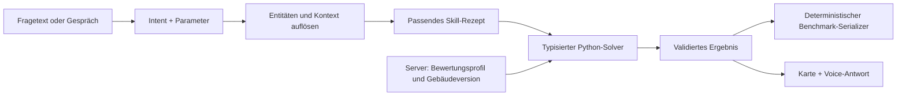

# Recherche: wiederverwendbare Repositories und Agent-Skills

**Stand:** 24.10.2026. **Analysierter Team-Stand:** `3b4e83953a01e640490a6c41954ace13decd2ff5`. Ausgangspunkt ist der [Codex-Review](<../codex reviewed plan suggestions .md>), ergänzt um den neueren [Review der zwei User Experiences](../2026-10-24-plan-review-zwei-ux.md), die [ElevenLabs-Konfiguration](../docs/elevenlabs-agent-config.md), den vollständigen [Fragenkatalog](../docs/question-overview/README.md) und die während der Recherche hinzugekommene [Architekturübersicht](../docs/architecture/README.md).

**Ziel:** konkrete Übernahmen und Skills empfehlen, die im verbleibenden Hackathon-Fenster bis Sonntag 13:00 helfen. Dieser Bericht recherchiert und entwirft; er installiert keine Skills, implementiert keine Produktfunktionen und ändert keine Teamentscheidung. Aufwandsspannen sind Schätzungen für erfahrene Entwickler mit vorhandenen Schnittstellen. Sie sind keine gemessenen Lieferzeiten.

## 1. Empfehlung in fünf Entscheidungen

1. **Den vorhandenen Core und offiziellen Scorer ausbauen.** Keine fremde Indoor-Komplettanwendung integrieren. NetworkX, Shapely, ein kleiner Entitätsresolver und gegebenenfalls extremitypathfinder passen unmittelbar zu den vorhandenen Daten.
2. **Sechs eigene fachliche Skills aus den sechs vorhandenen Frageclustern ableiten.** Öffentliche Skills liefern Bibliothekswissen und Vorgehensweisen; die Synera-Regeln müssen wir ausdrücklich ergänzen. Insbesondere `errand`, gemeinsame Wände und `what_if_door` sind keine allgemeinen „Graphfrage“-Prompts.
3. **Skills als kurze versionierte Anweisungen über getesteten Tools verwenden.** Das LLM wählt Absicht und Parameter; Python berechnet. Für Voice bleiben die kleinen Navigator-/Admin-Tooloberflächen bestehen. Ein neuer universeller Code-Agent oder eine zusätzliche Cloud-Ausführungsumgebung ist dafür nicht nötig.
4. **Für UI und den neuen Kameraumfang kleine Komponenten auswählen:** ElevenLabs-SDK, SVG mit Zoom/Pan, jsQR und QR-Erzeugung. three.js/WebXR ist ein eigener begrenzter Versuch für Android. MindAR ist eine mögliche Alternative für Bildmarker, keine allgemeine Gebäudeortung.
5. **Bildimport als Entwurf mit Kalibrierung und Validierung behandeln.** `svgelements` hilft beim Vektorpfad; Claude Vision kann Rasterentwürfe erzeugen. Der gefundene `floorplan-to-vector`-Skill ist eine interessante Referenz für überprüfte Rekonstruktion, aber kein fertiger automatischer PNG→Synera-Importer.

**Wenn heute nur drei neue Bausteine hinzukommen:** RapidFuzz für robuste Namensauflösung, ein kleiner versionierter Skill-/Intentkatalog und jsQR für den geplanten Startpunkt. Für den geometrischen Router zuerst den bereits erprobten extremitypathfinder-Kandidaten prüfen. Weitere Pakete nur bei einem konkret fehlenden Feature hinzufügen.

## 2. Was aus dem Repo für diese Recherche maßgeblich ist

### Architektur und Prioritäten

- **Railway ist gesetzt:** ein FastAPI-Service für API, React-Build und WebSocket, persistenter Zustand auf Volume; lokaler Benchmark mit demselben Core. Cloudflare-Komponenten aus dem alten `PLAN.md` sind keine Rechercheziele mehr.
- **Codex-Review bleibt die Grundlage für Korrektheit und Aufwand.** Der neuere Team-Review ergänzt Planimport am Laptop, zwei Voice-Rollen und Kamera-/QR-Navigation am Handy. Die Recherche berücksichtigt diese Features, ohne ihre Machbarkeit bereits als bewiesen zu behandeln.
- **Die zwei Distanzverträge bleiben getrennt.** Der veröffentlichte README-Benchmark und die gespeicherte neue Route-Ankündigung sind nicht austauschbar. Kein fremder Router und kein Skill entscheidet automatisch, welcher Vertrag für Sonntag gilt. Siehe [offene Jurorenfragen](<../open questions for judge .md>).
- Im analysierten Checkout existieren weiterhin Starter, Daten, Evaluator und Dokumentation; die geplanten Ordner `core/`, `server/`, `web/` und `bench/` fehlen. Aussagen über Vorarbeit in `../repo` sind kein Nachweis ihrer Integration hier.

### Die vorhandene Clusterung vollständig nutzen

Alle **2.930** Einträge in `questions-clustered.jsonl` wurden maschinell mit ihren originalen JSONL-Objekten über Pfad und Zeile verglichen. Die Objekte stimmen überein; IDs sind eindeutig. Alle 145 Testantworten und versteckten Testparameter bleiben leer. Die neue Recherche verändert den Fragenkatalog nicht.

| Cluster | Enthaltene `kind`-Werte | Gesamt | Train / Dev / Test | Skill-Schwerpunkt |
|---|---|---:|---|---|
| C1 – Finden und Zählen | `locate`, `count` | 792 | 652 / 140 / 0 | Entitäten, vollständige Filterung, Mehrdeutigkeit |
| C2 – Routen | `route`, `route_step_free`, `route_with_closure`, `tour` | 1.338 | 1.109 / 229 / 0 | Gültige Wege, Constraints, vorgeschriebene Stoppreihenfolge |
| C3 – Flächen und Auswahl | `largest_room`, `floor_area_total` | 331 | 226 / 51 / 54 | Polygonflächen, Filter, Maximum und Summe |
| C4 – Eingeschränkte Erreichbarkeit | `wide_delivery_count`, `step_free_reachable_count` | 100 | 62 / 20 / 18 | Ein gefilterter Graph, erreichbare Zielräume zählen |
| C5 – Räumliche Beziehungen | `room_stacked`, `shared_walls_count`, `straight_line_3d` | 249 | 153 / 46 / 50 | Überdeckung, Wandtoleranz und echte Höhen |
| C6 – Zusammengesetzte Aufgaben | `errand`, `what_if_door` | 120 | 76 / 21 / 23 | Reihenfolge fachlicher Schritte, isolierte Simulation |

C3 und C5 decken **104/145 veröffentlichte Testfragen** ab. C1 und C2 sind für die App wesentlich, obwohl sie im veröffentlichten Haupttest nicht vorkommen. Frequenzen sind keine Gewichtung der gesamten Funktionspunkte und keine Vorhersage der Sonntagsfragen. Die 15 vorgeschlagenen Backend-Toolverträge im Fragenkatalog sind Analyse, keine bereits implementierten Tools.

## 3. Repositories: priorisierte Auswahl für die Umsetzung

**Einordnung:** „Übernehmen“ bedeutet Library oder eng begrenztes Beispiel einsetzen. „Versuch“ bedeutet erst an einem repräsentativen Fall abnehmen. Für Lizenzangaben wurden Repository-Metadaten beziehungsweise konkrete Lizenzdateien geprüft; Abhängigkeiten und übernommene Einzeldateien behalten ihre eigenen Bedingungen.

### 3.1 Direkt passende Bausteine

| Rang | Ressource / Lizenz | Konkreter Einsatz bei uns | Aufwand / Entscheidungstest |
|---|---|---|---|
| 1 | [NetworkX](https://github.com/networkx/networkx) + [Shapely](https://github.com/shapely/shapely), jeweils BSD-3-Clause | Vorhandener MultiGraph, Raumflächen, Überdeckungen, Wandbeziehungen und gefilterte Erreichbarkeit. | Schon im Kit. Keine Migration: fachliche Lücken schließen und gegen Dev prüfen. |
| 2 | [RapidFuzz](https://github.com/rapidfuzz/RapidFuzz), MIT | Schreib-/Transkriptionsfehler bei Raum- und Maschinennamen; Kandidaten für Rückfragen. | 45–90 min für Resolver und gezielte Fälle. Exakte IDs und Nummern haben Vorrang. |
| 3 | [ElevenLabs packages](https://github.com/elevenlabs/packages), MIT | `@elevenlabs/react`, WebRTC-Session, Client-Tools, UI-Ereignisse. | Bestehende Konfiguration verwenden; erster Voice→Tool→Karte-Durchlauf etwa 1–2 h, Fehlerfälle zusätzlich. |
| 4 | [react-zoom-pan-pinch](https://github.com/BetterTyped/react-zoom-pan-pinch), MIT | Touch-/Mausnavigation um unser eigenes SVG. | 30–60 min Grundintegration plus Handytest. Keine zweite Routingbibliothek im Frontend. |
| 5 | [extremitypathfinder](https://github.com/jannikmi/extremitypathfinder), MIT | Lokale Tür-zu-Tür-Wege in gültigen Raum-Polygonen; globaler Portalgraph bleibt unser Code. | Max. 60 min Integrationstest; danach grob 2–4 h für einen belastbareren Raumadapter. Gesamtrouter zusätzlich. |
| 6 | [Pydantic](https://github.com/pydantic/pydantic), MIT, und [Anthropic Python SDK](https://github.com/anthropics/anthropic-sdk-python), Apache-2.0 | Typisierte Intent-/Toolparameter und Resultate; Text-/Benchmarkadapter ohne neues Agentframework. | 1–2 h für einen ersten Fragepfad, anschließend je Familie erweitern. Schema allein beweist keine fachlich korrekte Auswahl. |

**RapidFuzz richtig begrenzen:** exakte ID → normalisierter Alias → wenige unscharfe Kandidaten → gegebenenfalls Rückfrage. Eigene Normalisierung ist nötig. Zahlen und Etagen nicht wegfiltern: „Press 4“ und „Press 14“ können textlich ähnlich sein und fachlich verschieden. Zählfragen müssen den vollständigen Assetbestand filtern, nicht eine gekürzte Suchtrefferliste. Die Library ist eine Resolverhilfe, keine räumliche Wissensbasis. [README und Beispiele](https://github.com/rapidfuzz/RapidFuzz#usage).

**extremitypathfinder gezielt einsetzen:** `PolygonEnvironment.store(boundary, holes, validate=True)` und `find_shortest_path(start, goal)` liefern den lokalen Pfad. Der eigene Adapter kümmert sich weiterhin um Ringorientierung, Türanschlüsse nach dem Inset, mehrere Komponenten, Ebenen und Scorerkosten. Zunächst ohne Numba, um zusätzliche native/JIT-Abhängigkeiten zu vermeiden. Der Codex-Review enthält einen bestandenen kleinen synthetischen Versuch; das ist keine Validierung auf allen Synera-Gebäuden oder auf Railway. [Offizielle API](https://extremitypathfinder.readthedocs.io/en/latest/1_usage.html).

**SDK und Schemas:** strukturierte Ausgabe kann JSON-Form und Feldtypen absichern. Falsche Entität, falsches Kostenprofil oder falsche Reihenfolge bleiben trotzdem möglich. Für die kurze Benchmarkpipeline ist ein validierter Intent mit erlaubtem Solver einfacher als allgemeiner vom LLM erzeugter Python-Code. Kompatibilität mit tatsächlich verwendetem Modell/SDK durch einen kleinen echten API-Test prüfen. [Anthropic Structured Outputs](https://platform.claude.com/docs/en/build-with-claude/structured-outputs).

### 3.2 Bausteine für QR und Kamera-Navigation

| Ressource / Lizenz | Was sie tatsächlich liefert | Empfehlung für diesen Hackathon |
|---|---|---|
| [cozmo/jsQR](https://github.com/cozmo/jsQR), Apache-2.0 | QR-Decodierung aus Bildpixeln, inklusive Lage der Code-Ecken im Bild. | **Erste Wahl für den im Teamplan genannten QR-Scanner.** Etwa 1–2 h für Kamera, Auswahl und sauberes Stoppen/Starten. Kein metrisches Tracking. |
| [zxing-js/browser](https://github.com/zxing-js/browser), MIT; zugrunde liegende Pakete gesondert beachten | Browser-/Kamera-Wrapper um Barcode-Decodierung. | Alternative, wenn ein fertiger Scanner-Wrapper schneller passt. Nicht zusätzlich zu einem funktionierenden jsQR-Pfad einführen. |
| [python-qrcode](https://github.com/lincolnloop/python-qrcode), BSD-3-Clause-Text mit zusätzlichen Herkunftshinweisen | QR-Bilder, auch SVG. | Etwa 30–60 min für Marker-IDs und druckbare SVG-/HTML-Blätter. PDF-Erzeugung ist für den ersten Druckpfad nicht erforderlich. |
| [three.js: AR-Hit-Test-Beispiel](https://github.com/mrdoob/three.js/blob/dev/examples/webxr_ar_hittest.html), MIT | WebXR-Session, Referenzraum, Hit-Test und platzierte Geometrie. | **Android-Versuch**, zuerst 60–90 min nur eine korrekt platzierte Linie; Route und Voice erst danach verbinden. |
| [immersive-web/webxr-samples](https://github.com/immersive-web/webxr-samples) | Kleine Referenzbeispiele zu WebXR-Funktionen. | Als Ergänzung zum three.js-Beispiel lesen. Bei Codeübernahme konkrete Datei-/Repositorylizenz prüfen. Kein Indoor-Ortungssystem. |
| [hiukim/mind-ar-js](https://github.com/hiukim/mind-ar-js), MIT | Bildziel- und Gesichtstracking; direkte three.js-Integration ist dokumentiert. | Optionaler **Bildmarker-Versuch** für einen begrenzten Kamerabereich. 1–2 h für ein Target, zusätzliche Kalibrierung/Route unbestimmt. Kein kontinuierliches SLAM. |
| [AR.js](https://github.com/AR-js-org/AR.js), eigener Code MIT, ARToolKit-Abhängigkeit LGPLv3 mit Zusatzbedingungen | Fiducial-/Bildmarker- und ortsbezogene AR-Pfade. | Alternative bei ausdrücklich gewähltem Markertracking. Nicht als rein MIT-lizenzierten Komplettstack behandeln; keine zweite AR-Pipeline parallel bauen. |

**Die zentrale Integrationslücke:** QR-Daten können `building_id`, `marker_id` und damit einen bekannten Planpunkt auflösen. Daraus folgt noch keine bekannte Kameratranslation und -rotation im Gebäude. Wer einen Meter vor einem Wandmarker steht, befindet sich nicht am Markerpunkt. Der Start einer WebXR-Session setzt den Ursprung auch nicht automatisch auf die zuvor gescannte Markerebene. Das ist eine geometrische Ableitung aus dem [WebXR-Referenzraummodell](https://www.w3.org/TR/webxr/), keine dokumentierte Eigenschaft eines QR-Decoders.

Für eine metrisch verankerte Bodenroute braucht ihr entweder gemessene Markerpose plus bekannte Markergröße/Ausrichtung oder eine ausdrücklich angeleitete manuelle Kalibrierung von Standort, Blickrichtung und Boden. Ein Hit-Test findet eine Fläche; er identifiziert nicht von selbst deren Gebäude-Koordinaten. Bei Wechsel zwischen QR-Stream und WebXR muss die Registrierung nachweislich erhalten beziehungsweise neu hergestellt werden. MindAR/AR.js halten einen Markerbezug, solange Tracking funktioniert; daraus folgt keine dauerhafte Ortung um die nächste Ecke.

**Browserentscheidung:** Die geprüften [Mozilla-Kompatibilitätsdaten für XRSystem](https://github.com/mdn/browser-compat-data/blob/main/api/XRSystem.json) führen Safari/iOS ohne Unterstützung und Chrome mit Unterstützung auf; konkrete AR-Funktionen bleiben geräteabhängig. `isSessionSupported('immersive-ar')` auf dem echten Gerät prüfen. Für [BarcodeDetector](https://github.com/mdn/browser-compat-data/blob/main/api/BarcodeDetector.json) steht Safari-Unterstützung hinter einer Einstellung. Deshalb JS-QR-Decoder und 2D-/Manöverfallback beibehalten. Ein Polyfill ersetzt keine fehlende native Positionsverfolgung.

**Abnahme vor einer Demo-Zusage:** beide realen Handys, Kamera und ElevenLabs-Audio gleichzeitig, Marker erneut erkennen, Kameraverlust, Bildschirmdrehung und Sperrung während der Navigation. Eine Linie am Boden muss nach wenigen Metern und nach einer Drehung weiterhin am richtigen Ort liegen. Wurde nur ein Richtungspfeil ohne kontinuierliche Positionierung umgesetzt, genau diese Funktion benennen.

### 3.3 Planimport und Bearbeitung

| Ressource / Lizenz | Nutzen | Grenze / sinnvoller Versuch |
|---|---|---|
| [meerk40t/svgelements](https://github.com/meerk40t/svgelements), MIT | SVG-Pfade, Gruppen-/Viewporttransformationen und Formen lesen. | 1–2 h auf einem Kit-SVG prüfen. Semantische Raumzuordnung, Türen und Metermaßstab liefert ein Parser nicht automatisch. |
| [Anthropic Vision](https://platform.claude.com/docs/en/build-with-claude/vision) + typisierte Ausgabe | Rasterplan als Eingabe für einen Gebäudeentwurf. | Den dreistündigen Teamversuch mit kleinem Ausschnitt und wenigen Räumen durchführen. Erkanntes Ergebnis gegen Bild und Validator prüfen. |
| [YImingZHANG615/floorplan-to-vector](https://github.com/YImingZHANG615/floorplan-to-vector), MIT für Projekt, Skill und synthetische Beispiele | Vorhandener Skill samt Python-Code für Wandbaselines, Türen, Maßstab und Overlay-Prüfung. | Als Vorgehens-/Code-Referenz für Importkorrektur prüfen; eigenes Format und weitere native Pakete. Kein direkt verwendbarer Synera-Importer. |

**SVG:** Die Kit-SVGs sind Darstellungen, keine garantierten semantischen Gebäudefiles. Ein Parser kann transformierte Umrisse retten, aber Text als Font-Glyphen ist nicht automatisch ein Raumlabel. Zuerst einen Floor rekonstruieren und mit dem vorhandenen JSON vergleichen; nicht den Erfolg auf einem Matplotlib-Export als universellen Fotoimport ausgeben. Bei vorhandenem `building.json` bleibt dieses der direkte Datenpfad.

**Raster:** Pixelkoordinaten zunächst als solche bewahren, dann zwei Bildpunkte und eine bestätigte reale Länge zur Kalibrierung nutzen. Nach einer Skalierung ändern sich Flächen quadratisch. Perspektivisch fotografierte Fluchtpläne zuerst entzerren oder als unsicheren Entwurf behandeln. Korrekte JSON-Syntax genügt nicht: Referenzen, Polygonvalidität, Türverbindungen und fehlende Strukturen müssen separat geprüft werden. Kein Maßstab aus einer vermeintlichen Standardtür ableiten, wenn keine solche Annahme bestätigt wurde.

**Bearbeitung:** Für Vorschau/Commit/Undo braucht ihr keine fremde Gesamteditoranwendung. Die bereits geplanten Serverversionen und kleinen Änderungen an Kit-Objekten sind der passendere Vertrag. Ein optionaler Zeicheneditor ist ein eigener Scope, kein automatisch durch `svgelements` gelöstes Feature.

### 3.4 Bewusst nicht neu integrieren

- **c3nav / NavigaTUM / vollständige Wayfinder-Apps:** hilfreiche Architektur-/UX-Referenzen, aber eigene Datenmodelle und Anwendungsschichten. Die Codex-Recherche beschreibt ihre Grenzen bereits. Ein bestehendes Indoor-System spart den Synera-Adapter und dessen Scorerregeln nicht.
- **BIM-/IFC-Viewer, Open-RMF, SLAM/VPS und Gaussian Splatting:** lösen andere Eingabe-/Lokalisierungsprobleme oder verlangen eine neue Datenaufnahme. Für den aktuellen Lieferpfad zurückstellen.
- **Vektor-RAG als Rechenersatz:** kann später bei unstrukturierten Handbüchern helfen. Für exakte Flächen, Türbreiten, Erreichbarkeit und stabile IDs ist der strukturierte Core der direkte Weg.
- **Ein zusätzliches Agentframework, ein zweiter Graphserver oder native Mobile-Apps:** erst bei einer konkret belegten Lücke. Die Kombination aus FastAPI, Anthropic-SDK und ElevenLabs-SDK reicht für die recherchierten Wege.
- **Große Skill-Sammlungen pauschal installieren:** viele Trigger, fremde Runtime-Annahmen und unnötige Anweisungen. Einzelne geprüfte Referenzen gezielt adaptieren.

## 4. Welche öffentlichen Skills tatsächlich helfen

Ein Agent Skill ist ein versionierter Ordner mit `SKILL.md`, optionalen Referenzen und Skripten. Er bündelt ein Vorgehen; eine Toolfunktion führt eine konkrete Operation aus. Ein Skill ist weder ein trainiertes Spezialmodell noch eine Garantie für korrekte Geometrie. Der [offene Standard](https://agentskills.io/specification) beschreibt diese Struktur und bedarfsweises Laden. Das [Integrationshandbuch](https://agentskills.io/client-implementation/adding-skills-support) zeigt, dass die Anwendung Katalog, Aktivierung und Zugriff selbst bereitstellen muss.

Die folgenden Dateien wurden als Recherchematerial gelesen. Ihre Anweisungen wurden nicht als neue Regeln für diesen Arbeitsauftrag übernommen.

| Priorität | Konkrete Skill-Quelle | Eignung für uns | Anpassung / Urteil |
|---|---|---|---|
| 1 | [K-Dense: NetworkX](https://github.com/K-Dense-AI/scientific-agent-skills/blob/593377bb048752abb0152deab9fbb1083a6087df/skills/networkx/SKILL.md) | Grapharten, gewichtete kürzeste Wege, Konnektivität und API-Muster. | Gute Referenz für C2/C4/C6 und Entwickler. Auf MultiGraph, Portale und unsere Kostenprofile kürzen; keine Zentralitäts-/Plottingkapitel in den Voiceprompt. |
| 2 | [OpenGIS: Shapely](https://github.com/znlgis/opengis-skills/blob/4b64b890758af0c0abfaf853f0d5a1f6b287a1df/gis/shapely/SKILL.md) | Polygonoperationen, Grenzfälle, Validierung und räumlicher Index. | Für C3/C5/Import als Wissensquelle adaptieren. Lokale Meter und getrennte Etagen explizit machen; Beispiele gegen die installierte API prüfen. |
| 3 | [floorplan-to-vector](https://github.com/YImingZHANG615/floorplan-to-vector/blob/f95414019163740b8054aa9214ade7abcc6b2eb0/SKILL.md) | Kalibrierung, Wand-/Türrekonstruktion und visuelle Überprüfung. | Hilfreich für Admin-/Importworkflow. Kein Ersatz für Vision-Erkennung, Raumsemantik oder Synera-Graph. |
| 4 | [Anthropic skill-creator](https://github.com/anthropics/skills/blob/dbd4588f9e1033efb41dad4bef2f7947c8993d44/skills/skill-creator/SKILL.md) | Verfahren zum Entwerfen und Vergleichen eigener Skills. | Für die Entwicklung der sechs Skills und kleine Vergleichsläufe nutzen; nicht in den Navigator-Agent laden. Apache-2.0 im zugehörigen Lizenztext. |
| 5 | [Anthropic webapp-testing](https://github.com/anthropics/skills/blob/dbd4588f9e1033efb41dad4bef2f7947c8993d44/skills/webapp-testing/SKILL.md) | Playwright-basierte Prüfung von UI-Abläufen und Serverstart. | Entwicklungswerkzeug für Preview/Commit/Undo/Reconnect. Reale Kamera-, Mikrofon- und XR-Tests ersetzt es nicht. Apache-2.0 im zugehörigen Lizenztext. |
| 6 | [K-Dense: GeoPandas](https://github.com/K-Dense-AI/scientific-agent-skills/blob/593377bb048752abb0152deab9fbb1083a6087df/skills/geopandas/SKILL.md) | Einheiten, Geometrie-/Join-Prüfung, Exportkontrolle. | Einzelne Prüfideen hilfreich; vollständiger GeoPandas/GDAL/PROJ-Stack für lokale Kit-Polygone unnötig. Nicht künstlich ein geografisches CRS für das Kit erfinden. |

**Lizenzdetails der Skills:** K-Dense hat einen MIT-Repositorytext; der geprüfte NetworkX-Skill deklariert selbst eine 3-Clause-BSD-Lizenz, GeoPandas MIT. Diese konkreten Angaben bei Übernahme dokumentieren, statt die gesamte Sammlung pauschal als einheitlich lizenziert zu behandeln. OpenGIS hat einen MIT-Repositorytext; die dort genannte Shapely-Library ist separat BSD-3-Clause. Bei Anthropic sind nicht alle Skills offen lizenziert: Das Repository bezeichnet die Dokument-Skills ausdrücklich als source-available. Für unsere zwei Empfehlungen wurden die jeweiligen Apache-2.0-Dateien geprüft. [K-Dense-Lizenz](https://github.com/K-Dense-AI/scientific-agent-skills/blob/593377bb048752abb0152deab9fbb1083a6087df/LICENSE.md), [Anthropic README](https://github.com/anthropics/skills#about-this-repository).

### Der spezifische Plan-Skill: brauchbar, aber kein Erkennungsmodell

`floorplan-to-vector` verlangt entweder eine geprüfte semantische Maske oder überprüfte Wandbaselines/Geometriehinweise. Es exportiert unter anderem DXF und SVG, nicht unser Raum-/Öffnungsmodell. Das Projekt erklärt selbst, kein universeller automatischer Fotoerkenner zu sein. Daraus ergibt sich sein sinnvoller Einsatz: Kalibrierungs-/Overlayverfahren lesen, gegebenenfalls kleine Geometriehelfer prüfen, aber keinen kompletten CAD-Exportstack in die App übernehmen. Die im Repo dokumentierten Tests sind überwiegend synthetisch; hier wurde das Paket nicht ausgeführt. [README](https://github.com/YImingZHANG615/floorplan-to-vector/blob/f95414019163740b8054aa9214ade7abcc6b2eb0/README.md).

### Keine gefundene Datei ersetzt die sechs Challenge-Skills

In der geprüften Auswahl wurde kein fertiges Paket verifiziert, das unsere neun Benchmarkarten mit dem Synera-Schema, den exakten Toleranzen und beiden Routingprofilen abdeckt. Das ist eine Grenze dieser Recherche, keine Behauptung über sämtliche öffentlichen Repositories. Die bessere Wiederverwendung ist: Bibliothekswissen übernehmen, den kleinen domänenspezifischen Ablauf selbst formulieren und mit den vorhandenen Labels testen.

## 5. Konkreter Skill-Katalog für die sechs Fragecluster

Die folgenden Namen und Funktionssignaturen sind **Vorschläge für interne Adapter**, kein neuer verbindlicher Client-Toolvertrag. Die IDs T02–T14 beziehen sich auf die vorhandene Analyse im Fragenkatalog. Die Navigator-/Admin-Namen aus `docs/elevenlabs-agent-config.md` bleiben die äußere Voice-Schnittstelle.

### S1 – `building-entities` für C1

**Trigger:** „where is“, „find“, „how many“, Objektname, Raumreferenz. **Daten:** Asset- und Raumindizes, Etagen, stabile IDs. **Verknüpfung:** T02/T03.

1. Gebäudekontext und Etage auflösen. Exakte IDs/Refs vor Fuzzy-Suche verwenden.
2. Bei Locate den tatsächlichen Assetdatensatz mit enthaltendem Raum und Etage zurückgeben. Bei mehreren plausiblen Treffern im Gespräch eine Rückfrage stellen.
3. Bei Count den gesamten passenden Bestand filtern und eindeutige Asset-IDs zählen; kein Zählen der gekürzten UI-Treffer.

**Effizienz:** normalisierte Indizes und kleine Kandidatenlisten. **Abnahme:** „Press 4“/„Press 14“, gleichnamige Assets auf verschiedenen Etagen, kein Treffer, viele Treffer und Typzählung. Eine fehlende Entität erzeugt kein erfundenes Objekt.

### S2 – `building-routes` für C2

**Trigger:** A→B, „without stairs“, Sperrung, „visit … then …“. **Daten:** Räume, Öffnungen, vertikale Verbinder, aktueller Zustand. **Verknüpfung:** T02/T05/T12/T13.

1. Start und Ziel stabil auflösen; Start aus der tatsächlichen Sitzung, wenn die App ihn kennt. Fehlenden Start im Gespräch erfragen.
2. Bewertungsprofil wird vom Laufkontext gesetzt. Step-free, Breite und Sperrungen normalisieren, dann den passenden Graphen filtern.
3. Bei Tour vorgeschriebene Stoppreihenfolge beibehalten und aufeinanderfolgende Legs verbinden. Kein TSP lösen, wenn die Reihenfolge feststeht.
4. Route mit benutzten Portalen, Geometrie je Etage und Version zurückgeben; bei fehlendem Pfad ausdrücklich unerreichbar melden.

**Effizienz:** gecachter Gebäudegraph und ausgewählte Raumgeometrie. **Abnahme:** paralleler Lift/Treppe, gesperrter Lift, mehrere Türen zwischen Räumen und unerreichbares Ziel. Raumfolge, konkrete Türwahl und gezeichnete Linie müssen dieselbe Lösung beschreiben.

### S3 – `building-areas` für C3

**Trigger:** „largest“, „total floor area“, Raumtyp und Geschoss. **Daten:** metrische Polygone, Raumtypen, Floors. **Verknüpfung:** T02/T04/T14.

1. Raumtyp und Etage auflösen; nur die vollständige passende Raumgruppe betrachten.
2. Polygonfläche im Core berechnen. Bei `largest_room` das Maximum wählen; bei `floor_area_total` alle Flächen summieren, erst am Schluss runden.
3. Größter Raum: akzeptiertes Label plus Fläche. Numerische Summe: genau ein Zahlenwert in der finalen `Answer:`-Zeile.

**Effizienz:** Fläche pro unverändertem Polygon vorberechnen. **Abnahme:** größte Bounding Box ist nicht zwingend größte Polygonfläche, keine Treffer, mehrere ähnliche Raumtypen. **Scorerfalle:** Bei rein numerischer Antwort kein `m²` anhängen, weil der aktuelle Scorer die `2` als weitere Zahl parst. Beim speziellen `largest_room`-Vertrag gelten andere Formatregeln.

### S4 – `building-reachability` für C4

**Trigger:** „into how many rooms“, Rollstuhl, breite Last, geschlossener Lift. **Daten:** `step_free`, Öffnungsbreiten, Sperrungen, Raumtyp und Zielgeschoss. **Verknüpfung:** T02/T05/T06/T14.

1. Start, Zielgeschoss, Mindestbreite und temporäre Schließung bestimmen.
2. Alle unzulässigen Übergänge vor der Traversierung entfernen. Breite `>=` Mindestbreite, nicht `>`.
3. Einmal die erreichbare Menge bestimmen, dann nur `type=room` auf dem verlangten Geschoss zählen.

**Effizienz:** eine Traversierung statt einer eigenen Route zu jedem Raum. **Abnahme:** exakt passende Türbreite, Treppe plus Lift als Parallelverbindung, nicht stufenloser Eingang, erreichbarer Korridor ohne Zielraum. Ein Trolley ist kein Gabelstapler; unbestätigte Fahrgassenklassen werden nicht aus Türbreite geraten.

### S5 – `building-spatial-relations` für C5

**Trigger:** „above/below“, „share a wall“, „straight-line 3D“. **Daten:** Polygone, Etagenfolge, `elevation_m`. **Verknüpfung:** T02/T04/T08/T09/T10/T14.

**Drei ausdrücklich getrennte Verfahren:**

- `room_stacked`: nächste relevante Etage bestimmen, maximale Polygonüberdeckung vergleichen; gleiche Raumnummern oder nächste Schwerpunkte reichen nicht. Gemeinsames XY-System prüfen.
- `shared_walls_count`: gleiche Etage und zählbare Räume, mindestens 1 m Wandverlauf innerhalb 0,35 m Toleranz. Keine Tür voraussetzen und Eckkontakt nicht als gemeinsame Wand zählen.
- `straight_line_3d`: Polygon-`centroid` und reale Etagenhöhe verwenden, dann 3D-Euklidik; keine Routinganker und keine feste Geschosshöhe.

**Effizienz:** Index pro Etage und danach präzise Geometrie. Ein STRtree filtert Kandidaten, beweist aber selbst keine Wandbeziehung und berücksichtigt Z nicht. **Abnahme:** dicker Spalt zwischen Wänden, nur Ecke, mehrere Überlappungskandidaten, unterschiedliche Etagenhöhen. [Shapely STRtree](https://shapely.readthedocs.io/en/stable/strtree.html).

### S6 – `building-scenarios` für C6

**Trigger:** kombinierte Abhol-/Lieferaufgabe oder hypothetische neue Tür. **Verknüpfung:** T02/T03/T04/T05/T07/T11/T14. Dieses Skill braucht zwei klar getrennte Rezepte:

**Errand:** Erst vom Start das nächstgelegene passende Asset-Zimmer nach dem geltenden Routingmodell auswählen. Unabhängig den größten gefragten Zielraum bestimmen. Danach Start→Pickup und Pickup→Ziel addieren. Nicht eine andere Abholstelle wählen, nur weil die Gesamttour dadurch kürzer wäre.

**What-if door:** Ausgangszustand festhalten; Distanzen zu den Ausgängen berechnen. Auf isoliertem Overlay/Kopie die Tür in der Mitte der gemeinsamen Wand einsetzen. Neu berechnen und auf dem gefragten Zielgeschoss nur Verbesserungen **größer als 1 m** zählen. Keinen Commit auslösen.

**Effizienz:** ein Single-Source-Lauf für Pickup-Kandidaten; für viele Distanzen zum nächsten Ausgang bei geeignetem Graphmodell ein gemeinsamer Distanzlauf statt N Einzelrouten. Gerichtete Modelle benötigen die passende Rückwärtsrichtung. Der genaue Vertrag bleibt unser Code; [NetworkX Multi-Source-Dijkstra](https://networkx.org/documentation/stable/reference/algorithms/generated/networkx.algorithms.shortest_paths.weighted.multi_source_dijkstra.html) ist der Algorithmusbaustein.

**Abnahme:** nächster Pickup ergibt nicht die kürzeste Gesamttour; Tür am Eckpunkt statt Wandmitte; Verbesserung exakt 1 m; wiederholte Frage ohne Zustandsänderung; anderes Routingprofil.

### Zwei zusätzliche App-Skills

| Skill | Rolle / Ablauf | Pflichtgrenze |
|---|---|---|
| `building-import` | Admin: Inputformat erkennen → Entwurf erzeugen → Maßstab klären → validieren → Overlay → Korrektur → bestätigen. | Ein Bild, Parser oder Visionmodell darf keine ungeprüften Meterwerte als bestätigt ausgeben. B1-JSON-Import und B2-Fotoimport bleiben unterscheidbar. |
| `building-edits` | Admin: `propose_edit` → Wirkung erklären → ausdrückliche Bestätigung → `commit_edit`; Undo als geprüftes Folgeereignis. | Preview/What-if schreiben nichts dauerhaft; Server prüft Sitzung, Version und Idempotenz. Skilltext allein erzwingt diese Garantien nicht. |

Turn-by-Turn, QR-Status und sichtbare Kartenreaktion gehören in die Navigator-Policy und `next_step`, nicht in einen neuen allgemeinen Geometrie-Agenten. Landmarken müssen aus tatsächlichen Daten kommen; ein bloßer Anzeigenname beweist keine Sichtbarkeit entlang des Weges.

## 6. Wie die Skills mit unserem Stack arbeiten können

### Empfohlener minimaler Laufweg



**Benchmark:** Der vorhandene Evaluator übergibt Gebäudepfad und Fragetext, nicht Gold-`inputs`. Ein kurzer Router kann Intent/Parameter als Schema extrahieren; ein Resolver bindet Namen an vorhandene IDs. Der ausgewählte Solver rechnet. Falls der ausgewählte Weg unklar ist, eine begrenzte Reparatur mit konkretem Validierungsfehler versuchen. Danach einen nachvollziehbaren Fehler protokollieren, keine beliebige Antwort erfinden.

**Voice:** Navigator und Admin haben bereits getrennte kleine Toolmengen. Die passenden kurzen Regeln werden bei der Agentkonfiguration zusammengestellt. Client-Handler rufen die Railway-API auf und aktualisieren die Darstellung. Auf Antworten warten und tatsächliche Fehler zurückgeben. Das SDK-/Toolsetup ist hier die etablierte Plattformintegration, kein automatisch vorhandener Zugriff auf lokale Skill-Dateien. [ElevenLabs Client Tools](https://elevenlabs.io/docs/eleven-agents/customization/tools/client-tools).

### Drei Varianten der Skill-Laufzeit

| Variante | Was wir bauen müssten | Urteil |
|---|---|---|
| **A – Kleine Rezepte beim Build in Rollen-/Intentprompts übernehmen** | Markdownversionen im Repo; gezielt benötigte Regeln für Navigator, Admin und Benchmark zusammenstellen. | **Empfehlung für jetzt.** Am wenigsten zusätzliche Laufzeitlogik; keine Behauptung automatischer Skill-Erkennung. |
| **B – Eigener Skill-Katalog im Text-/Benchmarkagenten** | Katalog laden, nur passende Inhalte aktivieren, erlaubte Tools und Kontext getrennt durchsetzen. | Sinnvoll bei wachsender Vielfalt. Kleiner Loader genügt; sechs Skills benötigen keine Suchplattform. |
| **C – Native Claude-API-Skills im Code-Execution-Container** | Skills hochladen/versionieren, Code-Execution-Integration und Eingangsdaten bereitstellen. | Für diesen Pfad **nicht priorisieren**: laut Dokumentation isolierter Container ohne Netz und ohne Paketinstallation zur Laufzeit. Das ist nicht unser Railway-Core und nicht automatisch der ElevenLabs-Agent. |

Die native Claude-Integration läuft über Code Execution und `container.skills`; bloß ein `skills/`-Verzeichnis anzulegen aktiviert sie nicht. Die Unterschiede sind in der [offiziellen API-Anleitung](https://platform.claude.com/docs/en/build-with-claude/skills-guide) dokumentiert. Für uns wäre ein neues zweites Ausführungsumfeld zusätzliche Integrationsarbeit, ohne den gemeinsamen Core zu ersetzen.

### Vorgeschlagene Ablage für spätere Umsetzung

```text
agent_skills/
  building-entities/SKILL.md
  building-routes/SKILL.md
  building-areas/SKILL.md
  building-reachability/SKILL.md
  building-spatial-relations/SKILL.md
  building-scenarios/SKILL.md
  building-import/SKILL.md
  building-edits/SKILL.md
  references/
    schema.md
    evaluation-profiles.md
    serialization.md
```

Diese Struktur ist ein Entwurf, **hier nicht angelegt**. Pro Skill etwa ein kurzer Ablauf, eindeutige Trigger, verbotene Verwechslungen und kleine Beispiele; gemeinsame Verträge einmal referenzieren. Als Startvorlage genügt:

```yaml
---
name: building-areas
description: Resolve a requested floor and room type, then obtain a largest-room or total-area result from the validated building core. Use for area questions; do not estimate geometry from labels or furniture.
metadata:
  version: "0.1"
---
```

Ein eigener Skill braucht keine Kopie der Core-Implementierung. Im Skriptverzeichnis höchstens einen dünnen Aufruf des gemeinsamen Solvers ablegen, damit API, Skill und Benchmark nicht auseinanderlaufen. `allowed-tools` im Format ist eine Beschreibung mit implementationsabhängiger Unterstützung; Berechtigungen bleiben vom Server durchzusetzen.

### Regeln, die immer gelten müssen

- **Laufkontext:** Daten-Hash, Gebäudeversion und serverseitig ausgewähltes Bewertungsprofil mitführen. Skillversion ist nicht Scorerversion.
- **Sitzung:** Nutzerstandort, Profil und bestätigter Gebäudestand werden nicht aus alten Modellantworten rekonstruiert.
- **Betriebsmodus:** Im Gespräch kann der Agent nachfragen; ein Headless-Benchmark benötigt eine dokumentierte Fehlerbehandlung ohne menschlichen Zwischenschritt.
- **Ergebnis:** Antworten aus typisierten Resultaten serialisieren; Rohzahlen nicht vom LLM nachrechnen lassen. Bei rein numerischem Benchmark genau eine Zahl nach `Answer:`.
- **Referenzdaten:** Fragecluster, Goldantworten und `source_inputs` sind Entwicklungsmaterial. Der Produktagent bekommt keine lesende Goldantwortensuche; Betrieb und Evaluation müssen getrennte Datenpfade haben.
- **Änderungen:** Schreibwerkzeuge nur im Adminpfad und nach Serverprüfung. What-if und unabhängige Benchmarkfragen haben isolierten Zustand.
- **Importdaten:** Text im Planbild, Raumname oder QR-Payload ist Dateninhalt und keine neue Agentanweisung. QR-IDs gegen den Gebäudekatalog validieren; nicht beliebige Payloads ausführen.

## 7. Evaluation: herausfinden, ob Skills tatsächlich helfen

Die Vergleichsfrage lautet nicht „klingt die Antwort besser?“, sondern „werden Intent, Parameter, Entität, Berechnung und Ausgabe zuverlässiger und mit weniger Aufwand erzeugt?“ Der vorhandene Fragenkatalog und Scorer liefern dafür bereits den größten Teil der Infrastruktur.

### Zwei Prüfungen getrennt durchführen

1. **Core-Prüfung mit bekannten Parametern:** erwartetes Ergebnis und Randfälle je Solver prüfen. Das sagt nichts über das Verständnis freier Fragen aus.
2. **Ende-zu-Ende-Prüfung:** ursprünglicher Fragetext → Intent/Resolver/Skill → Core → Serializer. Goldparameter und Referenzantworten nur im nachgeschalteten Vergleich verwenden.

**Vergleich:** identisches Modell, gleicher Gebäudestand, gleiches Scoringprofil. Ausgangsagent versus kurze Skill-Rezepte. Zuerst etwa 20–30 bewusst ausgewählte Fragen über alle sechs Cluster, danach die vollständigen 138 Benchmark-Dev-Fragen. Die 369 Dev-Warm-ups separat für Locate-/Routinginteraktion testen; nicht mit dem eigentlichen Benchmarkscore vermischen. Wer anhand von Dev optimiert, sollte zusätzlich einige neue Paraphrasen und ungewohnte Gebäude als Kontrollfälle verwenden.

| Messgröße | Wofür sie hilft |
|---|---|
| Offizieller Score je `kind` | Endgültige Korrektheit unter dem gewählten veröffentlichten Vertrag. |
| Intent-/Parameterfehler | Erkennt falsche Skillwahl und fehlende Angaben. |
| Entitätsfehler | Trennt Namensauflösung von Rechenproblemen. |
| Core-/Profilfehler | Erkennt falsche Geometrie, Constraints oder Kostenmodelle. |
| Serializerfehler | Erkennt falsche IDs/Labels, Einheiten oder zusätzliche Zahlen. |
| Toolaufrufe und Token pro Frage | Misst, ob Skillrezepte den Ablauf kürzer machen. |
| Median und p95-Latenz, Retries | Zeigt typische und langsame Abläufe; Durchschnitt allein verdeckt Ausreißer. |
| Unerwünschte Zustandsänderung | Für What-if und Bestätigungstests muss der Wert null sein. |

### Kleine Abnahmefälle, die die Skills unterscheiden

| Fall | Was ein passender Skill verhindern muss |
|---|---|
| Mehr als zehn passende Stühle | UI-Suchlimit darf den Count nicht begrenzen. |
| „Ohne Treppen“, Eingang selbst hat Stufen | Nicht nur den Treppenconnector filtern. |
| „Visit A then B“ | Stopps nicht in eine vermeintlich bessere Reihenfolge bringen. |
| Größte Fläche in konkavem Raum | Nicht Bounding-Box-Fläche verwenden. |
| Raum direkt oben, anderer Raumname | Überdeckung statt Name oder Schwerpunktnähe. |
| Gemeinsame Wand ohne Tür | Türnachbarschaft ist kein Wandkriterium. |
| Nächster Pickup ergibt längere Gesamttour | Trotzdem die fachlich verlangte Pickup-Auswahl beibehalten. |
| Verbesserung exakt 1 m | Nicht als „größer als 1 m“ zählen. |
| Doppelte Bestätigung / verspätetes Ergebnis | Ein Commit, aktuelle Gebäudeversion bleibt maßgeblich. |
| Kein passender Skill / unklare neue Frage | Begrenzte Klärung oder protokollierter Fehler, kein beliebiger Solver. |

Keine Einsparung oder Genauigkeitssteigerung durch die vorgeschlagenen Skills wurde in diesem Recherchelauf gemessen. Öffentliche Skillbewertungen und Repository-Sterne ersetzen den beschriebenen Vergleich nicht.

## 8. Was sich im verbleibenden Zeitfenster lohnt

| Reihenfolge | Begrenztes Arbeitspaket | Geschätzter Einsatz | Abnahmepunkt |
|---|---|---|---|
| 1 | Gemeinsame Profil-/Serializerregeln und zwei prioritäre Skills C3/C5 | 1–2 h zusätzlich zu existierenden Core-Funktionen; deren fehlende Implementierung kommt hinzu | Typisierte Ergebnisse aus freien Dev-Fragen; akzeptierte Antwortzeilen. |
| 2 | C4/C6 als explizite Rezepte und Resolver | 2–4 h zusätzlich zu funktionierenden Graphprimitiven | Breite/Erreichbarkeit und beide zusammengesetzten Aufgaben korrekt. |
| Parallel | C1/C2 als Navigatorregeln mit tatsächlichem Sessionkontext | 1–2 h auf vorhandenem Such-/Routingpfad | Find → Route → nächster Schritt; mehrdeutige Entität erzeugt Rückfrage. |
| Parallel | QR-/Druckpfad mit jsQR und python-qrcode | 1–2 h plus Markerplatzierung | Beide Geräte lösen echte Marker auf den richtigen Planpunkt auf. |
| Danach | Ein ausgewählter Kameraansatz | Erst 60–90 min Machbarkeitsgate, Produktintegration danach separat | Kalibrierte Lage, Drehung und Voice auf echtem Gerät; sonst 2D-/Manöverpfad. |
| Danach | B2-Import mit Vision oder gezielter Vektorquelle | Bereits im Teamplan: max. 3 h Versuch | Kleiner neuer Plan, bestätigter Maßstab, plausibler Graph, Overlay und Korrektur. |

**Nicht alle Spannen addieren und als sichere Lieferzusage lesen:** Einige Pakete können parallel laufen, andere hängen am noch fehlenden Core. Eine komplette neue Skills-Laufzeit, zwei AR-Stacks und ein allgemeiner CAD-Importer gleichzeitig würden die Vereinfachung aus dem Codex-Review wieder aufheben.

## 9. Quellenstand, Wiederverwendung und Grenzen

### Interne Grundlage

- [Codex-Review](<../codex reviewed plan suggestions .md>): Architekturvereinfachung, Scoringprofile, konkreter Geometrieversuch und Prioritäten.
- [Aktueller UX-Review](../2026-10-24-plan-review-zwei-ux.md), [Voice-Konfiguration](../docs/elevenlabs-agent-config.md) und [Architekturübersicht](../docs/architecture/README.md): neuer Kamera-/Importumfang, Rollen und WebRTC-Pfad. Die aktuelle Grafik wurde ebenfalls angesehen; sie stellt geplante Integration dar, keine bereits getestete Ortung.
- [Fragenübersicht](../docs/question-overview/README.md) und [vollständige Clusterdatei](../docs/question-overview/questions-clustered.jsonl): Taxonomie und vorhandene Toolzuordnung.
- [README](../README.md), [Starter-Core](../starter_agent/building_map.py), [Tools](../starter_agent/tools.py), [Evaluator](../benchmark/evaluate.py), [Scorer](../benchmark/score.py): tatsächlicher Daten-/Ausführungsvertrag.
- Gesprächsquellen: [Teamzusammenfassung](../2026-10-24-brainstorming-zusammenfassung.md), [Volltranskript](../docs/brainstorming/2026-10-24-transkript.md), [weitere Aufnahmen](../2026-10-24-weitere-aufnahmen-relevante-infos.md), [Lead-Q&A](../2026-10-24-challenge-lead-qa.md), [Route-Ankündigung](../2026-10-24-route-scoring-specifications.md), [Jurorenfragen](<../open questions for judge .md>). Die früher geprüften PDFs werden über die Review-/Quelldokumente berücksichtigt; neue Portal-/Discordnachrichten wurden hier nicht abgerufen.

### Nachprüfbare externe Snapshots ausgewählter Kandidaten

Die folgenden Default-Branch-Commits wurden über GitHub gelesen. Das sind Recherche-Snapshots, **keine pauschale Empfehlung, einen Entwicklungstip statt einer geprüften Paketversion zu installieren**.

| Projekt | Gelesener Stand |
|---|---|
| K-Dense Scientific Agent Skills | [`593377b`](https://github.com/K-Dense-AI/scientific-agent-skills/tree/593377bb048752abb0152deab9fbb1083a6087df) |
| OpenGIS Skills | [`4b64b89`](https://github.com/znlgis/opengis-skills/tree/4b64b890758af0c0abfaf853f0d5a1f6b287a1df) |
| Anthropic Skills | [`dbd4588`](https://github.com/anthropics/skills/tree/dbd4588f9e1033efb41dad4bef2f7947c8993d44) |
| floorplan-to-vector | [`f954140`](https://github.com/YImingZHANG615/floorplan-to-vector/tree/f95414019163740b8054aa9214ade7abcc6b2eb0), Default-Branch `codex/initial-release` |
| extremitypathfinder | [`ad9a4d1`](https://github.com/jannikmi/extremitypathfinder/tree/ad9a4d15a69d9c4dcbe576de58c4f6efad18ef02) |
| ElevenLabs packages | [`93991e2`](https://github.com/elevenlabs/packages/tree/93991e27a52bcd241c5d2fcb0cb4f23e4c24c2d0) |
| jsQR | [`8e6a036`](https://github.com/cozmo/jsQR/tree/8e6a036beafa7053dd44b1b76ac578d22b1b3311) |
| three.js | [`5e6eee6`](https://github.com/mrdoob/three.js/tree/5e6eee6ce8757abde7105aba35a358feac986e91) |
| svgelements | [`9794fc9`](https://github.com/meerk40t/svgelements/tree/9794fc91501fbf51ac7494ff7b8364ece402fe39) |
| RapidFuzz | [`0932842`](https://github.com/rapidfuzz/RapidFuzz/tree/09328422916b13181238660cd3b23a71905d1ec9) |

**Prüftiefe:** Repository-Fit, relevante READMEs/APIs, konkrete Skilldateien und Lizenzangaben wurden gelesen. Die 2.930 Clusterobjekte wurden gegen die Originale abgeglichen; Gebäudebestand und Benchmarkverteilungen wurden erneut gezählt. Die allgemeine Repo-/Transkriptanalyse baut auf der in diesem Chat bereits erfolgten vollständigen Quellenprüfung auf. Nicht jede Planbilddatei wurde visuell untersucht. Ein vorausgegangener synthetischer Geodäsietest wird als solcher referenziert, nicht als neuer Anwendungstest dargestellt.

In diesem Auftrag wurden keine öffentlichen Skillinstaller oder Fremdskripte ausgeführt, keine Dependencies in das Teamprojekt übernommen, keine reale Kamera-/Voice-Session getestet, keine Infrastruktur angelegt und keine API-Credits für einen neuen Agentvergleich verbraucht. Die Kandidaten sind deshalb unterschiedlich weit bestätigt: dokumentierte API, kleine frühere Machbarkeitsprüfung oder lediglich ein passender Workflow. Diese Unterschiede sollten vor einer Übernahme sichtbar bleiben.

Für tatsächliche Übernahmen Projekt, konkrete Dateien/Paketversion, Commit und Lizenz in der vorgesehenen Herkunftsliste erfassen. Gebäudedaten weiter gemäß [ATTRIBUTION.md](../ATTRIBUTION.md) behandeln. Der Bericht empfiehlt eine kurze Auswahl und eigene fachliche Skills; die vorhandenen Goldantworten bleiben Prüfmaterial.
