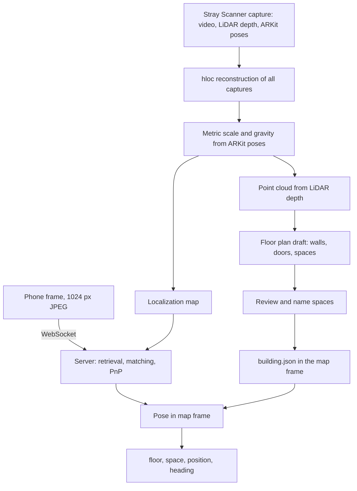

# Camera localization

Status: steps 1 to 3 are done. The code is in `localization/`. Results are in [Spike results](#spike-results).

## Goal

A person opens the mobile web app in a building they do not know. The camera shows where they are and
which way to go. The first position must appear within about one second. It must then update while they walk.

Step one is to find the user: floor, space, `x/y` position in metres and viewing direction.
Route guidance uses that result as its start point.

## Constraints

- The client is a mobile web app, not a native app. It has a camera and motion sensors only.
- Safari on iPhone has no WebXR. The design must work without it.
- No QR codes or other markers. The test buildings have none.
- No paid localization services, such as an Immersal Pro plan.
- The test building has no `building.json` and no floor plan. We create both from a phone scan.
- An iPhone 12 Pro with LiDAR records the scan. Users need a camera only.

## Decisions

| Topic | Decision | Reason |
|---|---|---|
| Localization method | [hloc](https://github.com/cvg/Hierarchical-Localization): MegaLoc retrieval, SuperPoint features, LightGlue matching, PnP + RANSAC | Best-tested open pipeline for indoor visual localization. Modular, so parts can be replaced. |
| Matcher upgrade | Try [LoMa](https://github.com/davnords/LoMa) only if LightGlue is not accurate enough | Same runtime as LightGlue, much better on InLoc in its paper. Not yet checked with hloc. |
| Gaussian splats | Not used for localization | Pose refinement takes seconds per image. Optional later for visuals. |
| Capture app | [Stray Scanner](https://github.com/strayrobots/scanner) | Free and open source. Saves video, LiDAR depth, ARKit poses and camera calibration. |
| Capture device | iPhone 12 Pro | LiDAR has not improved measurably since. A newer Pro helps only in dim buildings because of its larger image sensor. |
| Map frame | Now: the ARKit poses of one capture, kept fixed. Later: one hloc reconstruction that joins all captures. | Fixed ARKit poses give metres and gravity with no alignment step. Several captures need SfM, because each has its own frame and ARKit drifts on long walks. |
| Floor plan | Derived from the same scan, so it shares the map frame | No separate alignment step. `building.json` stays traceable to the scan. |
| GPU | Google Cloud Spot VM `g2-standard-4` (1× NVIDIA L4) in `europe-west4-a` | On-demand L4s were out of stock in all EU zones. Spot costs about 0.43 USD/h, but Google can stop it at any time. Close to Germany for low network latency. |
| Server API | FastAPI with a WebSocket | Matches the planned Python backend. |
| Compass | Not used | Visual localization gives a better heading. Reconsider only if the spike shows confusion between similar corridors. |

## Pipeline



### Offline: map and floor plan

Implemented in `localization/build_map.py` for one capture:

1. Pick a keyframe after every 0.3 m of movement or 12° of turning. Take the sharpest of the 7 nearest frames.
   The GPU video decoder (NVDEC) reads the video.
2. Turn the frames upright. Stray Scanner stores portrait video as landscape, and SuperPoint does not handle rotated images.
3. Use the ARKit poses as fixed camera poses. This gives metres and the up direction directly.
4. Extract SuperPoint and MegaLoc features. Pair each keyframe with its nearest keyframes and with its 10 most similar keyframes.
5. Match the pairs with LightGlue in 3 parallel processes. Triangulate the 3D points with COLMAP.

Planned:

6. Join several captures in one SfM reconstruction. Fit a similarity transform (Umeyama) to the ARKit centres for metres and gravity.
7. Back-project LiDAR depth with the poses into one point cloud.
8. Find floors from the camera heights. Make a top-down wall density image per floor.
9. Draw the floor plan: first semi-automatically in a small editor over the density image.
   Doors are where the camera path crosses a wall. Later, try
   [SpatialLM](https://github.com/manycore-research/SpatialLM) for an automatic draft.
10. Write `building.json`. Record the scan and transform in `source_ref`.

### Online: one localization request

1. The client sends a downscaled frame. During walking it sends 1 to 2 frames per second.
2. MegaLoc finds the 3 to 5 most similar map frames.
3. SuperPoint and LightGlue match the frame to them. PnP + RANSAC gives the 6DoF pose.
   Browsers do not expose camera intrinsics, so calibrate each test phone once or let hloc estimate focal length.
4. Shapely finds the space polygon that contains the position. The floor follows from the height.
5. Smooth successive poses. Reject positions outside walkable spaces.

Proposed result shape:

```json
{"floor_id": "...", "space_id": "...", "position": [x, y], "heading_deg": 0.0, "confidence": 0.0}
```

### Server time

Measured on the L4 with 1024 px JPEG queries and 5 retrieved map frames. Median per stage:

| Stage | Time |
|---|---|
| JPEG decode | 3 ms |
| MegaLoc retrieval at 512 px | 40 ms |
| SuperPoint features | 21 ms |
| LightGlue, 5 pairs | 117–132 ms |
| PnP + RANSAC | 11–13 ms |
| Total | 196–208 ms |

Network time comes on top. A 1024 px JPEG is about 70–85 KB. LightGlue is the largest part.
Fewer retrieved frames or [LoMa](https://github.com/davnords/LoMa) can reduce it.

## Spike results

Map: one slow iPhone 12 Pro capture, 9.5 minutes, 1,666 keyframes, 167,539 3D points,
mean reprojection error 1.7 px.

| Test | Located | Median error | Within 0.5 m | Within 1 m |
|---|---|---|---|---|
| 200 held-out frames of the same capture | 200 | 0.5 cm | 99.5 % | 100 % |
| Hectic iPhone 17 Pro capture, every 30th frame | 532 of 533 | 0.33 m | 72 % | 88 % |
| Same, only results with at least 30 inliers | 86 % of frames | 0.27 m | 82 % | 97 % |

Held-out frames come from the same walk, so that result is optimistic.
For the second capture, a turn and shift fitted between both ARKit paths gives the reference position.
ARKit drift in both captures adds to the error. Results with many inliers still show 0.2–0.4 m, and the value
changes from minute to minute. So part of the measured error is probably drift, not localization error.

The inlier count works as a confidence value. Results with fewer than 30 inliers have a median error of 4.3 m.
The client should ignore them or wait for the next frame.

### Map build time

For the capture above on the `g2-standard-4` VM:

| Stage | First version | Now |
|---|---|---|
| Frame extraction | about 6 min | 1.9 min |
| SuperPoint and MegaLoc features | 2 min | 2 min |
| LightGlue, about 18,300 pairs | 12 min | 4.5 min |
| Geometric verification and triangulation | 3.4 min | 3 min |
| Total | about 23.5 min | 11.4 min |

The first version decoded the video with OpenCV on the CPU and matched with hloc, one pair at a time.
That version also had the one-frame shift described below. Fixing it raised the map from 76,615 to 167,539 points
and lowered the median error on the hectic capture from 0.43 m to 0.33 m.

## Running the pipeline

The VM uses Ubuntu 24.04 with the NVIDIA 580 server driver. Setup notes:

- Install hloc from Git into a virtual environment, plus `huggingface_hub` and `safetensors` for MegaLoc.
- Install `libnvidia-decode-580-server` (same version as the driver). Ubuntu's ffmpeg needs it for the GPU video decoder.
- pycolmap 4 ignores the two-view geometries that hloc writes. `build_map.triangulate` marks them as calibrated.
- OpenCV's software decoder drops the first frame of Stray Scanner videos. That shifts every image by one frame against its pose. NVDEC returns all frames.

```sh
python -m localization.build_map --capture ~/data/raw/<capture> --out ~/data/maps/<capture>
python -m localization.evaluate --map ~/data/maps/<capture>
python -m localization.evaluate_capture --map ~/data/maps/<capture> --capture ~/data/raw/<other capture>
```

Stop the VM when it is idle: `gcloud compute instances stop loc-gpu --zone=europe-west4-a`.

## Capture guide

- Walk at about half normal speed. Hold the phone steady at chest height.
- Record every corridor in both directions. Turn briefly into each room.
- Switch the lights on. Do not film directly into windows.
- Make one capture per floor. Include stairs and lift areas so floors can be joined.
- Keep the earlier fast iPhone 17 Pro video. It is a realistic query set for testing.

Scans show real buildings and may show people. Keep them out of Git. Store them in a private bucket or local folder.

## Steps

| # | Step | Owner | Done when |
|---|---|---|---|
| 1 | Request a Google Cloud GPU quota of 1 (`GPUS_ALL_REGIONS`), create an L4 VM in `europe-west4` | Lenard | Done |
| 2 | Record one corridor slowly in both directions with Stray Scanner on the iPhone 12 Pro | Lenard | Done: 9.5 minutes on the VM |
| 3 | Localization spike: import Stray Scanner data, build the hloc map, localize held-out frames and the fast video | Claude | Done: median error below 0.5 m and server time below 500 ms, see [Spike results](#spike-results) |
| 4 | Floor plan spike: point cloud, density image, semi-automatic spaces and doors, first `building.json` | Claude | Route tools accept the file. Spaces match the real corridor |
| 5 | Localization API: FastAPI WebSocket returning the result shape above | Claude | A phone frame returns a floor, space and position |
| 6 | Web client: camera, frame upload, arrow to the next route point | Team | A person can follow a route on one floor |
| 7 | Scale up: full floors, several floors, stairs and lifts | Team | Multi-floor route works in the test building |
| 8 | Optional: SpatialLM floor plan draft, LoMa matcher, compass needle in the UI | Team | Only after steps 1 to 7 work |

Step 3 is the go/no-go check. If accuracy fails, first check capture quality and lighting.
Then try LoMa, more retrieved frames, or a newer phone for the capture.

## Risks

- Similar corridors can confuse retrieval. Pose smoothing and walkable-area checks reduce this.
- Light changes and moved furniture between capture and demo reduce matches. Capture close to the demo date.
- Google can stop a Spot VM at any time. For the demo, start it early and check it. Switch to on-demand if a zone has stock.
- Browsers do not give camera intrinsics. The spike used the ARKit intrinsics of each frame. The web client needs a calibration per phone model or focal length estimation.
- SpatialLM was trained on homes. Office corridors may need manual correction.

## Sources

- hloc and its MegaLoc support: <https://github.com/cvg/Hierarchical-Localization>
- LightGlue speed: <https://arxiv.org/abs/2306.13643>
- Runtime per hloc stage: AIR-HLoc, <https://arxiv.org/abs/2403.18281>
- LoMa: <https://arxiv.org/abs/2604.04931>
- Matcher comparison for indoor scenes: <https://arxiv.org/abs/2504.17636>
- Gaussian splat localization runtime: GSVisLoc, <https://arxiv.org/abs/2508.18242>
- SpatialLM: <https://arxiv.org/abs/2506.07491>
- WebXR browser support: <https://caniuse.com/webxr>
- L4 VM price: <https://gcloud-compute.com/g2-standard-4.html>
- iPhone camera sensors: <https://www.dpreview.com/articles/1673729847/iphone-17-pro-camera-upgrade-is-it-worth-leaving-your-12-13-14-15-or-16-pro-behind/>
