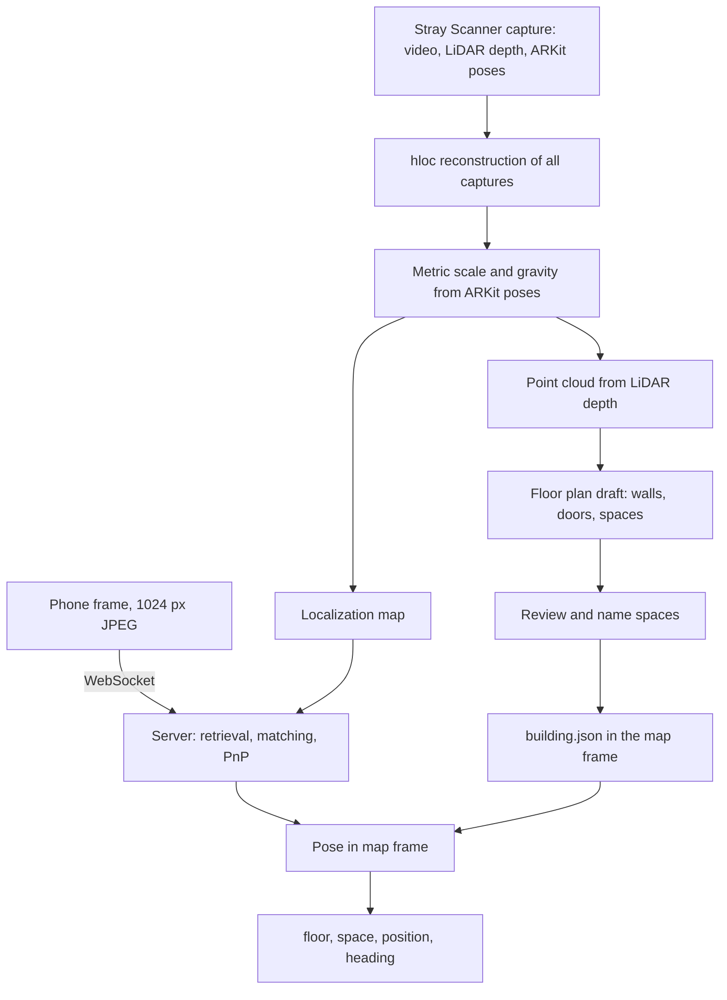

# Locora camera localization

Status: steps 1 to 5 are done. The code is in `localization/`. Results are in [Spike results](#spike-results)
and [Floor plan results](#floor-plan-results). The service runs on the GPU VM, see [Localization service](#localization-service).

## Goal

A person opens the mobile web app in a building they do not know. The camera shows where they are and
which way to go. The first position must appear within about one second. It must then update while they walk.

Step one is to find the user: floor, space, `x/y` position in metres and viewing direction.
Route guidance uses that result as its start point.

## Constraints

- The client is a mobile web app, not a native app. It has a camera and motion sensors only.
- Safari on iPhone has no WebXR. The design must work without it.
- No QR codes or other markers. The test buildings have none.
- No paid localization services, such as an Immersal Pro plan.
- The test building has no `building.json` and no floor plan. We create both from a phone scan.
- An iPhone 12 Pro with LiDAR records the scan. Users need a camera only.

## Decisions

| Topic | Decision | Reason |
|---|---|---|
| Localization method | [hloc](https://github.com/cvg/Hierarchical-Localization): MegaLoc retrieval, SuperPoint features, LightGlue matching, PnP + RANSAC | Best-tested open pipeline for indoor visual localization. Modular, so parts can be replaced. |
| Matcher upgrade | Try [LoMa](https://github.com/davnords/LoMa) only if LightGlue is not accurate enough | Same runtime as LightGlue, much better on InLoc in its paper. Not yet checked with hloc. |
| Gaussian splats | Not used for localization | Pose refinement takes seconds per image. Optional later for visuals. |
| Capture app | [Stray Scanner](https://github.com/strayrobots/scanner) | Free and open source. Saves video, LiDAR depth, ARKit poses and camera calibration. |
| Capture device | iPhone 12 Pro | LiDAR has not improved measurably since. A newer Pro helps only in dim buildings because of its larger image sensor. |
| Map frame | Now: the ARKit poses of one capture, kept fixed. Later: one hloc reconstruction that joins all captures. | Fixed ARKit poses give metres and gravity with no alignment step. Several captures need SfM, because each has its own frame and ARKit drifts on long walks. |
| Floor plan | Derived from the same scan, so it shares the map frame | No separate alignment step. `building.json` stays traceable to the scan. |
| GPU | Google Cloud standard VM `g2-standard-4` (1× NVIDIA L4) in `us-central1-a`, kept running | On 2026-10-25, L4 and T4 were out of stock in all 12 EU zones, and Google stopped the earlier Spot VM. A standard VM is not taken back for other customers. Stopping it risks not getting a GPU again. About 0.85 USD/h. Over a kept-open connection, a request from Germany takes 0.30 s. |
| Server API | FastAPI with a WebSocket | Matches the planned Python backend. |
| Compass | Not used | Visual localization gives a better heading. Reconsider only if the spike shows confusion between similar corridors. |

## Pipeline



### Offline: map and floor plan

Implemented in `localization/build_map.py` for one capture:

1. Pick a keyframe after every 0.3 m of movement or 12° of turning. Take the sharpest of the 7 nearest frames.
   The GPU video decoder (NVDEC) reads the video.
2. Turn the frames upright. Stray Scanner stores portrait video as landscape, and SuperPoint does not handle rotated images.
3. Use the ARKit poses as fixed camera poses. This gives metres and the up direction directly.
4. Extract SuperPoint and MegaLoc features. Pair each keyframe with its nearest keyframes and with its 10 most similar keyframes.
5. Match the pairs with LightGlue in 3 parallel processes. Triangulate the 3D points with COLMAP.

Implemented in `localization/floor_plan.py` for one capture and one floor:

6. Back-project the LiDAR depth of the keyframes into 5 cm voxels. Only high-confidence depth up to 5 m counts.
7. Find the floor as the most common point height below the camera. Turn the plan so that most walls run
   along the x and y axes.
8. Mark walls (points 1.0 to 2.2 m above the floor) and free space (camera rays and seen floor).
9. Draw the outline along the outer walls only (`localization/outline.py`). Interior walls do not count.
   Parallel outer walls closer than 2 m become one straight wall at the outer one. Space seen through
   glass beyond a wall drops out.
10. Write `building.json` with one floor and one space. `source_ref` holds the capture, the map and the
    4 x 4 transform `building_from_map`. Names, room types and furniture come from a small annotations file,
    because the scan cannot tell them.

Planned:

11. Split the floor into rooms and add doors. Doors are where the camera path crosses a wall.
    Try [SpatialLM](https://github.com/manycore-research/SpatialLM) for an automatic draft.
12. Join several captures in one SfM reconstruction. Fit a similarity transform (Umeyama) to the ARKit centres for metres and gravity.

### Online: one localization request

1. The client sends a downscaled frame. During walking it sends 1 to 2 frames per second.
2. MegaLoc finds the 3 to 5 most similar map frames.
3. SuperPoint and LightGlue match the frame to them. PnP + RANSAC gives the 6DoF pose.
   Browsers do not expose camera intrinsics, so the server estimates the focal length with the pose.
4. Shapely finds the space polygon that contains the position. The floor follows from the height.
5. Planned in the client: smooth successive poses. Ignore results that are not `reliable`.

### Localization service

`localization/server.py` serves one request per image over HTTPS. A plain POST is enough at 1 to 2 frames per
second, and a server can forward it without keeping a connection open.

```
POST /v1/buildings/{building_id}/localize[?focal_px=...]
Authorization: Bearer <LOCALIZATION_TOKEN>
Content-Type: image/jpeg

{"building_id": "scan-233fe5f22a", "located": true, "reliable": true,
 "floor_id": "scan-233fe5f22a-F0", "space_id": "scan-233fe5f22a-F0-S001",
 "position": [37.798, 17.022], "height_m": 1.578, "heading_deg": 177.3,
 "num_inliers": 526, "focal_px": 773.1,
 "timings_ms": {"decode": 5.5, "retrieval": 45.5, "features": 23.4, "matching": 95.7, "pose": 10.2}}
```

- `position` is in plan metres, as in `building.json`. `heading_deg` is the viewing direction, counterclockwise
  from +x. `height_m` is the camera height above its floor.
- `reliable` means at least 30 inliers. Below that, the spike's median error was 4.3 m.
- `GET /health` lists the buildings with a map. It needs no token.
- Errors: 401 for a missing or wrong token, 404 for a building without a map, 413 above 4 MB, 422 for a body
  that is not an image.
- The token stays on servers. The web app's own server forwards the images and adds the token, so browsers
  never see it.

Focal length test on 40 frames of the iPhone 17 Pro capture, at 1024 px:

| Focal length | Median error | Within 1 m | Median error, reliable only |
|---|---|---|---|
| Known from ARKit | 0.41 m | 85 % | 0.29 m |
| Estimated from a start value of 0.75 x long side | 0.38 m | 85 % | 0.33 m |
| Fixed start value, 7 % too long | 0.41 m | 85 % | 0.34 m |

The estimate lands within -8 % to +4 % of the true value for 80 % of the frames. So the web client needs no
calibration per phone model.

### Server time

Measured on the L4 with 1024 px JPEG queries and 5 retrieved map frames. Median per stage:

| Stage | Time |
|---|---|
| JPEG decode | 3 ms |
| MegaLoc retrieval at 512 px | 40 ms |
| SuperPoint features | 21 ms |
| LightGlue, 5 pairs | 117–132 ms |
| PnP + RANSAC | 11–13 ms |
| Total | 196–208 ms |

Network time comes on top. A 1024 px JPEG is about 70–85 KB. LightGlue is the largest part.
Fewer retrieved frames or [LoMa](https://github.com/davnords/LoMa) can reduce it.

## Spike results

Map: one slow iPhone 12 Pro capture, 9.5 minutes, 1,666 keyframes, 167,539 3D points,
mean reprojection error 1.7 px.

| Test | Located | Median error | Within 0.5 m | Within 1 m |
|---|---|---|---|---|
| 200 held-out frames of the same capture | 200 | 0.5 cm | 99.5 % | 100 % |
| Hectic iPhone 17 Pro capture, every 30th frame | 532 of 533 | 0.33 m | 72 % | 88 % |
| Same, only results with at least 30 inliers | 86 % of frames | 0.27 m | 82 % | 97 % |

Held-out frames come from the same walk, so that result is optimistic.
For the second capture, a turn and shift fitted between both ARKit paths gives the reference position.
ARKit drift in both captures adds to the error. Results with many inliers still show 0.2–0.4 m, and the value
changes from minute to minute. So part of the measured error is probably drift, not localization error.

The inlier count works as a confidence value. Results with fewer than 30 inliers have a median error of 4.3 m.
The client should ignore them or wait for the next frame.

### Map build time

For the capture above on the `g2-standard-4` VM:

| Stage | First version | Now |
|---|---|---|
| Frame extraction | about 6 min | 1.9 min |
| SuperPoint and MegaLoc features | 2 min | 2 min |
| LightGlue, about 18,300 pairs | 12 min | 4.5 min |
| Geometric verification and triangulation | 3.4 min | 3 min |
| Total | about 23.5 min | 11.4 min |

The first version decoded the video with OpenCV on the CPU and matched with hloc, one pair at a time.
That version also had the one-frame shift described below. Fixing it raised the map from 76,615 to 167,539 points
and lowered the median error on the hectic capture from 0.43 m to 0.33 m.

## Floor plan results

For the capture above: 1,375,380 voxels from 1,666 keyframes in about 25 s on the VM.

- The walls are turned by 5.0° against the map frame. The floor lies 1.6 m below the phone.
  The ceiling is 2.53 m above the floor.
- The outline has 16 corners and 581 m². All sides are straight.
- The building has many glass walls and one open-plan office. So it is one space with two standing tables
  (table tops 1.0 to 1.2 m above the floor).
- All 200 held-out query cameras lie inside the outline after the transform, at a median height of 1.60 m.

`building_from_map` maps a map point `(x, y, z)` with y up to the plan `(x, y, height above floor)`.
Seen from above, the map's x and -z axes become the plan's x and y, then the plan turns by the wall angle.

## Running the pipeline

The VM uses Ubuntu 24.04 with the NVIDIA 580 server driver. Setup notes:

- Install hloc from Git into a virtual environment, plus `huggingface_hub` and `safetensors` for MegaLoc.
- Install `libnvidia-decode-580-server` (same version as the driver). Ubuntu's ffmpeg needs it for the GPU video decoder.
- pycolmap 4 ignores the two-view geometries that hloc writes. `build_map.triangulate` marks them as calibrated.
- OpenCV's software decoder drops the first frame of Stray Scanner videos. That shifts every image by one frame against its pose. NVDEC returns all frames.

```sh
python -m localization.build_map --capture ~/data/raw/<capture> --out ~/data/maps/<capture>
python -m localization.evaluate --map ~/data/maps/<capture>
python -m localization.evaluate_capture --map ~/data/maps/<capture> --capture ~/data/raw/<other capture>
python -m localization.floor_plan --capture ~/data/raw/<capture> --map <map name> \
    --annotations <annotations.json> --out ~/data/buildings/<capture>
```

`floor_plan` writes `building.json` and a preview image `plan.png`. The docstring shows the annotations format.

For a visual check, `compare` localizes random frames of another recording. It draws each photo next to the
coloured point cloud seen from the estimated pose, and the position on the floor plan. Run it after
`evaluate_capture`, which stores the alignment between both recordings:

```sh
python -m localization.compare --map ~/data/maps/<map> --map-capture ~/data/raw/<map capture> \
    --capture ~/data/raw/<other capture> --building ~/data/buildings/<capture>/building.json --out ~/data/compare
```

### Deployment

| Item | Value |
|---|---|
| VM | `probe-y` in `us-central1-a`, standard, automatic restart. The name comes from a capacity test; a VM can only be renamed while stopped |
| Public URL | `https://34-57-207-160.sslip.io`, fixed IP `loc-gpu-us-ip`. sslip.io resolves the name to the IP |
| HTTPS | Caddy with a Let's Encrypt certificate, `localization/deploy/Caddyfile`. Firewall rule `allow-localization-https` opens ports 80 and 443 for the tag `localization-https` |
| Service | systemd unit `localization/deploy/localization.service`, starts after a reboot |
| Token | `LOCALIZATION_TOKEN` in `~/localization.env` on the VM, readable only by its owner |
| Data | A second disk made from the snapshot `loc-gpu-snap-1` of the first VM. It is mounted at `/mnt/old`; `/home/lenard` and the Python packages in `/usr/local/lib/python3.12/dist-packages` are bind mounts from it |

```sh
sudo systemctl status localization caddy
journalctl -u localization -f
gcloud compute instances describe probe-y --zone=us-central1-a --format='value(resourceStatus.upcomingMaintenance)'
```

Do not stop the VM before the demo. GPUs were out of stock in Europe, and a stopped VM may not get one back.
Clients should keep one HTTPS connection open: a new connection to the US adds about 0.5 s.

## Capture guide

- Walk at about half normal speed. Hold the phone steady at chest height.
- Record every corridor in both directions. Turn briefly into each room.
- Switch the lights on. Do not film directly into windows.
- Make one capture per floor. Include stairs and lift areas so floors can be joined.
- Keep the earlier fast iPhone 17 Pro video. It is a realistic query set for testing.

Scans show real buildings and may show people. Keep them out of Git. Store them in a private bucket or local folder.

## Steps

| # | Step | Owner | Done when |
|---|---|---|---|
| 1 | Request a Google Cloud GPU quota of 1 (`GPUS_ALL_REGIONS`), create an L4 VM | Lenard | Done. Moved from `europe-west4` (Spot) to `us-central1` (standard) |
| 2 | Record one corridor slowly in both directions with Stray Scanner on the iPhone 12 Pro | Lenard | Done: 9.5 minutes on the VM |
| 3 | Localization spike: import Stray Scanner data, build the hloc map, localize held-out frames and the fast video | Claude | Done: median error below 0.5 m and server time below 500 ms, see [Spike results](#spike-results) |
| 4 | Floor plan spike: point cloud, density image, semi-automatic spaces and doors, first `building.json` | Claude | Done: one clean outline, see [Floor plan results](#floor-plan-results). Rooms and doors are planned |
| 5 | Localization API: HTTPS endpoint returning floor, space, position and heading | Claude | Done: public over HTTPS, a phone frame returns a floor, space and position in about 180 ms on the GPU. The Railway connection is open |
| 6 | Web client: camera, frame upload, arrow to the next route point | Team | A person can follow a route on one floor |
| 7 | Scale up: full floors, several floors, stairs and lifts | Team | Multi-floor route works in the test building |
| 8 | Optional: SpatialLM floor plan draft, LoMa matcher, compass needle in the UI | Team | Only after steps 1 to 7 work |

Step 3 is the go/no-go check. If accuracy fails, first check capture quality and lighting.
Then try LoMa, more retrieved frames, or a newer phone for the capture.

## Risks

- Similar corridors can confuse retrieval. Pose smoothing and walkable-area checks reduce this.
- Light changes and moved furniture between capture and demo reduce matches. Capture close to the demo date.
- GPU stock: on-demand GPUs can be sold out everywhere. Keep the standard VM running until the demo. Google stops it only for host maintenance or a hardware fault and then restarts it. Check `upcomingMaintenance` before the demo.
- Browsers do not give camera intrinsics. The server estimates the focal length; this has been tested with recorded video frames, not yet with a browser camera.
- SpatialLM was trained on homes. Office corridors may need manual correction.

## Sources

- hloc and its MegaLoc support: <https://github.com/cvg/Hierarchical-Localization>
- LightGlue speed: <https://arxiv.org/abs/2306.13643>
- Runtime per hloc stage: AIR-HLoc, <https://arxiv.org/abs/2403.18281>
- LoMa: <https://arxiv.org/abs/2604.04931>
- Matcher comparison for indoor scenes: <https://arxiv.org/abs/2504.17636>
- Gaussian splat localization runtime: GSVisLoc, <https://arxiv.org/abs/2508.18242>
- SpatialLM: <https://arxiv.org/abs/2506.07491>
- WebXR browser support: <https://caniuse.com/webxr>
- L4 VM price: <https://gcloud-compute.com/g2-standard-4.html>
- iPhone camera sensors: <https://www.dpreview.com/articles/1673729847/iphone-17-pro-camera-upgrade-is-it-worth-leaving-your-12-13-14-15-or-16-pro-behind/>
