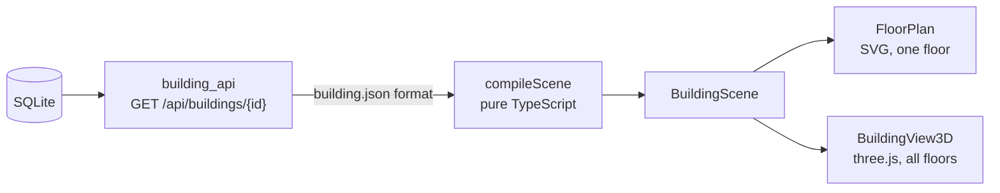

# Locora building views

Status: the building API with uploads and routes, the scene compiler, the 2D floor plan and the 3D exploded view are
implemented. The web application in `web/` uses both views. See [web/README.md](../web/README.md).

## Data flow



- `building_api/` serves stored buildings with FastAPI. Building and route requests are read-only. The response is the
  `BuildingDocument` from `building_db.store.load_building`, so it has the `building.json` format.
- The home page imports `building.json` through `POST /api/buildings/import`, then opens the stored building
  at `/admin/:buildingId`. Validation and saving finish before navigation. Errors remain on the home page.
- `packages/building-view/` is a TypeScript package without a UI framework. A React application can wrap
  its two view classes.
- The browser parses the API response and passes the object to `compileScene`. Nothing is written to a file.
- `src/api.gen.ts` is generated from the API's OpenAPI schema with `pnpm gen:api`. Run it after a change to
  `building_db/source.py`, so the TypeScript types match the Pydantic models.

## Scene compiler

`compileScene(building)` returns the `BuildingScene` that both views draw. It has no side effects, and the
result does not depend on the order of the source lists. Lists are sorted by ID with locale-independent
comparison. Derived coordinates are rounded to millimetres. It throws `SceneError` with every broken
reference it finds.

It derives these values:

| Value | Rule |
|---|---|
| Walls | `building.json` has no walls. Every space edge becomes a wall. Each opening of the space cuts a gap of `width_m` into the space's nearest edge. Wall pieces shorter than 5 cm are dropped. |
| Opening direction | The unit vector of the edge the opening cut. An opening more than 1 m from every edge of its spaces cuts nothing and has no direction. |
| Label point | The point farthest inside the outline (pole of inaccessibility, through `polylabel`). This works for L-shaped rooms, where the centroid can lie outside. |
| Asset corners | `width_m` lies along x, then the footprint turns counterclockwise by `rotation_deg`. In the dev data, 3,832 non-axis-aligned assets fit their room only with this direction. |

The wall rule fits both kinds of source data. Procedural and OSM rooms touch, so two walls lie on top of each
other. Swiss Dwellings and ResPlan rooms have a gap of about 13 to 16 cm between them, which becomes the wall
thickness. In the dev data, 88 of 2,314 OSM opening sides are more than 1 m from their space's edge.

The scene compiles the largest building (1,623 spaces, 5,250 assets, 10,854 wall pieces) in about 40 ms.

## Views

Both views take a scene, an `Overlay` and options, and report clicks as `PickResult` with the entity, floor
and plan point. The overlay holds a route, the user position with heading, highlighted IDs and closed IDs.
The views draw these values but calculate nothing. Routes come from the building tools.

`FloorPlan` draws one floor as SVG. The building layer is redrawn only when the floor or options change. The
overlay has its own layer, so a moving position updates a few elements. Labels scale with the room and fall
back from the name to the ref. Wheel zoom and drag pan are built in. `getView`, `setView`,
`onViewChange` and the `interactive`, `labels`, `assets` and `openings` options are what a later minimap
needs.

`BuildingView3D` draws all floors as an exploded view. Drag turns the camera, right-drag or Shift-drag moves it, and the wheel zooms toward the pointer. A double click, or `centerOn`, makes a point the new centre to turn around, so off-centre parts are easy to inspect. Arrow keys move the view when the canvas has focus. Each floor sits at its elevation
plus `floorGap` for each floor below. Walls are 1.2 m high by default, or `"full"` for the floor height.
`setFocusFloor` shows the other floors as flat outlines and limits clicks to the focused floor.
Transparent 3D floors were rejected: where floors share a layout, their translucent walls stack and look half
solid. Stairs and lifts are columns
between their stop points. Labels collide in screen space and larger rooms win. The view renders only after a
change, not in a continuous loop. Asset heights are display values per category, because `building.json`
has no heights.

Performance: spaces are one mesh each, so clicks can name them. Walls are merged into one mesh per floor and
assets are one instanced mesh per floor.

## Playground

```bash
uv run python -m building_db import buildings.sqlite3 data/*/*/building.json
uv run python -m building_api serve buildings.sqlite3
cd packages/building-view && pnpm install && pnpm dev
```

Open `http://localhost:5173/?building=<id>`. Set `BUILDING_API` if the API does not run on port 8000. The
playground reads only buildings from the API. Shift-click in the plan adds a point to a test path, so overlays
can be checked without the agent.

## Checks

```bash
uv run python -m unittest tests.test_building_api
cd packages/building-view && pnpm check && pnpm test
```

The TypeScript tests cover the wall rule, footprint rotation, label placement, order independence, all dev
buildings, overlay updates, picking and floor offsets. WebGL output is checked visually in the playground.
