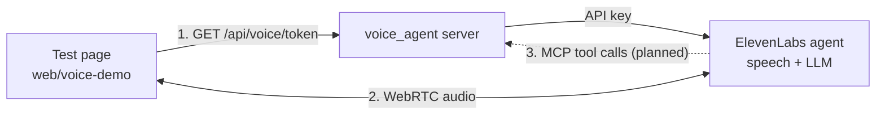

# Voice agent

Status: the ElevenLabs agent definition, the token server and a minimal test page exist. The building tools
are not connected yet. They follow when the shared MCP server is committed.

## What it does

The voice agent answers spoken questions about one building. It does not change buildings or control the app.
ElevenLabs runs speech recognition, the language model and speech output. Our server only issues conversation
tokens and, later, serves the building tools over MCP. The benchmark agent is separate and unaffected.

## Files

| Path | Owns |
|---|---|
| `voice_agent/agent.py` | The agent's settings: model, backup model, language, authentication. Source of truth. |
| `voice_agent/prompt.md` | The agent's system prompt |
| `voice_agent/server.py` | Starlette app with the token route |
| `voice_agent/settings.py` | Environment settings |
| `web/voice-demo/` | Test page: start and end a conversation, transcript, tool calls, typed messages |

## Agent settings

| Setting | Value | Why |
|---|---|---|
| LLM | `claude-sonnet-5-5`, reasoning effort `low` | Good tool use; low effort keeps turn-taking fast |
| Backup LLM | `claude-haiku-5-5` | A failure of the main model does not end the conversation |
| Language | English | Agreed for the demo |
| Authentication | On | A conversation needs a short-lived token from our server, so the API key stays on the server |
| Call limits | 3 at once, 200 per day | The token route is public on Railway; the limits cap anonymous use |
| Expressive voice | On (default) | More natural speech. Its audio tags such as `[happy]` are hidden in the transcript |
| Speech recognition, voice, turn-taking | ElevenLabs defaults | Change only when a test shows a need |

Change settings in `voice_agent/agent.py` or `prompt.md`, then run `sync`. Changes made in the ElevenLabs
dashboard are overwritten by the next sync.

## Run the demo

1. Put `ELEVENLABS_API_KEY` in `.env`.
2. Create the agent: `uv run python -m voice_agent sync`. Add the printed `ELEVENLABS_AGENT_ID` to `.env`.
3. Start the server: `uv run python -m voice_agent serve`.
4. Start the page: `cd web/voice-demo && pnpm install && pnpm dev`, then open the printed URL.

To use the deployed server instead of step 3, start the page with
`VOICE_SERVER=https://voice-agent-production-653b.up.railway.app pnpm dev`.

## Deployment

| Item | Value |
|---|---|
| Railway project, service, environment | `talk-to-your-building`, `voice-agent`, `production` |
| Public URL | https://voice-agent-production-653b.up.railway.app |
| Build | `voice_agent/Dockerfile`, selected by the service variable `RAILWAY_DOCKERFILE_PATH` |
| Secrets | `ELEVENLABS_API_KEY` and `ELEVENLABS_AGENT_ID` as Railway service variables |
| Deploy | `railway up` from the repository root, linked to the service |

`.railwayignore` keeps `data/`, `benchmark/`, tests, the web app and `.env` out of the upload, so evaluation
questions and answers never reach Railway. The image itself contains only the locked dependencies and `voice_agent`.
The ElevenLabs API key needs only the ElevenAgents Write permission.

## Building tools, next step

The agent will reach the building tools from the shared FastMCP server in `building_tools`. Plan:

- The voice server mounts the MCP server under `/mcp` for one building, chosen by a command line argument
  at start. No building is configured in `.env` or in code.
- The endpoint is public because ElevenLabs calls it from the internet, so it rejects requests without the
  bearer token. The token is sent as an `Authorization` header in the ElevenLabs MCP integration.
- The tools only read, so they run without approval prompts (`approval_policy: auto_approve_all`).
- `sync` registers the MCP integration and attaches it to the agent. ElevenLabs cannot change an integration's
  URL, so `sync` replaces the integration when the public URL changes.
- The Railway URL is the public MCP endpoint. The demo building's `building.json` must be added to the image
  explicitly, because `data/` is excluded from the upload.

## Later, for the real UI

- The UI chooses the building per conversation. ElevenLabs MCP headers can carry a dynamic variable, for example
  `X-Building-Id: {{building_id}}`, set when the conversation starts. The server then picks the building per request.
- The UI reports what the user sees, such as the selected room, with `sendContextualUpdate`. This adds context
  without triggering a reply.
- Client tools can show a route on the map. The agent still only reads; the UI decides what to display.

## References

- [ElevenLabs MCP](https://elevenlabs.io/docs/eleven-agents/customization/tools/mcp): transports, approval modes, workspace enablement.
- [ElevenLabs LLMs](https://elevenlabs.io/docs/eleven-agents/customization/llm): models, backup models, reasoning settings.
- [ElevenLabs React SDK](https://elevenlabs.io/docs/eleven-agents/libraries/react): conversation tokens, transcript callbacks, `sendContextualUpdate`.
- [Create agent API](https://elevenlabs.io/docs/api-reference/agents/create): field names and model IDs used in `agent.py`.
- [Dynamic variables](https://elevenlabs.io/docs/eleven-agents/customization/personalization/dynamic-variables): variables in prompts and headers.
