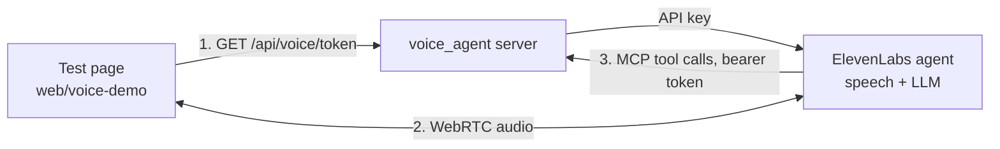

# Voice agent

Status: the agent runs at ElevenLabs and answers from the building tools. The voice server is deployed on Railway
with one demo building. A minimal test page starts conversations.

## What it does

The voice agent answers spoken questions about one building. It does not change buildings or control the app.
ElevenLabs runs speech recognition, the language model and speech output. Our server only issues conversation
tokens and serves the building tools over MCP. The benchmark agent is separate and unaffected.

## Files

| Path | Owns |
|---|---|
| `voice_agent/agent.py` | The agent's settings and the MCP integration, with `sync`. Source of truth. |
| `voice_agent/prompt.md` | The agent's system prompt |
| `voice_agent/server.py` | Starlette app: token route, with the tools mounted under `/mcp` |
| `voice_agent/tools.py` | Loads the building, adapts tool schemas for ElevenLabs, checks the bearer token |
| `voice_agent/settings.py` | Environment settings |
| `web/voice-demo/` | Test page: start and end a conversation, transcript, tool calls, typed messages |

## Agent settings

| Setting | Value | Why |
|---|---|---|
| LLM | `claude-sonnet-5-5`, reasoning effort `low` | Good tool use; low effort keeps turn-taking fast |
| Backup LLM | `claude-haiku-5-5` | A failure of the main model does not end the conversation |
| Language | English | Agreed for the demo |
| Authentication | On | A conversation needs a short-lived token from our server, so the API key stays on the server |
| Call limits | 3 at once, 200 per day | The token route is public on Railway; the limits cap anonymous use |
| Expressive voice | On (default) | More natural speech. Its audio tags such as `[happy]` are hidden in the transcript |
| Speech recognition, voice, turn-taking | ElevenLabs defaults | Change only when a test shows a need |

Change settings in `voice_agent/agent.py` or `prompt.md`, then run `sync`. Changes made in the ElevenLabs
dashboard are overwritten by the next sync.

## Run the demo

1. Put `ELEVENLABS_API_KEY` and `BUILDING_MCP_TOKEN` (`openssl rand -hex 32`) in `.env`.
2. Deploy the server (see below), then create or update the agent:
   `uv run python -m voice_agent sync --mcp-url https://voice-agent-production-653b.up.railway.app/mcp`.
   On first run, add the printed `ELEVENLABS_AGENT_ID` to `.env`.
3. Start the page against the deployed server:
   `cd web/voice-demo && pnpm install && VOICE_SERVER=https://voice-agent-production-653b.up.railway.app pnpm dev`.

ElevenLabs calls the tools at the URL given to `sync`, so the tools answer from the deployed building. A local
`uv run python -m voice_agent serve data/dev/<id>/building.json` only issues tokens for the page; ElevenLabs
cannot reach it.

## Deployment

| Item | Value |
|---|---|
| Railway project, service, environment | `talk-to-your-building`, `voice-agent`, `production` |
| Public URL | https://voice-agent-production-653b.up.railway.app |
| Build | `voice_agent/Dockerfile`, selected by the service variable `RAILWAY_DOCKERFILE_PATH` |
| Demo building | `proc-factory-dev-003` ("Fertigung Ost 27"), the `BUILDING` build argument in the Dockerfile |
| Secrets | `ELEVENLABS_API_KEY`, `ELEVENLABS_AGENT_ID` and `BUILDING_MCP_TOKEN` as Railway service variables |
| Deploy | `railway up` from the repository root, linked to the service |

`.railwayignore` uploads only the `building.json` files from `data/` and leaves out `benchmark/`, `SUBMISSION/`,
tests, the web app and `.env`, so evaluation questions and answers never reach Railway. The image contains the
locked dependencies, `building_db`, `building_tools`, `voice_agent` and one `building.json`.

The ElevenLabs API key needs only the ElevenAgents Write permission. MCP was enabled once for the workspace with
`can_use_mcp_servers`. The MCP token is stored as the ElevenLabs workspace secret `building-mcp-authorization`.

## Building tools

The agent uses the shared FastMCP server from `building_tools` for one building.

- `serve` takes the building as a command line argument. No building is configured in `.env` or in code.
- The endpoint is public because ElevenLabs calls it from the internet. It rejects requests without the bearer
  token. ElevenLabs sends the token in an `Authorization` header that reads the workspace secret.
- The tools only read, so they run without approval prompts (`approval_policy: auto_approve_all`).
- `sync` registers the MCP integration and attaches it to the agent. ElevenLabs cannot change an integration's
  URL, so `sync` replaces the integration when the public URL changes.
- The server is stateless, so a redeploy does not break running conversations.

ElevenLabs silently drops tools whose parameters contain objects. The shared server passes route rules as a
`RouteConditions` object, so ElevenLabs showed only 6 of 9 tools. `voice_agent/tools.py` therefore gives `route`
and `reachable_spaces` flat parameters (`step_free`, `min_door_width_m`, `closed`, `no_pass_through_room_types`)
and builds `RouteConditions` from them. The calculation stays in `building_tools`. Two things are not available
by voice: per-leg conditions and added doors, and with them `exit_distance_change`, which answers benchmark
what-if questions. A test fails if a tool schema with objects reaches ElevenLabs again.

## Later, for the real UI

- The UI chooses the building per conversation. ElevenLabs MCP headers can carry a dynamic variable, for example
  `X-Building-Id: {{building_id}}`, set when the conversation starts. The server then picks the building per request.
- The UI reports what the user sees, such as the selected room, with `sendContextualUpdate`. This adds context
  without triggering a reply.
- Client tools can show a route on the map. The agent still only reads; the UI decides what to display.

## References

- [ElevenLabs MCP](https://elevenlabs.io/docs/eleven-agents/customization/tools/mcp): transports, approval modes, workspace enablement.
- [ElevenLabs LLMs](https://elevenlabs.io/docs/eleven-agents/customization/llm): models, backup models, reasoning settings.
- [ElevenLabs React SDK](https://elevenlabs.io/docs/eleven-agents/libraries/react): conversation tokens, transcript callbacks, `sendContextualUpdate`.
- [Create agent API](https://elevenlabs.io/docs/api-reference/agents/create): field names and model IDs used in `agent.py`.
- [Dynamic variables](https://elevenlabs.io/docs/eleven-agents/customization/personalization/dynamic-variables): variables in prompts and headers.
