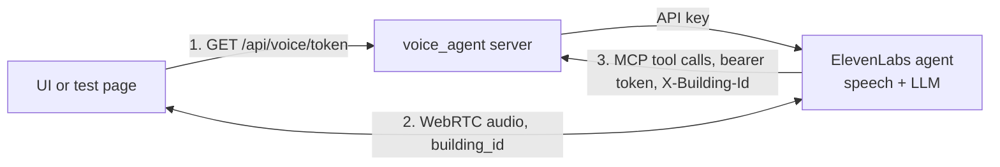

# Voice agent

Status: the agent runs at ElevenLabs and answers from the building tools. The voice server is deployed on Railway
with every building from `data/`; each conversation selects one. A minimal test page starts conversations.

## What it does

The voice agent answers spoken questions about the building selected for the conversation. It does not change buildings or control the app.
ElevenLabs runs speech recognition, the language model and speech output. Our server only issues conversation
tokens and serves the building tools over MCP. The benchmark agent is separate and unaffected.

## Files

| Path | Owns |
|---|---|
| `voice_agent/agent.py` | The agent's settings and the MCP integration, with `sync`. Source of truth. |
| `voice_agent/prompt.md` | The agent's system prompt |
| `voice_agent/server.py` | Starlette app: token and building list routes, CORS, with the tools mounted under `/mcp` |
| `voice_agent/tools.py` | Loads the buildings, runs each tool call on the selected one, adapts tool schemas for ElevenLabs, checks the bearer token |
| `voice_agent/settings.py` | Environment settings |
| `web/voice-demo/` | Test page: pick a building, start and end a conversation, transcript, tool calls, typed messages |

## Agent settings

| Setting | Value | Why |
|---|---|---|
| LLM | `claude-sonnet-5-5`, reasoning effort `medium` | Good tool use. Medium answered as fast as low (2 to 5 s) and chose better tools |
| Backup LLM | `claude-haiku-5-5` | A failure of the main model does not end the conversation |
| Language | English | Agreed for the demo |
| Authentication | On | A conversation needs a short-lived token from our server, so the API key stays on the server |
| Call limits | 3 at once, 200 per day | The token route is public on Railway; the limits cap anonymous use |
| Expressive voice | On (default) | More natural speech. Its audio tags such as `[happy]` are hidden in the transcript |
| Speech before tool calls | Off, a typing sound plays instead | Spoken text before a call was repeated after the result ([#21](https://github.com/hagenhaeussler/Industrial-Agents-Hackathon-2026/issues/21)) |
| Speech recognition, voice, turn-taking | ElevenLabs defaults | Change only when a test shows a need |

Change settings in `voice_agent/agent.py` or `prompt.md` and deploy. Railway runs `sync` before each deploy, so
ElevenLabs always matches the deployed code. Changes made in the ElevenLabs dashboard are overwritten by the next
deploy.

## Interface for the UI

| Step | What the UI does |
|---|---|
| Building list | `GET /api/voice/buildings` returns `[{"id", "name"}]`: the buildings the voice agent can talk about. The full list comes from `building_api`. |
| Token | `GET /api/voice/token` returns `{"token"}`, valid for one conversation start. Fetch it right before starting. |
| Start | `startSession({ conversationToken, dynamicVariables })` with `building_id` (required) and, when known, `current_space_id`, `current_space_name`, `destination_id`, `destination_name`. Unknown values can be left out or sent as empty strings. |
| Route display | On `onMCPToolCall` with `state: "success"` and `tool_name: "route"`, read `parameters.stops` and the flat conditions `step_free`, `closed`, `min_door_width_m`, `no_pass_through_room_types`. These names are kept stable. |

The agent uses a known current room as the route start and a known destination as the end, without asking.
Without `building_id`, every tool call fails and the agent says it cannot check.

The UI reaches the routes in one of two ways:

- Same origin or a proxy, such as the Vite proxy in development. No setting needed.
- Another domain: list the UI's origin in the service variable `VOICE_CORS_ORIGINS` (comma-separated). CORS allows
  only GET from those origins.

## Run the test page

Nothing runs locally except the page; it uses the deployed server:
`cd web/voice-demo && pnpm install && VOICE_SERVER=https://voice-agent-production-653b.up.railway.app pnpm dev`.

ElevenLabs calls the tools at the deployed URL. A local `uv run python -m voice_agent serve data` issues tokens and
lists buildings, but ElevenLabs cannot reach its tools.

For a new ElevenLabs agent, run `uv run python -m voice_agent sync --mcp-url <public URL>/mcp` once with
`ELEVENLABS_API_KEY` and `BUILDING_MCP_TOKEN` in `.env`, then set the printed `ELEVENLABS_AGENT_ID` on Railway.

## Deployment

| Item | Value |
|---|---|
| Railway project, service, environment | `talk-to-your-building`, `voice-agent`, `production` |
| Public URL | https://voice-agent-production-653b.up.railway.app |
| Build | `voice_agent/Dockerfile`, selected by the service variable `RAILWAY_DOCKERFILE_PATH` |
| Buildings | Every `data/*/*/building.json`, about 5 s to load at start and about 600 MB memory |
| Secrets | `ELEVENLABS_API_KEY`, `ELEVENLABS_AGENT_ID` and `BUILDING_MCP_TOKEN` as Railway service variables |
| Optional | `VOICE_CORS_ORIGINS` for a UI on another domain |
| Pre-deploy command | `uv run --no-sync python -m voice_agent sync`, set in the service settings. It uses the service's own URL. A failed sync stops the deploy. |
| Deploy | `railway up` from the repository root, linked to the service |

`.railwayignore` uploads only the `building.json` files from `data/` and leaves out `benchmark/`, `SUBMISSION/`,
tests, the web app and `.env`, so evaluation questions and answers never reach Railway. `.dockerignore` does the
same for local Docker builds. The image contains the locked dependencies, `building_db`, `building_tools`,
`voice_agent` and the `building.json` files.

The ElevenLabs API key needs only the ElevenAgents Write permission. MCP was enabled once for the workspace with
`can_use_mcp_servers`. The MCP token is stored as the ElevenLabs workspace secret `building-mcp-authorization`.

## Building tools

The agent uses the shared FastMCP server from `building_tools`, one per building.

- `serve` takes a directory and loads every `building.json` in it. No building is configured in `.env` or in code.
- ElevenLabs sends the conversation's `building_id` in the `X-Building-Id` header. One MCP endpoint lists the
  tools; each call runs on the selected building's server. A missing or unknown building is a tool error.
- The endpoint is public because ElevenLabs calls it from the internet. It rejects requests without the bearer
  token. ElevenLabs sends the token in an `Authorization` header that reads the workspace secret.
- The tools only read, so they run without approval prompts (`approval_policy: auto_approve_all`).
- `sync` registers the MCP integration and attaches it to the agent. ElevenLabs cannot change an integration's
  URL, so `sync` replaces the integration when the public URL changes.
- The server is stateless, so a redeploy does not break running conversations.

ElevenLabs silently drops tools whose parameters contain objects. The shared server passes route rules as a
`RouteConditions` object, so ElevenLabs showed only 6 of 9 tools. `voice_agent/tools.py` therefore gives `route`
and `reachable_spaces` flat parameters (`step_free`, `min_door_width_m`, `closed`, `no_pass_through_room_types`)
and builds `RouteConditions` from them. The calculation stays in `building_tools`. Two things are not available
by voice: per-leg conditions and added doors, and with them `exit_distance_change`, which answers benchmark
what-if questions. A test fails if a tool schema with objects reaches ElevenLabs again.

## Later

- The UI can report changes during a conversation, such as a newly selected room, with `sendContextualUpdate`.
  This adds context without triggering a reply.
- Remove `web/voice-demo/` once the real UI covers its tests.

## References

- [ElevenLabs MCP](https://elevenlabs.io/docs/eleven-agents/customization/tools/mcp): transports, approval modes, workspace enablement.
- [ElevenLabs LLMs](https://elevenlabs.io/docs/eleven-agents/customization/llm): models, backup models, reasoning settings.
- [ElevenLabs React SDK](https://elevenlabs.io/docs/eleven-agents/libraries/react): conversation tokens, transcript callbacks, `sendContextualUpdate`.
- [Create agent API](https://elevenlabs.io/docs/api-reference/agents/create): field names and model IDs used in `agent.py`.
- [Dynamic variables](https://elevenlabs.io/docs/eleven-agents/customization/personalization/dynamic-variables): variables in prompts and headers.
