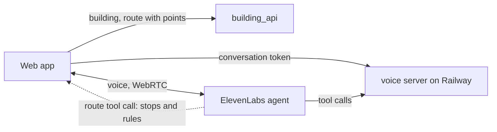

# Web app

One React app with two routes:

| Route | For | What it does |
|---|---|---|
| `/` | Everyone | Pick a building |
| `/b/:buildingId?from=…&to=…&step_free=1` | Phone, QR target | Map, step list or camera view, with the avatar and the voice assistant in every view |
| `/admin/:buildingId` | Desktop | 3D building and floor plans, search, position by click, routes, QR code to a phone, team sidebar |

## Run

```sh
uv run python -m building_db import buildings.sqlite3 data/*/*/building.json   # once
uv run python -m building_api serve buildings.sqlite3 --port 8010
pnpm --dir packages/building-view install                                       # once
cd web && pnpm install && pnpm dev
```

The dev server proxies `/api/voice` to the voice server on Railway and every other `/api` path to the building
API. Set `VOICE_SERVER` or `BUILDING_API` to use other servers. Camera and microphone need HTTPS or localhost.

```sh
pnpm check   # TypeScript
pnpm test    # unit tests
pnpm build
```

## Deploy

The Railway service `web` (project `talk-to-your-building`) runs the building API and serves the built app from
one container. `web/deploy/deploy.sh` uploads the committed code and the `building.json` files only, and refuses
to deploy if any other file from `data/` is staged. The image imports the buildings into SQLite at build time.

```sh
web/deploy/deploy.sh
```

The service variable `VITE_VOICE_SERVER` holds the voice server's public URL. The voice server must list the web
app's origin in `VOICE_CORS_ORIGINS`.

## How the parts fit



- The UI calculates no routes. It draws the route and points from `GET /api/buildings/{id}/route`.
- When the voice agent calls `route`, the UI reads the stops and rules from the tool call and loads the same route
  from the API. So the screen shows what the agent says.
- The conversation gets `building_id`, the current space and the destination as dynamic variables. A change on
  screen during a conversation goes to the agent as a contextual update.
- The avatar (Blobatar `alain00` from the phone prototype) follows the conversation: idle, connecting, listening,
  speaking with the voice level, and happy on arrival.
- A QR code holds only the phone link. The phone loads the route itself.

## Preview parts

Settings in the workspace name these. The main view does not.

- Team members, channels, messages and presence are sample content in `src/admin/team.ts`.
- Moving equipment changes only the browser's copy of the building.
- The camera view draws the next turn over the camera image. It does not track the position. The position comes
  from the QR code, a click or the steps the user confirms.
